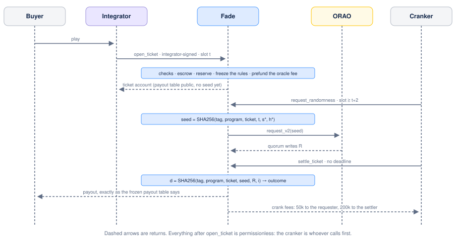

# Fade — Start Here

**Fade is the other side of every ticket, as a public payout protocol.** Anyone running a game on Solana can offer fair odds without holding a vault or running an oracle, and anyone can fund the vault by providing liquidity.

Every game of chance needs a counterparty. Today, shipping one on-chain means being that counterparty: holding capital big enough to cover the wins, and running a randomness source players have to take on trust. Fade makes that role public. A shared USDC vault takes the other side; an oracle draws the outcome; and one arithmetic check, run before any money moves, guarantees the odds the integrator advertised are the odds the program applies. In betting slang, to *fade* a bet is to take the other side of it — which is what Fade's liquidity providers do.

## Who does what

- **The integrator** brings the game and the players, and nothing else: no capital, no deposit, no registration — a program, a server or a wallet will do. It writes the payout table and keeps an app share of 0 to 500 bps of every ticket price.
- **The player** pays the ticket price from their own wallet, with their own signature, and reads the real odds on-chain before the draw.
- **The liquidity providers** fund the vault. They deposit USDC, earn a vault margin of at least 100 bps of every ticket price, and carry all of the variance.
- **The oracle**, ORAO, writes a random value its three signers must all sign. Nobody at Fade holds a key to it; the oracle's own governance is a disclosed limitation (Technical Specification §7).
- **Anyone at all** can move a ticket forward or price an epoch, and is paid a flat, prepaid fee for doing it.

**Two kinds of integrator.** A builder with a game and no capital plugs in and finds the liquidity already there. An operator that already holds its own capital sends Fade the tickets its capital cannot cover and keeps the rest. Either way the ticket price can come from the player's own wallet or from funds the operator holds for its players: Fade does not know players, and does not need to.

## What happens when someone buys a ticket

The integrator calls `open_ticket` and signs it — a program over a cross-program invocation, with an address derived from its own program id, or a server or wallet with its own key. That signature *is* its identity: there is no registration, no allowlist and no deposit. In that one instruction Fade checks the payout table in exact integer arithmetic, checks that the worst-case payout fits every cap, moves the ticket price from the account that pays it — the player's, or the operator's — splits out the app share and the protocol share, and freezes the rules into the ticket. Afterwards the ticket belongs to the public: anyone may request the randomness, anyone may settle it, and if the randomness never arrives, anyone may expire it.

## How the vault stays honest

Deposits and withdrawals are not instant. They queue, and every request made inside the same ten-minute window clears at **one price**, computed after that window's tickets have resolved. This is forward pricing, the rule mutual funds have followed since the 1960s, and it is what stops someone depositing on a result they have already seen. One rule makes it airtight: an epoch is priced only once every ticket opened before its close has resolved, so the price never has to guess at an open ticket.

## Five numbers

|  |  |
| --- | --- |
| **7.5 USDC** | the minimum ticket price — derived, not chosen: below it the 0.0009 SOL a ticket costs once Solana's rent reduction is fully active (0.11 USD at the 120 USD/SOL it is derived at) exceeds the vault's own take |
| **100 / 20 / 0–500 bps** | the split of every margin: vault margin (the floor), protocol share, app share |
| **600 seconds** | one epoch, the window in which every deposit and withdrawal clears at one price |
| **150 slots** | how long Fade waits for randomness before a ticket can be expired — about a minute |
| **5 000 → 535 k USDC** | the founding vault the team funds, where a 7.5 USDC ticket pays up to 10×, and the vault at which the same ticket can pay 1 000× |

These are the specification's values (`RiskParams::SPEC`). The devnet deployment runs with two changes so the demos can offer tickets of a few cents and the vault prices often: a 0.10 USDC minimum ticket price and a 120-second epoch.

## If you are…

| If you are | Read, in this order |
| --- | --- |
| **short on time** | this page, then the [Technical Specification](spec/README.md) §1 and §2 |
| **a prospective liquidity provider** | this page, then [Spec 01](spec/01-vault-and-lp-accounting.md) and [Spec 04](spec/04-risk-and-exposure.md) |
| **a developer thinking of integrating** | this page, then [Spec 07](spec/07-solana-implementation-security.md) and [Spec 03](spec/03-payout-table-invariant.md) |
| **an auditor or a reviewer** | [Technical Specification](spec/README.md) end to end, then domain documents 08, 07, 01, 02, 03, 04, 05 |

## Where the project stands

- **V1 is specified and implemented.** Every page here is a specification; the program is written against it, in [`programs/fade`](../programs/fade), and runs on Solana devnet behind the app at https://app.fade.finance and the keeper at https://api.fade.finance.
- **V1 is one asset and one oracle.** Legacy SPL USDC and ORAO. Every ticket gets its own draw. The distribution is frozen when the ticket opens, and there are no callbacks into integrator programs.
- **The upgrade key exists** — a 4-of-7 council behind a 72-hour timelock, plus a 2-of-3 guardian that can only tighten. Burning it now would strand liquidity behind the first bug.
- **The demo runs on devnet**: the checkout, swap and Booster demos open real tickets against the devnet vault, drawn by ORAO and settled by the keeper. The mainnet launch funds the vault with 5 000 USDC from the team.

## The map

**Technical** — the mechanism, its parameters and their derivations

| Page | Read it for |
| --- | --- |
| [Technical Specification](spec/README.md) | Every parameter, every ruling, every invariant, the known limitations, the open technical questions |
| [Spec 01 — Vault and LP Accounting](spec/01-vault-and-lp-accounting.md) | Share math, epoch pricing, the strike, withdrawal policy, yield and dilution |
| [Spec 02 — Randomness and Settlement](spec/02-randomness-and-settlement.md) | Why ORAO, the ticket state machine, the crank economics, outcome selection |
| [Spec 03 — Payout Table Invariant and Arithmetic](spec/03-payout-table-invariant.md) | The exact integer check, the rounding proof, modulo bias, the variance gap |
| [Spec 04 — Risk and Exposure](spec/04-risk-and-exposure.md) | Where the caps come from, the integrator ceiling, the breakers, capacity against assets |
| [Spec 05 — Governance and Upgrade Safety](spec/05-governance.md) | Who may change what, how long it takes, and what can never be changed |
| [Spec 07 — Solana Implementation Security](spec/07-solana-implementation-security.md) | Per-instruction account validation, CPI authentication, the audit plan |
| [Spec 08 — Program Architecture](spec/08-program-architecture.md) | The accounts and what each instruction writes, the epoch lifecycle, who pays for strikes and claims, throughput |

**Evidence and code**

| Where | What |
| --- | --- |
| [`scripts/oracle/fade_ref.py`](../scripts/oracle/fade_ref.py) | The integer reference of the program's arithmetic, and the generator of every published parameter figure |
| [`programs/fade`](../programs/fade) | The protocol itself |
| [`docs/diagrams`](diagrams) | The drawings on these pages, as SVG, with the generator that produces them |
| [Event schema versions](event-versions.md) | The version history of every event the program emits |

Four specification documents carry an appendix, sitting beside them in [`spec/`](spec). Every parameter on every page comes from the [Technical Specification](spec/README.md) §2 table, which wins wherever two pages disagree.
