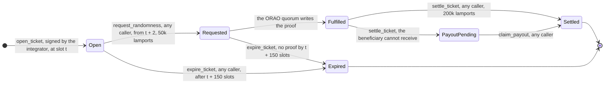

# Fade — diagrams

The drawings the specification uses, and the source they are generated from.

Two kinds live here. The **SVG files** are produced by `diagrams.py`, which draws
them from the same figures the specification quotes, so a parameter change is a
code change rather than a redraw. The **Mermaid source** below is for diagrams
GitHub can render in place and that read as well in a diff as on a page.

Regenerate the SVGs with `python3 diagrams.py`; `lib.py` holds the drawing primitives, and a label is always painted after every box so it can never be hidden behind one.

| File | Used by | Shows |
| --- | --- | --- |
| `overview.svg` | [Start Here](../README.md), [Technical Specification](../spec/README.md) | The parties and the flows between them |
| `ticket-sequence.svg` | [Start Here](../README.md) | One ticket across player, integrator, Fade, ORAO and crankers |
| `epoch-cycle.svg` | [Start Here](../README.md), [Spec 01](../spec/01-vault-and-lp-accounting.md) | Request, strike, claim, and the three USDC accounts they move funds between |
| `admission-funnel.svg` | [Technical Specification](../spec/README.md) | Every check `open_ticket` runs, and why each one refuses |
| `ticket-lifecycle.svg` | [Spec 02](../spec/02-randomness-and-settlement.md) | The state machine, as a drawing |
| `seed-timeline.svg` | [Spec 02](../spec/02-randomness-and-settlement.md) | Why the seed cannot be fixed before the ticket opens |
| `cpi-identity.svg` | [Spec 07](../spec/07-solana-implementation-security.md) | How Fade identifies its caller, and the three ways that fail |

---

## Ticket lifecycle

Where a ticket can be, how it moves, and who is allowed to move it. Specified in
Spec 02 (randomness and settlement) and the Technical Specification §3.6.

| State | What the protocol holds | What can still happen |
| --- | --- | --- |
| **Open** | the ticket's vault credit in the vault, the worst-case payout reserved against it, and the payout table, margin and split frozen into the ticket account | the randomness request, or expiry |
| **Requested** | the same, plus an ORAO request paid for by a ticket-owned PDA (`vrf-payer`) | fulfilment, or expiry |
| **Fulfilled** | the same, plus the oracle's proof on chain | settlement only — it can no longer expire |
| **PayoutPending** | the payout, moved to `payout-escrow` because the beneficiary's USDC account could not receive it | `claim_payout`, by anyone, to the stored beneficiary |
| **Settled** | nothing; the payout has been made in full and the ticket account closed | — |
| **Expired** | nothing; the vault keeps the ticket's vault credit | — |

Three things this diagram is meant to make obvious.

1. **Every transition after `open_ticket` is permissionless**, and each is paid out
   of the 250 000 lamports prepaid at open. Nobody has to run a bot for the
   protocol to work, and if we run one it competes on equal terms.
2. **The randomness is requested after the ticket opens, never at the same time.**
   The seed is derived from the first block hash later than slot `t`, so it does
   not exist when the player commits — which is what stops the oracle's key
   holders from picking winning tickets with a player.
3. **Expiry forfeits the ticket price, it never refunds it.** A refund would make
   withholding a draw a free option: collude with the oracle, let the losing
   tickets expire, keep the winning ones. Under forfeiture that strategy nets
   exactly zero.
