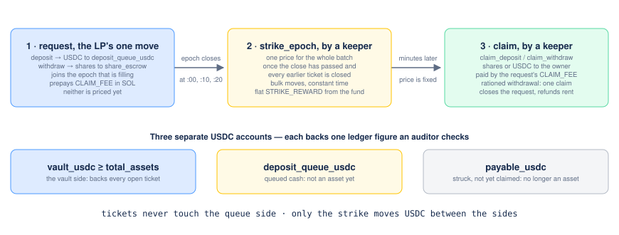

> [Fade](../README.md) · Technical. Domain document 01 of the [Technical Specification](README.md): owns vault state, share math, epoch pricing, the strike, withdrawal policy, yield and dilution, and the drawdown Monte Carlo. Parameter values are the Technical Specification's §2 table, which wins wherever the two differ.

# Fade Spec 01 — Vault and LP Accounting

Domain: the LP vault, share math, NAV model, withdrawal policy, LP economics. All numeric claims below were computed, not estimated; the computations are reproduced verbatim on [Fade Spec 01 — Vault and LP Accounting — Appendix](01-vault-and-lp-accounting-appendix.md). Reference values used throughout: `margin_bps = 150`, min/max ticket price **25** / 10,000 USDC, illustrative vault `TVL = 175,000 USDC`. The per-ticket liability cap is the Technical Specification's §2 formula (`min(0.5 · vault_margin/10_000 · free_balance, 150 bps · total_assets)`, with the integrator ceiling `20 % · total_assets` alongside, and the liability of a ticket counted as `payout_max − vault_credit`, Technical Specification §3.5); the flat-cap sensitivity studies sit in the appendix file beside it, labelled as such.

---

## 0. Recommended parameters (summary)

| Parameter | Value | Where justified |
| --- | --- | --- |
| `decimals_offset` (virtual shares) | 3 | §2 |
| `min_first_deposit` | 100 USDC | §2 |
| Deposit/withdraw rounding | always round the output **down**, favouring the vault | §2 |
| NAV model | epoch-batched forward pricing | §3 |
| Fill mechanism | the strike prices the epoch; each request is claimed individually, by a keeper its own `CLAIM_FEE` pays, so a liquidity provider makes one move | §3, [Spec 08](08-program-architecture.md) §6 |
| `epoch_length_seconds` | 600 (10 min) | §3 |
| Assumed VRF+settle p99 latency | 35 s | §3 |
| Per-ticket liability cap | `min(0.5 · vault_margin/10_000 · free_balance, 150 bps · total_assets)`; integrator ceiling `20 % · total_assets` | §4, Technical Specification §2 |
| Epoch | a batch of requests numbered by the strike, closing at the next multiple of `epoch_length_seconds` after its first request; at most two live | §3.3, [Spec 08](08-program-architecture.md) §4 |
| Strike condition | the epoch's close passed **and** no ticket opened before it still open | §3.5 |
| Strike and claim fees | a flat `STRIKE_REWARD` per epoch from the strike fund; `STRIKE_FEE` per request only while the fund is below `FUND_TARGET`; `CLAIM_FEE` per request to its claimer | §3.5, [Spec 08](08-program-architecture.md) §6 |
| LP shares | standard SPL mint, transferable | §1 |
| Global utilisation admission breaker | 70% | §4 |
| Assumed LP/protocol vs integrator margin split | 100 bps / 50 bps of the 150 bps reference margin | §5 |

---

## 1. Vault state

The vault's state is split between two accounts that never share a write, so that liquidity-provider traffic never competes with players for the same accounts ([Spec 08](08-program-architecture.md) §1): **`Vault`**, written by the tickets, holds the vault's accounting; **`Queue`**, written by liquidity-provider requests, holds the queued deposits and withdrawals and the two live epochs. Their fields, seeds and sizes are Spec 08 §2's; this section keeps what the accounting rests on.

Shares are a standard SPL mint controlled by the vault's authority PDA — this reuses SPL transfer and balance infrastructure instead of a bespoke per-LP position account, and makes shares composable (transferable, listable) for free.

**Shares are transferable**. Forward pricing (§3) closes the free option on the *primary* market — nobody deposits into or withdraws from the vault at a stale price. A share sold between two holders changes hands at whatever price they accept; that moves value between them, never onto or out of the vault, so solvency is untouched. The vault does not restrict, freeze or observe secondary transfers, and says so to liquidity providers.

**Tracked internally vs derived:**

- Tracked, mutated only by vault instructions: in `Vault`, `total_assets`, `total_shares`, `total_reserved_liability`, `open_vault_credits` and the epoch counters ([Spec 08](08-program-architecture.md) §4); in `Queue`, what each live epoch has queued and the indices of withdrawals served across epochs (Spec 08 §5).
- Derived, never stored: NAV per share = `f(total_assets, total_shares, decimals_offset)` (§2); free liquidity = `total_assets − total_reserved_liability − open_vault_credits` (§4); APY, off-chain, from the series of epoch prices (§5).
- Explicitly **not** a source of truth: any token account's live balance. `vault_usdc ≥ total_assets`, `deposit_queue_usdc ≥` the deposits queued and `payable_usdc ≥` what struck withdrawals still owe are identities checked against the tracked figures — `≥`, never `=`, because a stray transfer can only create a surplus. Each account is read once, at initialisation, to assert that it is empty; no price is ever computed from a balance.

---

## 2. Share math

### 2.1 Formulas (OpenZeppelin ERC-4626 virtual-shares convention, borrowed directly)

```
deposit(assets):
    shares_out = floor( assets * (total_shares + 10^offset) / (total_assets + 1) )
    total_shares += shares_out; total_assets += assets

withdraw(shares):
    assets_out = floor( shares * (total_assets + 1) / (total_shares + 10^offset) )
    total_shares -= shares; total_assets -= assets_out
```

(In the final design these are not called directly by users — they are the per-request formula evaluated once per epoch at the *strike*, see §3 — but the math is identical.)

### 2.2 Rounding direction

Both outputs round **down**. This means:

- A depositor always gets *slightly* fewer shares than the exact ratio → existing LPs are never diluted by rounding.
- A withdrawer always gets *slightly* fewer assets than the exact ratio → remaining LPs are never expropriated by rounding.

Every rounding decision in the vault favours the vault / remaining stakeholders over the party executing the action — the same principle the top-level spec applies to the payout table invariant (`sum(p_i*m_i) <= 1-margin`, rounded to favour the vault). Concretely: the payout table check compares `Σ p_i·m_i` against `(10 000 − margin)·1e9` exactly, by cross-multiplication in `u128` ([Spec 03 §3](03-payout-table-invariant.md)), so nothing is rounded and a borderline payout table is never accepted at a real margin below the floor; the payout itself is floored.

### 2.3 First-depositor / donation defence

Two independent attacks, two independent fixes (both verified numerically):

**(b1) Donation to the ATA.** Closed outright by never reading NAV from the token balance (§1). A direct SPL transfer to `vault_usdc` changes `vault_usdc.balance()` but not `total_assets` or `shares_mint.supply` — it has *zero* effect on share price. V1 has no instruction that sweeps it: the stray balance stays in `vault_usdc` as an unaccounted surplus (the ledger identity is `≥`, never `=`) and is never credited to the donor.

**(b2) Classic first-depositor rounding.** This exploits rounding on a *real* deposit and is not fixed by (b1) alone. Reproduced numerically: attacker deposits 1 base unit (1 share, naive 1:1), donates 1,000 USDC to the ATA (irrelevant under (b1) unless NAV is naively read from the ATA — shown for illustration), victim deposits 999 USDC → under naive `shares = assets*total_shares/total_assets` (floor, no virtual shares), victim receives **0 shares**, forfeiting the full 999 USDC to the attacker.

Fix: OpenZeppelin's virtual shares/assets (`assets.mulDiv(totalSupply() + 10**offset, totalAssets() + 1)`), introduced in OZ Contracts v4.9 (PR #3979) after a formally proven inflation-attack defence. Computed directly (not merely asserted):

| offset | attacker's realised P&L on (1-unit seed + 1,000 USDC donation, victim deposits 999 USDC) |
| --- | --- |
| 0 | **–333.67 USDC** (already a loss) |
| 2 | –498.997 USDC |
| 3 | –499.875 USDC |
| 6 | –499.9999 USDC |

A grid search over 120 (donation, victim-deposit) pairs at `offset=0` found no profitable configuration (best case: exact breakeven, only at the trivial 1-base-unit scale) — matching OZ's proof that `offset=0` already makes the attack non-profitable. Larger offsets push the loss toward half the attacker's own donation, converging as `offset → ∞`.

**Recommendation:** `decimals_offset = 3` — not because 0 is unsafe (it isn't), but because 3 costs negligible precision (1 virtual share = 1/1000 USDC) while pushing the attacker's loss well past "obviously not worth the transaction fees," rather than leaving a near-breakeven curiosity that invites probing. `offset = 6` was considered and rejected: it buys no additional *safety* over 3 (the loss is already \>99.9% of the donation) and costs more usable precision on a vault whose early TVL may be modest. Paired with `min_first_deposit = 100 USDC`, enforced in the deposit instruction, so the seeding deposit itself cannot be an economically negligible 1-base-unit position.

### 2.4 Overflow analysis (u64 vs u128)

Computed bounds (`U64_MAX ≈ 1.845e19`, `U128_MAX ≈ 3.403e38`):

| Expression | Worst case | Value | Fits u64? | u64 headroom |
| --- | --- | --- | --- | --- |
| `price * multiplier_bps` (liability calc) | price=1e10, m=1e8 bps | 1.0e18 | yes | **18.4x — too tight to trust** |
| `Σ p_i * m_i` over 32 outcomes | p=1e9, m=1e8 bps, ×32 | 3.2e18 | yes | **5.8x — too tight to trust** |
| `vault_balance * 10_000` (bps-denominator scaling, e.g. utilization check) | TVL = 1B USDC | 1.0e19 | yes | **1.85x — unsafe at plausible scale** |
| `assets * (total_shares + 10^offset)` (share math) | assets=shares=1e15 (1B USDC-scale, 1:1 price) | 1.0e30 | **no** | overflows |

**Conclusion:** every one of these must be computed with a u128 intermediate before dividing back down, *even the ones that "fit" in u64 today* — the u64 headroom on the first three is under 20x, meaning a modest future increase to `M_CEILING`, outcome count, or vault size blows through it. Only the final result (back in base units, ≤ 1e15 for any plausible TVL) is stored as u64. This is a concrete audit checklist item (§7): grep for any `u64 * u64` in the vault/payout-table-check code path that isn't immediately widened.

---

## 3. NAV model immune to finding (a)

### 3.1 The exploit, quantified

Under a naive "NAV = current total\_assets, computable and actionable at any instant" model, an attacker who deposits `D` into a vault of `P` right before a settle lands, then withdraws right after, captures fraction `f = D / (P + D)` of that settle's PnL delta, symmetrically in both directions (capture a gain, or dodge a loss for zero cost as an *existing* LP with no new capital at all).

Reproducing the stated measurement: `P = 175,000`, losing ticket price `Δ = 1,000` (full price kept by vault), `D = 1,750,000` → `f = 1.75M / 1.925M = 90.9%` (**matches the stated 91%**), attacker profit `= 909.09 USDC`. Capture fraction as a function of deposit size (same vault):

| Deposit | Capture fraction |
| --- | --- |
| 10,000 | 5.4% |
| 50,000 | 22.2% |
| 175,000 (1x TVL) | 50.0% |
| 500,000 | 74.1% |
| 1,750,000 (10x TVL) | 90.9% |

### 3.2 Options evaluated

| Option | Verdict |
| --- | --- |
| Epoch/queued deposits & withdrawals | **Adopted** — see below |
| Lock/cooldown on shares (GMX-GLP-, Hyperliquid-HLP-style) | Rejected as *primary*: a pure entry-side lock (GLP: 15 min historically; HLP: 4-day, resets on top-up) does nothing for an **existing**, already-vested LP who just times an ordinary withdrawal around a known pending loss — no new capital, no lock to trigger. Needed only as a special case of epoch batching's general mechanism (see below), not as a separate primitive. |
| Realized-PnL released into NAV linearly via a buffer (rate-limited "streaming" NAV) | Rejected — modelled: at zero hold time the release is zero *in either direction*, which kills a costly attacker's *gain-capture* attempt (good) but does nothing to stop a costless *loss-dodging withdrawal* by an incumbent LP (bad) — the asymmetry in who pays to exploit it makes this an incomplete fix, not a wrong idea; it just doesn't reach the withdrawal side. |
| Accrue pending tickets' EV at open instead of at settle | Rejected as *unnecessary* once epoch batching is adopted (below): it only pre-recognises the deterministic margin, leaving the actual exploitable quantity (settle's specific outcome vs. expectation) exactly where it was; batching already neutralises that quantity directly, so this adds bookkeeping (must reconcile expected-vs-actual at settle) for no incremental protection. |
| Making settle non-permissionless | Rejected — doesn't even fix the underlying gap (a permissioned settler still creates an "outcome known, not yet applied" window; it just makes the attacker race a designated party instead of the open field), adds a liveness dependency that contradicts "pause never blocks settlement," and is a centralization vector. |

### 3.3 Recommended design: epoch-batched forward pricing

This is the DeFi-native form of **forward pricing**, the mechanism SEC Rule 22c-1 has required of US mutual funds since 1968: a hard order cutoff means every order executes at a *future*, not-yet-known NAV, never the current one. (The 2003 "late trading" scandal — Canary Capital et al. — was about orders placed after that cutoff in violation of the rule, not the event that introduced it.) It is precisely isomorphic to finding (a): "VRF fulfilled, not yet applied" is our version of "material news, not yet in the 4pm NAV."

**Mechanism:**



- **An epoch is a batch of requests priced together**, as in Centrifuge's epochs and ERC-7540's asynchronous vaults — not Solana's ~2-day epoch. The first request opens one, which closes at the next multiple of `epoch_length_seconds` (600 s: at :00, :10, :20 … UTC); a request made after the close joins the next. At most two epochs are live, and a period with no request creates nothing. The state machine is [Spec 08](08-program-architecture.md) §4.
- `request_deposit(amount)`: transfers `amount` into `deposit_queue_usdc` immediately and records a `DepositRequest` against its epoch; the amount is **not** part of `total_assets` until the strike (§3.4 — this exclusion is load-bearing, not cosmetic).
- `request_withdraw(shares)`: locks `shares` in `share_escrow` and records a `WithdrawRequest`.
- `settle_ticket` is **unchanged**: still permissionless, still updates `total_assets` and releases `total_reserved_liability` immediately and continuously, exactly as specified. Epochs never gate settlement.
- `strike_epoch()` (permissionless and paid, Spec 08 §6; callable once the epoch's close has passed **and** no ticket opened before the close is still open — the clean-strike rule of §3.5): computes one clearing price `nav_per_share = f(assets, total_shares, offset)` from the vault's settled assets as they stood at the close (§3.5), which by then reflect every ticket opened before the close, and nothing opened after it. It then, in **constant time**, records that price and the withdrawal fill in an `EpochRecord`, moves the epoch's deposits into `vault_usdc` and mints their aggregate shares into `share_claims`, burns the filled withdrawal shares and moves their assets into `payable_usdc`, and promotes the next epoch.
- `claim_deposit(request)` / `claim_withdraw(request)`: fill one request at the price already recorded for *its* epoch, then close the request account. Permissionless, and paid: each request prepays a `CLAIM_FEE` that goes to whoever executes its claim, so keepers claim on behalf of liquidity providers, and **a liquidity provider makes a single move** — the request — and receives the shares or the USDC about ten minutes later. The price was fixed at the strike, so *when* a claim happens cannot change what it receives.

**Why the fill is not part of the strike.** A strike that iterated over every queued request would be `O(n)` in a single transaction, so a vault with more requests than fit in one transaction's compute budget could never close an epoch at all — the pricing mechanism would fail exactly when the vault succeeded. Splitting it costs one extra transaction per request — sent by a keeper that the request itself pays — and buys a strike whose cost does not depend on how many liquidity providers the vault has. The single-clearing-price guarantee below is unaffected: it is a property of *when the price is computed*, not of when the tokens move.

**Why this closes the exploit:** every request queued in epoch `N`, no matter when in the epoch it was submitted, clears at the *same* price, struck *after* the epoch closes. Submitting late (i.e., after seeing an outcome) confers zero advantage over submitting at the epoch's start, because both get identically priced. To act on a specific known outcome at all, a request must be queued before the current epoch's close — and by the time that epoch's strike actually runs, the outcome has (with overwhelming probability, given the margin below) already been applied by `settle_ticket`, so it's already reflected in the very price the request is filled at. There is no window in which "I know X happened" and "my mint/burn price doesn't yet reflect X" coexist for longer than one epoch, and within one epoch nobody — attacker or ordinary LP — gets a better price than anyone else in that batch.

**Sizing the margin:** assumed VRF fulfillment latency (median 5s, p99 30s) + permissionless/tipped-keeper settle-call latency (5s) → p99 time from `open_ticket` to fully-settled ≈ **35s**. At `epoch_length = 600s` that is a **17x margin**. Computed for several epoch lengths:

| Epoch | Margin over p99 latency |
| --- | --- |
| 60s | 25s |
| 120s | 85s |
| 300s | 265s |
| **600s (recommended)** | **565s** |
| 1800s | 1765s |

**Residual exposure:** epoch batching does *not* remove ordinary directional risk — an LP who deposits in epoch `N` does not know what happens in `N+1`, which is correct. The "attack" degrades from a riskless, instant 91 %-capture round trip into holding real capital for at least one epoch, exposed to every other ticket's variance.

**UX / complexity cost:** deposits and withdrawals are not instant; they clear at the next strike, worst case just under `epoch_length_seconds` plus the clean-strike wait of §3.5 (show "next price at 09:20" in the client), and they take a single move from the liquidity provider. Far cheaper than HLP's 4-day lock; the machinery is [Spec 08](08-program-architecture.md)'s.

### 3.4 Interaction check

- **(a) × (b):** queued deposit cash is held apart, in `deposit_queue_usdc` and `Queue`, *excluded* from `total_assets` until the strike actually mints shares for it. If it weren't excluded, cash sitting in the queue would inflate the price *before* its own shares exist, silently diluting depositors in favour of whoever holds shares at that instant — a new, self-inflicted version of the donation-inflation bug from §2.3, scoped to one epoch. This is called out explicitly as an audit item (§7): confirm the strike calculation's `total_assets` input never includes the *current* epoch's own unminted deposits or unburned withdrawal shares.
- **(a) × (c):** withdrawal fills at strike are additionally bounded by free liquidity (`total_assets − total_reserved_liability − open_vault_credits`, §4.3) at strike time; if the epoch's aggregate withdrawal requests exceed what's free, the strike records a fill ratio below 100 %, the unfilled remainder rolls into the next epoch automatically, and a withdrawal served across several epochs is still claimed once (§4.3). No conflict: epochs give a natural, fair batching point at which to also apply the liquidity constraint, rather than a first-come-first-served race a bot would win.
- **(a) × virtual shares (§2.3):** the strike-price formula *is* the §2.1 deposit/withdraw formula; the offset only materially matters near inception (low TVL), epoch batching matters at every TVL. No conflict.
- **(a) × governance pause:** pause blocks new `open_ticket` calls and new `DepositRequest` submissions, but never `settle_ticket`, never `expire_ticket`, never `strike_epoch`, never a `WithdrawRequest`, and never a `claim_*` on an already-struck request — matching the top-level rule verbatim (Technical Specification §5, invariant 9).
- **(a) × the clean strike (§3.5):** the strike may run later than the close, by about a minute; the price it computes is the one at which every request of the epoch clears, so the delay changes nothing for fairness and only shifts when claims become possible.

---

### 3.5 The strike: paid, clean, and constant-time

**Paid.** Every permissionless instruction is funded by a flat SOL fee prepaid by the party that created the work, and the strike is no exception. It is paid a flat `STRIKE_REWARD`, 200 000 lamports, from a strike fund held by `Queue`, which also advances the rent of the epoch's record; requests pay `STRIKE_FEE` into the fund only while it is below `FUND_TARGET`. A flat reward per epoch, rather than a fee per request handed to the striker, keeps the strike paid when an epoch has a single request and stops it being overpaid when it has ten thousand. Its size is the settle share of `CRANK_FEE`, for the reason [Spec 02 §4](02-randomness-and-settlement.md#4-settlement-incentive) gives: one transaction of the same class, positive margin under congestion. A percentage-of-flow fee was rejected for the reason [Spec 04 §3.1](04-risk-and-exposure.md#31-recomputed-economics-of-the-reservation-freeze-attack) rejects a percentage rent: an epoch with withdrawals but no volume still needs a strike, and a percentage of nothing pays nobody. The fees and the fund are [Spec 08](08-program-architecture.md) §6's.

**Clean.** A ticket whose oracle result is public but not yet applied to `total_assets` is a known outcome that a strike could price around. The margin of §3.3 makes that rare; it does not make it impossible, and a liquidity provider who keeps a withdrawal request queued can force the race by opening a ticket just before the close and striking before anyone settles. Rule: **the strike of an epoch runs only once its close has passed and every ticket opened before that close has settled or expired.** `Vault` keeps two counters — open tickets opened before the live epoch's close, and after it — and a generation number: each ticket records the counter it joined and the generation, a strike requires the first counter to be zero, and each change of epoch moves the second counter into the first ([Spec 08](08-program-architecture.md) §4).

Every update is O(1) and the strike's cost stays independent of the number of requests and of tickets (property 12). Tickets opened after the close never delay the strike, so a stream of new tickets cannot starve it; it waits at most for the tickets open at the close to finish: `T_SETTLE` (150 slots) for those never fulfilled, and the settler's 200 000-lamport incentive for those fulfilled — about a minute in practice. A request made after the close joins the next epoch, which is priced after its own close and its own tickets, so no request is ever priced by a strike that did not wait for every ticket it could have known about. At a clean strike no ticket opened before the close is open. Tickets opened after it may be, and the strike prices on the vault's **settled assets**, `total_assets − open_vault_credits`, leaving their credits out: a credit the vault may yet pay back is not value a request can buy or sell. The results of tickets opened after the close that have already closed are left out too ([Spec 08](08-program-architecture.md) §4 rule 5): settlement and the strike are both permissionless, and a price that included them would let whoever orders the two pick which post-close outcomes it contains. Pricing on `total_assets` would let a liquidity provider who asked to withdraw everything open large tickets right after the close, raise the price its withdrawal is paid at by their credits, and leave the other liquidity providers to pay those tickets' expected winnings. So the strike never values an open ticket — neither at its credit, nor at its expected value, nor at a known-but-unsettled outcome — and withdrawal rationing (§4.3) is computed against the tickets opened after the close, the only ones left.

On the shared beacon ([Spec 09](09-shared-beacon.md) §9) a round's tickets count as opened at the round's payment, before its seed can exist, and a round counted before the close takes no ticket from the close on, so the rule holds there unchanged: the price contains exactly the tickets opened before the close, and the strike waits for a round paid before it at most `tick_slots + t_settle_slots` plus its settlement or expiry ([Spec 08](08-program-architecture.md) §13.7).

Epochs are numbered by the strike, not by the clock. An epoch with no request therefore does not exist and needs nothing: after a quiet night, the next request opens an epoch, and nothing has to be caught up.

**Consequence: **`settle_ticket`** must always succeed.** A ticket that could not be settled would block every later strike. If the payout transfer cannot land — a beneficiary token account frozen by the mint's freeze authority — the settlement books the outcome, releases the reservation, moves the payout into `payout_escrow`, the vault's single escrow account, and leaves the ticket open as `PayoutPending`; a permissionless `claim_payout` delivers it to the beneficiary later and closes the ticket. [Spec 07 §6](07-solana-implementation-security.md#6-token-handling) owns the account-level rule; this is the reason it is the rule.

## 4. Withdrawal policy and finding (c)

### 4.1 The freeze, quantified

At a flat per-ticket cap of `max_payout_bps = 1000`: cap `= vault * max_payout_bps/10_000 = 175,000 * 0.10 = 17,500`. At `multiplier = 1000x`, ticket price needed to hit that cap `= 17,500 / 999 = 17.5175 USDC`. Ten such tickets: total ticket price `= 175.18 USDC` (**matches the stated "\~175 USDC"**), total reserved `= 175,000 = 100%` of the vault. The per-ticket cap bounds any *one* ticket's liability; nothing in a per-ticket-only design bounds the *sum* — an attacker simply stacks `10_000/max_payout_bps = 10` such tickets (independent of multiplier — verified for 10x/100x/1000x/10000x, always 10 tickets to 100%) to freeze the entire vault indefinitely, for a total ticket cost of well under $200 at that flat cap.

The protocol's actual per-ticket cap is the Technical Specification's §3.5 formula (`min(0.5 · vault_margin/10_000 · free_balance, 150 bps · total_assets)`), computed on the free balance rather than a flat 10% of gross assets — which turns this freeze from linear (29 tickets under a flat 10 % cap) into geometric (398 tickets on the free balance) to reach 95% utilisation instead.

### 4.2 The aggregate ceiling — sensitivity study in [the appendix](01-vault-and-lp-accounting-appendix.md)

A per-ticket cap bounds one ticket; nothing in a per-ticket-only design bounds the sum, so an aggregate ceiling is needed alongside it. The protocol's ceiling is the **70 % utilisation admission breaker** of Technical Specification §2, on `total_reserved_liability + open_vault_credits`, with `κ = 0.8` as the hard invariant behind it; both use `total_assets` as their base, deliberately, because an "available balance" base would let utilisation converge geometrically toward 100 % without ever breaching a per-step check. The trade-off table that sized it (computed at the flat 1000 bps reference cap: always-free share against the number of simultaneous max-sized tickets before refusal) and the cost of griefing at that reference point are on [the appendix](01-vault-and-lp-accounting-appendix.md); the protocol's tighter cap and 70 % ceiling move both figures tighter still.

### 4.3 What is withdrawable when liability is reserved

At each epoch strike: `free = total_assets - total_reserved_liability - open_vault_credits`, the epoch's own deposits added to `total_assets`, all three counted over the tickets opened after the close — the only ones open at a clean strike (§3.5), and further bounded so that `total_reserved_liability ≤ κ · total_assets` still holds once the withdrawals leave (`fade_math::risk::withdrawable`). Withdrawal requests for that epoch are filled pro rata against `free`; if `Σ requested_assets <= free`, everyone is filled in full. If not, every requester receives `requested_assets * free / Σ requested_assets` (rounded down, favouring the vault per §2.2), the batch never being paid more than `Σ requested_assets − ceil(Σ requested_assets / 10⁶)` so that at least a millionth rolls ([Spec 08](08-program-architecture.md) §5), and the unfilled remainder of their `WithdrawRequest` is automatically re-queued into the *next* epoch, without requiring the user to resubmit. A withdrawal served across several consecutive epochs is claimed **once**, in constant time, through two cumulative indices recorded at each strike ([Spec 08](08-program-architecture.md) §5), so the keeper its `CLAIM_FEE` pays settles it in one transaction. Deposits are never rationed (cash in is never liquidity-constrained).

**How long a rationed withdrawal can wait, bounded.** The 70 % utilisation breaker refuses any ticket that would take committed capital above 70 % of `total_assets`, so at least 30 % of the vault is free at every admission; a withdrawal queue of `X` USDC is therefore filled within `ceil(X / (0.3 × total_assets))` strikes even if new tickets keep landing, and within one strike of the last open ticket closing if they stop. Under `paused_new_tickets` (an upgrade in flight, [Spec 05 §2.2](05-governance.md#22-the-exit-interaction-worked-precisely)) reserved liability only shrinks, so the queue clears within one epoch plus `T_SETTLE`. The fill ratio of each epoch is recorded at the strike (property 16) and is part of the disclosure of §5.4.

### 4.4 Utilization curve? Rejected in favour of a hard cap, deliberately

Lending protocols use a *curve* (rate rises smoothly as utilization → 100%) because their liability is a *soft*, continuously-adjustable rate that rebalances supply/demand. Fade's liability is a *hard*, worst-case, per-ticket solvency guarantee (`open_ticket` is refused, never truncated at settlement — this is what makes the vault solvent-by-construction). Loosening that to a VaR-style ("reserve for the 99th percentile outcome, not the absolute worst case") reservation would free more capital for withdrawal but reintroduce tail insolvency risk — precisely the trustworthiness the LP-vault pitch is selling against. **Recommendation: keep worst-case per-ticket reservation exactly as specified; solve the freeze at the aggregate level with a hard ceiling, not by softening the per-ticket guarantee.** A smooth curve was considered for the *admission* side only — e.g., shrinking the effective per-ticket cap as utilization rises, to degrade gracefully rather than hit a wall at exactly 70% — but is not necessary for correctness (the hard cap already bounds the freeze) and is flagged as a V2 nicety, not a V1 requirement.

---

## 5. LP APY: yield source, distribution, disclosure

### 5.1 Yield source and assumed split

The entire yield is the structural margin on ticket volume: for every ticket, `E[vault_delta] = price * (margin_bps_floor - integrator_share_bps) / 10_000`, realized as variance around that mean at settle. The Technical Specification's §3.7 split fixes the vault's own take at the **LP floor, 100 bps of ticket price** — the least the vault may earn in expectation — with the protocol taking a further 20 bps to its treasury and the integrator taking 0–500 bps, both paid out of `price` at `open_ticket`, deterministic and zero-variance to the vault. At the reference `margin_bps_floor = 150` used throughout this document, `vault_margin_bps = 100` is exactly that LP floor, and `integrator_share_bps = 50` is the protocol's 20 bps and the integrator's 30 bps lumped into one deduction — both are zero-variance to the vault, and the split between them doesn't change `E[vault_delta]`. The remainder is what the vault is actually exposed to, so the simulation's revenue term is exactly the LP floor: the LP-yield, drawdown and time-to-dominance figures in §5.2, §5.3 and §6 already net out the protocol share, they are not gross of it. A future protocol *performance* fee on realised LP profit (§3.7's recorded V2 option, a Yearn-/GMX-style cut of vault profit, in place of the flat 20 bps) would carve further into that 100; numbers below are gross of that not-yet-adopted mechanism only.

### 5.2 Sensitivity study at a flat cap — in [the appendix](01-vault-and-lp-accounting-appendix.md)

The 30-day Monte Carlo (3 000 trials per scenario at `TVL = 175,000`) and the time-to-dominance study (§5.3) model the per-ticket rule as the flat `max_payout_bps = 1000` reference cap, **not** the protocol's free-balance cap, and were not re-run under it. They live, labelled as a sensitivity study, on [the appendix](01-vault-and-lp-accounting-appendix.md). What they establish in kind and what carries over: at 175 k of assets every volume scenario carries a 24–42 % chance of a losing month; the losing-month probability barely moves with TVL, because absolute ticket prices are fixed in dollars while only their *percentage* impact shrinks — TVL is a dilution buffer, not a risk-reduction lever; and the slow convergence of LP returns is driven by the \~98.5× longshot archetype, whose ticket prices the cap does not self-limit, rather than by the rarer top-payout archetype.

### 5.3 Time for the margin to dominate variance — in [the appendix](01-vault-and-lp-accounting-appendix.md)

Same study, same page: `P(cumulative PnL < 0)` crosses 25 % only after about 300 000 tickets and does not reach 10 % within the 400 000 simulated, and an ablation isolates the longshot archetype as the cause. A multiplier-tiered cap, or a ceiling on high-variance archetypes' share of volume, is a reasonable V2 lever, flagged, not built.

### 5.4 Disclosure the UI owes LPs

1. **Never show a single APY number.** Show the distribution: at minimum, the 1/5/50/95/99th percentile of trailing-30-day return, and `P(30-day return < 0)` — computed exactly as above, refreshed from actual realized NAV history once the vault has running data, not just from the day-one Monte Carlo.
2. **State the holding-period disclaimer as a number, not a platitude**: "at current volume, this vault has not yet accumulated enough tickets for the statistical margin to be more likely than not positive over a typical holding period; based on modeled volume, expect meaningful probability of a losing month for the first several months." Back it with the actual `P(pnl<0)` vs. ticket-count curve for the vault's *own* realized mix, not the illustrative one above.
3. **Disclose the payout table mix's variance contribution**, at least qualitatively ("this vault's return is currently dominated by medium-odds games; top-payout-tier games contribute less than their payout size suggests because of the liability cap").
4. **Disclose TVL vs. reserved liability** live (this is also the input to §4's utilization display) — an LP should be able to see "35,000 USDC (20%) guaranteed withdrawable right now" as a real-time number, not discover it at withdrawal time.

---

### 5.5 Turnover, dilution, and what vault growth does to the yield

**Turnover** is the ticket volume in a month divided by the **time-weighted** assets of the vault over that month — the average of `total_assets` over the month's epochs, so that a deposit landing on the 28th does not halve a whole month's turnover on paper. It is a ratio: "3×" means the vault was played through three times. It counts every ticket price, so the same money counts again each time it is spent on tickets.

The identity `LP revenue = vault_margin × volume` divides by the vault's size into `monthly return = vault_margin × turnover`, hence `APY = vault_margin × turnover × 12` uncompounded: 12 % a year per 1× of monthly turnover at the 100 bps floor, 33.6 % at the demo slot's 280 bps. There is no TVL term left: turnover already contains it. When capital arrives faster than volume, turnover falls and the return falls for every liquidity provider identically — NAV per share is one number, so no depositor is favoured or penalised against another; what falls is everyone's average. That is a market outcome and the protocol does not compensate it: raising the LP floor would refuse every game declared near the floor (`MarginFloor`) and shrink the integrator margin that brings the volume; an administered margin curve is the admin-controlled economic lever [Spec 05 §6](05-governance.md#6-rug-vector-self-audit) classifies as a rug vector (Technical Specification §3.8).

Two corrections to the intuition. First, the vault-size invariance of the yield only holds from about 3× monthly turnover: at 1× the yield is 9 %, 12 % and 14 % on 250 k, 1 M and 5 M vaults, because the cap clips large tickets harder when the free balance is small. Second, a bigger vault buys a thinner drawdown tail, not a higher mean. The disclosure rule of §5.4 is the answer to both: the trailing turnover is shown next to any return figure, so that capital can see whether it is arriving ahead of the volume it needs.

## 6. Risk-of-ruin / drawdown analysis — in [the appendix](01-vault-and-lp-accounting-appendix.md)

The drawdown tables of the flat-cap study (1st/5th/50th percentile drawdowns per volume scenario at `TVL = 175,000`) are on [the appendix](01-vault-and-lp-accounting-appendix.md) with their assumptions restated. Read-through that survives the cap change in kind: at the most conservative modelled volume there is a one-in-twenty chance of a within-month drawdown above 7 % of peak assets and a coin-flip chance of one above 17 %, roughly tripling at optimistic volume; the attractive mean and the fat drawdown are the same lever — a small vault intermediating large volume — not independent knobs.

---

## 7. Property tests and invariants for an auditor

**Accounting / solvency**

1. `vault_usdc.balance() >= total_assets` at all times, for all reachable program states (fuzz: donate arbitrary amounts directly to any vault token account between instructions, confirm the invariant holds and share price is unaffected).
2. `shares_mint.supply == Σ(LP share balances)` — trivially true for an SPL mint, but confirm no code path mints/burns shares outside `strike_epoch`, that `share_claims`' balance is exactly the shares struck and not yet claimed, and that `Vault.total_shares` equals the supply after every strike.
    - **Ledger identities**, at every reachable state: `vault_usdc.balance() >= total_assets`, `deposit_queue_usdc.balance() >=` the deposits queued in the live epochs, `payable_usdc.balance() >=` what struck withdrawals still owe. The three accounts are disjoint by construction: queued cash is not an asset yet, and struck-but-unclaimed cash is no longer one.
3. `total_reserved_liability + open_vault_credits <= total_assets` (gross solvency) and `total_reserved_liability <= 0.8 × total_assets` after every `open_ticket` (invariant/fuzz test over sequences of opens).
4. For every settled ticket: `payout <= vault_credit_at_open + reserved_liability_at_open` (the reservation guarantee actually holds against the realized outcome — fuzz over payout tables and outcome selection, not just the happy path).
5. `total_reserved_liability` decreases by exactly the ticket's reserved amount on every `settle_ticket`, win or lose (no leakage, no double release, no stuck reservations on program errors).
6. `total_assets` is never negative, never underflows.

**Share math**

1. Inflation-attack fuzz: for all `(donation, first_deposit, second_deposit)` triples, the attacker's realized P&L (first-deposit + donate + wait for a victim + redeem) is `<= 0` at the configured `decimals_offset`.
2. Deposit and withdrawal rounding always favours the vault (property: `shares_out(assets) <= exact_ratio`, `assets_out(shares) <= exact_ratio`, for random inputs incl. edge cases near zero and near u64::MAX).
3. Overflow fuzz on every bps-scaled multiplication identified in §2.4, at parameter values beyond today's configured maxima (an upgrade can raise `M_CEILING` or `MAX_OUTCOMES` later — the math must not silently wrap).

**NAV / epoch batching**

1. Single-clearing-price property: for any two requests (deposit or withdraw) queued in the same `epoch_id`, both are filled at identically the same `nav_per_share`, regardless of submission order within the epoch.
2. Strike calculation excludes the epoch's own queued deposits and unburned withdrawal shares from the price computation (regression test for the self-inflation bug noted in §3.4), and the credits of tickets opened after the close: opening a ticket after the close leaves the strike price unchanged (§3.5).
3. `strike_epoch` cannot be called before the epoch's close; cannot strike an epoch twice; **cannot run while any ticket opened before the close is still open** (§3.5); and its compute cost is independent of the number of queued requests and of open tickets (measure it at 1 and at 1,000 of each and assert the two are equal).
    - **Counters are conserved:** after any sequence of opens, settlements, expiries, requests and strikes, the two counters sum to the number of open tickets, and every open ticket is counted where its recorded side and generation place it ([Spec 08](08-program-architecture.md) §4).
    - **The strike never prices a known outcome:** for any ticket fulfilled before an epoch's close, that epoch's strike runs after its settlement, and a request made after a close is never priced by that close's strike.
    - **Empty time is free:** a period of any length with no request creates no epoch and requires no instruction; the next request opens an epoch with the next id.
    - **Strike fees:** each strike is paid exactly `STRIKE_REWARD` from the fund, whatever its number of requests, and requests pay `STRIKE_FEE` exactly while the fund is below `FUND_TARGET` ([Spec 08](08-program-architecture.md) §6).
    - **Claim timing is inert:** for any request, claiming it one second after the strike and claiming it a thousand epochs later produce byte-identical transfers. A claim against an epoch that has not struck is refused. A deposit is claimed exactly once; a withdrawal pays in total what one final claim pays, however its claims are split ([Spec 08](08-program-architecture.md) §5); the final claim closes the request and pays its `CLAIM_FEE` to the claimer.
4. Same-epoch deposit-then-full-withdraw-request nets to (approximately) a no-op modulo rounding-down on both legs (never a *profit*).
5. Sandwich-attack regression: reproduce the exact `(P=175k, D=1.75M, price=1000)` scenario from §3.1 end-to-end against the real program (not the model) and assert attacker profit is bounded by what one epoch's worth of *other* tickets' variance could produce, not by `f = D/(P+D)` of the targeted delta.

**Withdrawal / utilization**

1. `open_ticket` is refused, atomically, the instant either the per-ticket or the global utilization check would be breached — no state mutation on the refused path.
2. Pro-rata rationing at strike conserves value: `Σ fills + Σ rolled-over remainders == Σ requested`, exactly, for every epoch (no dust lost or created — watch rounding here specifically).
3. Freeze-bound regression: reproduce the `(10 tickets × ~17.5 USDC price @ 1000x)` scenario from §4.1 and assert committed capital never exceeds `utilisation_breaker_bps` of `total_assets`.

**Governance / pause**

1. While `paused_new_tickets` / `paused_new_deposits`: `open_ticket` and new `DepositRequest` submissions are rejected; `WithdrawRequest` submissions, `settle_ticket`, `expire_ticket` and `claim_payout` succeed unconditionally; `strike_epoch` still runs and still prices already-queued requests against free liquidity, and `claim_deposit`/`claim_withdraw` still succeed on anything already struck (per §3.4/§4.3).
2. Unpausing does not require replaying or re-validating already-settled state — pause/unpause must be a pure gate on the three instructions above, with no side effects on `total_assets`/`total_reserved_liability`.

---

## Precedents cited and what was borrowed

- **OpenZeppelin ERC-4626 virtual shares/assets** (`decimalsOffset`, PR #3979, "A Novel Defense Against ERC4626 Inflation Attacks") — borrowed directly for §2.3; formula and profitability analysis reproduced and verified numerically rather than assumed.
- **GMX GLP's historical 15-minute mint/redeem cooldown** — borrowed as the *order of magnitude* for the epoch-length safety margin (§3.3), not as the mechanism itself (GLP's cooldown is a blunt lock; this design needed the sharper forward-pricing mechanism to close the withdrawal side symmetrically, per §3.2's rejection of pure cooldowns). Note GMX later removed this cooldown (Dec 2022) once other protections were layered in — a caution against treating any single number as self-justifying.
- **Hyperliquid HLP's 4-day deposit lockup** (resets on top-up) — surveyed and rejected as the primary mechanism (§3.2): appropriate for a perp-DEX vault whose NAV risk (open position mark-to-market) is continuous and slow-moving, but far too coarse for this design's discrete, VRF-latency-scale information gap; a 10-minute epoch achieves the same anti-sandwich guarantee at a fraction of the UX cost.
- **1990s–2000s US mutual fund forward pricing / the 2003 late-trading enforcement actions** — the direct conceptual precedent for §3.3's core mechanism (single clearing price per batch, struck after the order cutoff). This is the closest real-world analogue to finding (a) found during this analysis, closer than either DeFi precedent above.

---

## Appendix

The computations behind every numeric claim above, and the flat-cap sensitivity study, are on [Fade Spec 01 — Vault and LP Accounting — Appendix](01-vault-and-lp-accounting-appendix.md).
