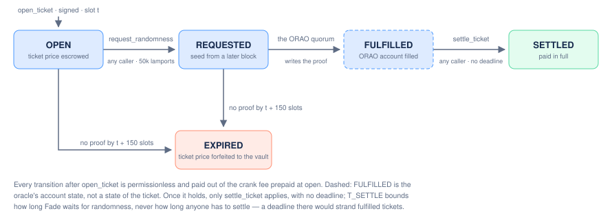
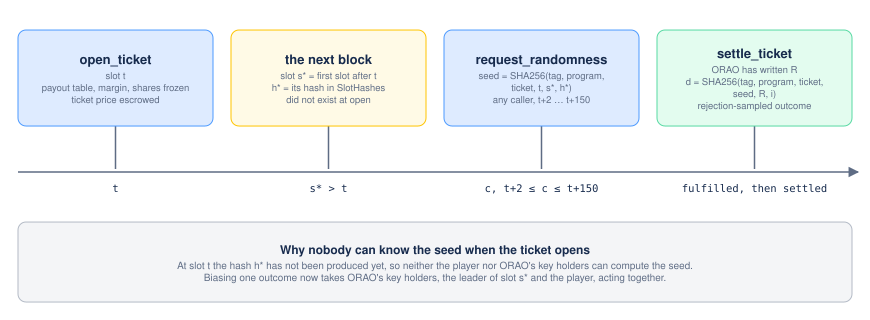

> [Fade](../README.md) · Technical. Domain document 02 of the [Technical Specification](README.md): owns oracle selection, the ticket state machine, settlement liveness, cranker economics, account-binding checks and outcome selection. Parameter values are the Technical Specification's §2 table, which wins wherever the two differ.

# Fade Spec 02 — Randomness and Settlement

Domain: randomness provider selection, two-phase ticket lifecycle, cranker incentives, account binding, outcome selection, censorship bounds, shared-beacon requirements.

## 0. Recommendation (read this first)

**Use ORAO VRF for V1, not Switchboard On-Demand.** Not a preference — a structural requirement.

Switchboard On-Demand randomness is a **pull** design: the oracle computes a value inside a TEE and *someone* must separately fetch it from Crossbar (the oracle's off-chain gateway) and submit a `reveal` transaction. That fetch-and-submit step is undifferentiated — nothing in the protocol distinguishes "the player did it" from "a bot did it." Any party with the ticket's public key can query Crossbar for the same value, so the design is *permissionless-revealable*, but nothing forces anyone to do so. A player can query Crossbar privately, see they lost, and simply not submit. A flat cranker fee (item 3) closes most of this gap by making a profit-motivated bot race to reveal regardless of outcome, but it cannot close all of it (item 6): the fetch step needs the oracle to have *produced* the value in the first place, and a single TEE oracle deciding not to answer a Crossbar query for one specific request is invisible on-chain and costs it nothing.

ORAO VRF is a **push** design: fulfillment is performed by ORAO's own Byzantine-quorum node set, unconditionally, on their infrastructure, regardless of whether any callback fires. Their own docs state the design goal explicitly: "all client requests must be fulfilled in one way or another." The party who decides *whether* the value gets written on-chain is never the player, and is never a single point of failure — it's ORAO's node quorum. This removes the player's private lookahead by construction, not by economic patching. It does not remove oracle-side collusion risk (item 6 still applies, capped structurally), but it removes the specific failure mode item (a) describes: the pull design where the party who can choose not to publish is exactly the party who benefits from not publishing.

Switchboard On-Demand is not integrated in V1. A second, differently-operated oracle for cross-attestation on large-liability tickets (item 6) is a roadmap item (Technical Specification §1); its account checklist stays in [the appendix](02-randomness-and-settlement-appendix.md) so the option remains evaluated, not assumed.

**Timeout parameter**: `T_SETTLE = 150 slots` (\~52.5s at current \~350ms mainnet slot time, tightening as SIMD-0525 lands). **Timeout resolution: forfeiture, never refund** — see item 2 for the proof that this is the only rule under which withholding is never profitable while honest players are never confiscated beyond what an honest loss already costs them.

**Cranker fee**: `CRANK_FEE = 250,000 lamports` (\~$0.045 at $180/SOL), prepaid in SOL by the player at `open_ticket` into a dedicated fee reserve independent of the ticket's token, split flat regardless of win/loss: 50,000 lamports to whoever calls the separate, permissionless `request_randomness` instruction (item 2 below), and 200,000 lamports to whoever calls `settle_ticket` or `expire_ticket`.

---

## 1. Research ledger — verified vs. assumed

The sourced evidence behind this document, split into what was verified and what is still assumed, is on [the appendix](02-randomness-and-settlement-appendix.md). The facts the rest of this page relies on:

- `SlotHashes` holds **512** entries, not 150 (150 is the unrelated blockhash expiry window).
- Mainnet slot time is **\~350 ms** (SIMD-0525) and falling, so every timing parameter is specified in slots.
- ORAO's mainnet quorum is **3 of 3 with no commit phase**; contributions are public before the quorum completes, so the key holders can precompute any seed's outcome — the reason for design B (§5.2 item 2).
- Per ticket: 500,000 lamports ORAO fee, 1,346,200 lamports of request rent locked for good, 250,000 lamports crank fee.
- Still assumed: ORAO's exact combination rule, and measured p50/p99 fulfilment latency (5 slots seen on mainnet, \~10 on devnet).

---

## 2. Ticket state machine

States: `Open → Requested → {Fulfilled} → Settled` on the happy path; `Open` or `Requested → Expired` on the unhappy path; `Requested → PayoutPending → Settled` when the beneficiary cannot receive the payout at settlement. On-chain the ticket's `status` is `Open`, `Requested` or `PayoutPending`; settlement and expiry close the account. `Fulfilled` is an observable off-chain condition (the oracle account has a value), not necessarily a distinct on-chain state for every provider — see the per-provider note below. The randomness request is its own permissionless instruction, issued strictly after the ticket opens rather than bundled into `open_ticket` — see item 5.2 for why: the seed cannot be fixed until entropy that postdates the ticket's own open slot exists.



### 2.1 Transition table

| From | To | Trigger | Caller | Ticket price | Reservation | Fee reserve |
| --- | --- | --- | --- | --- | --- | --- |
| — | `Open` | `open_ticket` | player (or integrator on player's behalf) | paid by the player: the protocol share to the treasury and the app share to the integrator, the rest (the vault credit) into the vault | `payout_max − vault_credit` reserved against the vault; the credit joins `total_assets` but not the free balance (Technical Specification §3.5) | player prepays `CRANK_FEE` (250,000 lamports) in SOL |
| `Open` | `Requested` | `request_randomness`, `open_slot + 2 <= clock.slot <= open_slot + T_SETTLE` | anyone (permissionless) | unchanged | unchanged | requester's 50,000-lamport share paid to caller |
| `Requested` | `Settled` (win) | `settle_ticket`, oracle fulfilled + binding checks pass — at any time once fulfilled, no deadline | anyone | the outcome's payout paid from the vault to the beneficiary | released; the vault credit becomes free balance | settler's 200,000-lamport share paid to caller |
| `Requested` | `PayoutPending` (win) | `settle_ticket`, same preconditions, when the beneficiary account cannot receive (closed or frozen) | anyone | the payout moves from the vault to `payout_escrow`; the ticket stays open holding the amount | released | settler's 200,000-lamport share paid to caller |
| `PayoutPending` | `Settled` | `claim_payout`, once the beneficiary can receive | anyone | the payout moves from `payout_escrow` to the beneficiary stored at open | already released | none |
| `Requested` | `Settled` (loss) | `settle_ticket`, same preconditions | anyone | nothing moves: the credit is already the vault's | released | settler's 200,000-lamport share paid to caller |
| `Open` | `Requested` (late) | `request_randomness` after `T_SETTLE`, only a request created through ORAO at the ticket's seed and fulfilled with a non-zero value | anyone | unchanged | unchanged | nothing funded; requester's 50,000-lamport share paid to caller |
| `Open` or `Requested` | `Expired` | `expire_ticket`, `clock.slot > open_slot + T_SETTLE`. For a `Requested` ticket, the bound request is pending or fulfilled with zero. For an `Open` ticket, its seed is recorded (`request_randomness` or `record_ticket_entropy`), `randomness` is the request address derived from it, and no request there is fulfilled with a non-zero value (`AlreadyFulfilled`: bind it late and settle) | anyone | forfeited: the credit stays in the vault | released | settler's 200,000-lamport share paid to caller |
| `Open` | refunded (or `PayoutPending`) | `refund_expired_ticket`, `clock.slot > open_slot + T_SETTLE`, seed never recorded and SlotHashes no longer proving `s*` | anyone | the vault credit to the beneficiary (or `payout_escrow`, the ticket `PayoutPending` with `outcome` `REFUND_OUTCOME`, 255); the shares paid at open are not returned | released | settler's 200,000-lamport share paid to caller |
| `Requested` | `Settled` (after `T_SETTLE`) | `settle_ticket` on a request fulfilled before anyone called `expire_ticket` — the deadline bounds expiry, never settlement | anyone | per outcome | released | settler's 200,000-lamport share paid to caller |

`settle_ticket`** has no deadline.** A deadline on it would strand any ticket fulfilled before `open_slot + T_SETTLE` but not settled by then: `settle_ticket` would refuse it as late and `expire_ticket` would refuse it as fulfilled, leaving its price in escrow and its reservation held against the vault for good. `T_SETTLE` bounds how long the protocol waits for randomness, not how long anyone has to collect it; the 200,000-lamport settler share makes sure someone does.

`expire_ticket` must re-check fulfillment status at call time and simply fail (not succeed) if the request account *has* since become fulfilled — this is a genuine on-chain race between two permissionless crankers (one calling `settle_ticket` with a freshly-fulfilled value, one calling `expire_ticket` because they last checked before it was fulfilled) and Solana's single-writer-lock semantics on the ticket account resolve it: whichever transaction lands first wins, and the loser's transaction simply errors (`AlreadyFulfilled` for an expiry that finds the request fulfilled, `NotExpired` for an expiry before `T_SETTLE`, an account error once the winner has closed the ticket) and costs the loser only its own transaction fee. Between crankers who cannot see the draw, the race costs the loser only its fee. Once ORAO's final fulfil arrives after the deadline, whoever orders that slot and reads its R chooses the end: the expiry first on a win, the fulfil first on a loss. No expiry rule removes that choice while the outcome depends on R alone (§7). It exists only when ORAO is later than `T_SETTLE`, it is bounded by the per-ticket cap, and every such expiry counts in `Vault.ticket_forfeits_withheld`.

A ticket nobody ever called `request_randomness` on follows the beacon's rules ([Spec 08](08-program-architecture.md) §13.5.8). Its seed is public from the slot after the open, so anyone may have created its request through ORAO and read the outcome. `expire_ticket` therefore needs the ticket's seed recorded (`record_ticket_entropy`, or the request that never landed: `EntropyUnrecorded` otherwise) and `randomness` the request address derived from it (`WrongRandomnessAccount`). A request there fulfilled with a non-zero value refuses the expiry (`AlreadyFulfilled`): `request_randomness` binds it after the window, funding nothing, and `settle_ticket` pays the draw. A pending one, or one fulfilled with zero, is forfeited and reported (`request_found`); no account there means no request, the keepers' failure. A ticket whose seed was never recorded and whose `s*` SlotHashes no longer proves can neither be bound nor checked: `refund_expired_ticket` returns its vault credit, never a forfeiture, whatever the draw would have been, as `expire_round` refunds a round. Every expiry and refund a withheld draw may explain counts in `Vault.ticket_forfeits_withheld`, its ordinal in the `TicketExpired` event.

### 2.2 Why forfeiture-on-timeout, not refund-on-timeout — proof sketch

Let `price` be the ticket price, `L` the set of possible outcomes, `p_i, m_i` the payout table. Honest expected value to the player per ticket: `EV_honest = price * (Σ p_i m_i - 1) = -margin * price`.

**Claim: if **`Expired`** forfeits the price (identical cost to an honest loss), a player who can induce non-settlement at will (by colluding with the oracle, or by simply not being the one who crank-reveals and hoping nobody else does) gains nothing over honest play.**

Model the colluding pair's strategy as a rule "the oracle only lets settlement complete when the true draw is in some favorable subset `F ⊆ L`; every draw outside `F` is left to expire." From the player's perspective, each attempt now costs exactly `price` (via forfeiture) with probability `Σ_{i∉F} p_i`, or pays `m_i * price` with probability `p_i` for `i∈F`. This is **exactly the same payoff distribution as honestly drawing from **`L`** and losing on **`i∉F`**, winning on **`i∈F` — because forfeiture and an honest loss both cost the player `price` and nothing else. Colluding to bias *which winning outcome gets revealed* (e.g., only ever reveal the smallest win, suppress the top payout) still costs the player `price` on every non-revealed draw, identically to a real loss. **There is no sequence of on-chain events a colluding player+oracle pair can produce that a non-colluding pair drawing from the true **`p_i`** distribution could not also produce with the same probabilities** — provided forfeiture costs *exactly* `price`, no more, no less (in particular: the prepaid `CRANK_FEE` must also be treated as sunk/lost on both paths symmetrically, which it is — it's paid at `open_ticket` regardless of outcome).

This closes the *player-favoring* half of hole (a) and (d) — a player cannot use collusion or non-disclosure to get better-than-honest odds. It does **not** close the *vault-favoring* half — an oracle that is bribed by the vault side to suppress a ticket that *would have been a big win*, converting it into a forfeiture the player never actually earned, still extracts value. That attack is real, is not solved by the forfeiture rule, and is bounded structurally in item 6 (payout cap) rather than by incentive design, because no incentive design distinguishes "genuine timeout" from "the true draw was a win and got suppressed" using only on-chain data — the whole point of using an oracle is that the contract cannot recompute the "correct" value itself.

**Now the honest-player-confiscation half of hole (a): does forfeiture-on-timeout punish a player during a genuine oracle outage?** Yes, in the abstract — but the choice of provider makes this vanishingly rare in practice, not in principle:

- With ORAO (push design, recommended), the *only* way `T_SETTLE` is reached without fulfillment is (1) ORAO's entire quorum is down/censoring — a systemic event visible to every consumer of ORAO on Solana simultaneously, not specific to this one ticket, and would be caught by basic monitoring (a circuit breaker that pauses `open_ticket` if ORAO fulfillment latency across *any* recent ticket exceeds a much shorter alarm threshold, e.g. 60 slots, well before the 150-slot forfeiture point) or (2) a bribed/malicious quorum specifically targeting this ticket, covered above.
- The monitoring circuit breaker is the actual answer to "genuine outage confiscates honest players": **detect the outage before any individual ticket reaches its forfeiture deadline, and stop accepting new tickets; tickets already in flight when the outage started still forfeit on timeout, but this is bounded exposure** (at most `T_SETTLE` worth of open tickets, capped in aggregate by the vault's total-reserved-liability limit), not a systemic drain. This is a liveness/insurance argument, not a cryptographic one — flag it as an explicit operational parameter (alarm threshold ≪ `T_SETTLE`) rather than claim it away.

If a future oracle choice cannot offer push-style unconditional fulfillment, forfeiture-on-timeout is not safe to use at all — refund would be needed, at which point the game is only playable against a bounded, pre-funded "abort insurance" pot rather than the main vault, priced to cover the worst case. State this plainly: **the clean solution to hole (a) is provider selection (push, not pull), not a cleverer parameter on top of a pull oracle.**

---

## 3. Timeout parameter derivation

```
SlotHashes hard ceiling:        512 slots  (~179s @ 350ms/slot, ~102s @ 200ms/slot end-state)
SRS-class happy path (ref.):      5 slots  (~1.75s @ 350ms/slot)
ORAO marketing range:        ~1–57 slots  ("sub-second possible" to "4-20s" @ 350ms/slot)
```

`T_SETTLE = 150 slots`:

- \~30x the happy-path reference latency — generous margin for congestion, retries, and a cranker market that hasn't warmed up yet (launch-stage liquidity of crankers is thin; don't tune this knife-edge).
- Leaves 362 slots (≈127s at 350ms/slot) of margin below the 512-slot SlotHashes hard ceiling for `request_randomness`, the only instruction that reads the sysvar: `s*` is at most a few slots after `open_slot`, so even a request made at `open_slot + T_SETTLE` reads an entry about 150 slots old. `settle_ticket` never reads `SlotHashes` and has no deadline (§2.1), so a slow cranker costs time, never the ticket: once the request is fulfilled, only `settle_ticket` can close it, whenever someone calls it.
- Expressed in slots, not seconds, so it does not need re-tuning as SIMD-0525 continues shrinking slot time — the safety margin against the (also slot-denominated) SlotHashes ceiling stays constant in relative terms.

Alarm threshold (operational, off-chain monitoring, not enforced on-chain): 60 slots — if any ticket is still unfulfilled at 60 slots (12x the happy-path reference), pause `open_ticket` via the program's existing admin pause switch pending investigation, without touching tickets already in flight.

---

## 4. Settlement incentive

`CRANK_FEE = 250,000 lamports` (\~$0.045 @ $180/SOL), prepaid by the player in native SOL at `open_ticket` and held on the ticket account, separate from the USDC ticket price. Paying the crank fee in SOL, prepaid, needs no price oracle and no carve-out from the price: the price is credited to the vault in full net of the protocol and app shares, and the SOL that keeps the ticket alive is a fixed number every party can read before signing. The fee is split flat across the two permissionless callers it rewards: 50,000 lamports to whoever calls `request_randomness`, 200,000 lamports to whoever calls `settle_ticket` or `expire_ticket` (item 2). The same 200,000-lamport figure is the `STRIKE_REWARD` paid for an epoch strike and the `CLAIM_FEE` a deposit or withdrawal request prepays for its claim ([Spec 01 §3.5](01-vault-and-lp-accounting.md#35-the-strike-paid-clean-and-constant-time), [Spec 08 §6](08-program-architecture.md#6-fees-on-the-liquidity-provider-side)): one transaction class, one price.

Cranker economics (base tx fee 5,000 lamports), for the settler's 200,000-lamport share:

| priority-fee regime | est. priority fee | total cost | margin on the 200,000-lamport share |
| --- | --- | --- | --- |
| p50 (uncongested) | 5,000 lamports | 10,000 | +190,000 |
| p90 | 50,000 lamports | 55,000 | +145,000 |
| p99 (congested) | 200,000 lamports | 205,000 | **−5,000** |

The requester's smaller, 50,000-lamport share clears p50 (+40,000) and p90 territory but is already loss-making at p99 congestion (50,000 vs. a 205,000-lamport cost, margin −155,000) — the first pass of the computation tests exactly this value. Both shares clear the uncongested and moderately-congested regimes that dominate observed network conditions; neither is guaranteed profitable at the tail, which is an accepted gap rather than an oversight — a genuinely stuck ticket still has the settle/expire share as backstop, and the existence of the request step at all (rather than folding the request into `open_ticket`) is what closes the precomputed-outcome hole in item 5.2, not something the fee split needs to optimize for.

`CRANK_FEE / price` ratio at the 7.5 USDC protocol minimum ticket price: 0.40% at $120/SOL. `MIN_PRICE` is a protocol-level parameter, not an integrator-facing convention — V1's single hardcoded USDC mint (§1) removes the "ticket token value varies per integration" premise a per-integrator minimum would need. It is derived, not chosen: the fixed per-ticket overhead the player pays in SOL — 500,000 lamports oracle fee, 184,440 lamports locked in the request account once SIMD-0437 is fully active (1,346,200 at today's rent), 250,000 lamports crank fee, 934,440 lamports total (≈$0.112 at $120/SOL) — must not exceed the vault's expected take. The Technical Specification's §2 row carries the derivation (7.5 USDC against the 150 bps reference margin; break-even at 9.3 USDC against the bare 120 bps floor, accepted) and the rule to recompute it when SOL moves more than 30% and at each rent step.

Rent: the ticket account's rent-exempt reserve is returned to the **player** (the party who funded account creation) on close, not to the cranker — keeping the cranker's incentive to a single, flat, predictable number avoids a second lever (rent arbitrage) that would need its own analysis.

`vrf_payer`** lifecycle.** Twice the ORAO fee (2 × 500,000 lamports) and the rent of a pending request account are prefunded at `open_ticket` into a system-owned PDA `["vrf-payer", ticket]`; `CRANK_FEE` stays on the ticket. The second fee is a margin: were ORAO to raise its fee between the open and the request, a request that could not pay would leave the ticket to be forfeited. `request_randomness` keeps on the PDA only the fee and rent of the moment, parks the rest on the ticket, and spends from the PDA through `invoke_signed`, so the requester pays nothing but the transaction fee, and any rent ORAO returns lands on the PDA. At `settle_ticket`, `expire_ticket` or `refund_expired_ticket` whatever remains on the PDA moves onto the ticket and goes back to `payer`, the account recorded at open, with the ticket's close (`claim_payout`'s for a parked one): `payer` is credited directly, never through a CPI, so an address turned into a program after the open still receives it; a ticket that expires without any request returns the whole prefund, minus the expirer's 200,000-lamport share. ORAO refunds a request's pending rent to the PDA when it fulfils it, when the PDA paid that rent (a request someone else created refunds its creator, and `TicketExpired.pending` is false for it); for a ticket expired with its request still pending that comes after the close, and `sweep_ticket_vrf(nonce)`, permissionless, moves it to its caller, since nothing on-chain names the payer any more. The keeper records every ticket's seed from `open_slot + 2` with `record_ticket_entropy` on its own transaction, sent ahead of its request whenever the seed is not recorded yet, so that a request refused, failing or dropped still leaves the seed recorded and the expiry's check of a request at the seed never depends on SlotHashes. The program requires no one to record it: a ticket opened while nobody records seeds for about the SlotHashes retention (512 slots) ends in `refund_expired_ticket`, which leaves whoever created and read its request a choice between settling and the refund. That residual is accepted, as for `expire_round`, and every such refund counts in `Vault.ticket_forfeits_withheld`, which recommends the guardian's pause until acknowledged. The request account itself is owned by ORAO, which has no close instruction, so its 1,346,200 lamports stay locked (Technical Specification §2): that lock is the largest part of the per-ticket overhead the minimum ticket price is derived from.

### 4.1 The NAV-timing attack this fee interacts with

A flat, outcome-blind fee removes the *cranker's* reason to prefer settling wins over losses (the original problem: "winners crank themselves, losers never do"). It does not, by itself, remove a *different* timing incentive that exists whenever a permissionless vault allows deposit/withdraw while tickets sit `Open`:

Between the moment a ticket's randomness is fulfilled (the true outcome is now computable by anyone reading the oracle account, i.e., them win/loss is known) and the moment `settle_ticket` actually executes against the vault, there is a window in which an LP who is also watching the chain has **strictly more information than the vault's own NAV accounting** if that accounting only recognizes tickets as vault P&L at `Settled` time. A self-interested LP can, in that window: withdraw before a known-win settles (dumping their pro-rata share of the loss onto the LPs who don't withdraw in time), or deposit right after a known-loss settles (buying in at a NAV that hasn't yet been marked up for a gain they didn't take any risk for).

This is not caused by the cranker fee — it exists independent of it, and it is a live risk in this design as soon as (1) deposit/withdraw is permissionless and (2) an `Open`-but-`Fulfilled` ticket's true value is knowable before `settle_ticket` runs. Two vault-side facts close it (the randomness path cannot on its own):

1. **Epoch-batched forward pricing, 600 s epochs** ([Spec 01 §3](01-vault-and-lp-accounting.md#3-nav-model-immune-to-finding-a)>)): a deposit or withdrawal request is priced at an epoch strike, never against the live NAV, so nobody enters or exits at a price that reflects one specific fulfilment they happened to see first.
2. **The clean strike** (Technical Specification §3.8; [Spec 01 §3.5](01-vault-and-lp-accounting.md#35-the-strike-paid-clean-and-constant-time)): the strike of an epoch runs only once every ticket opened before its close has resolved, and it prices on settled assets, without the credits or the results of tickets opened after the close; so the price never values an open ticket — neither at its credit, nor at its expected value, nor at a known-but-unsettled outcome. A fulfilled ticket nobody has settled delays the strike, at most by the settle latency the 200,000-lamport settler share buys; it never leaks into a price.

The cranker fee makes settlement prompt and outcome-blind, which shortens that delay; the clean strike is what closes the window.

---

## 5. Account-binding checks

§5.1, the equivalent checklist for Switchboard On-Demand — not integrated in V1 — is kept on [the appendix](02-randomness-and-settlement-appendix.md), with its numbering preserved.

### 5.2 ORAO VRF — checklist

1. **Network/treasury check**: `network_state` must be ORAO's own program-owned account — never accept a caller-supplied one. Its fee and treasury values are read live from `network_state` at request time (500,000 lamports on mainnet, 300,000 on devnet, verified 17 September 2026), not set by Fade's admin; treat any cached or caller-supplied fee/treasury value as invalid input.
2. **Seed binding, computed after entropy, not at open**: the ORAO seed is not derived at `open_ticket` — doing so would let the seed (and, since ORAO's fulfillment authorities can precompute the outcome of any seed, the ticket's outcome) be known before the ticket even opens. Instead, a separate, permissionless `request_randomness` instruction, which funds a new request only while `open_slot + 2 <= clock.slot <= open_slot + T_SETTLE` (`RequestWindow` outside it; the one call it accepts later is the late bind of a request someone created through ORAO at the seed and ORAO fulfilled with a non-zero randomness, which funds nothing and reads the recorded seed, or SlotHashes while it still proves `s*`), takes `s*` — the smallest slot present in `SlotHashes` greater than `open_slot` — and its hash `h*`, and computes on-chain `seed = SHA256("FADE/ORAO-SEED/v1" ‖ program ‖ ticket ‖ open_slot ‖ s* ‖ h*)` before calling `RequestV2(seed)`. This is the ORAO-side equivalent of hole (c)'s fix, tightened one step further: the seed must be a function of entropy that does not exist until *after* the ticket was created, not merely of the ticket's own identity — otherwise the leader who produces `s*` could grind or skip slots to steer the outcome, since they'd know the seed the instant they produce the block that fixes it.
3. **Request account derivation, not caller-supplied address**: derive the expected `request` PDA address on-chain from the program's own `force` (per ORAO's documented PDA derivation from the seed) and require the account passed in matches that derivation exactly — never accept an arbitrary `request` account pubkey from the instruction's account list.
4. **Owner check**: the `request` account must be owned by ORAO's VRF program ID.
5. **Fulfilled-state check at settle time**: parse the `request` account (`RandomnessV2`, or a legacy `Randomness`) with Fade's own byte layout (`fade_math::orao_layout`; Fade does not link ORAO's crate) and require the fulfilled byte array (`[u8; 64]`) is present/ non-default before treating the ticket as `Settled` — an account that exists but is still awaiting quorum fulfillment must be treated identically to "not yet fulfilled," never as a zero/default outcome.
6. **Single-use enforcement**: store the bound `request` pubkey in the ticket account and re-validate it on every subsequent instruction, so a different, already-favourable account cannot be swapped in at `settle_ticket`.
7. **No reliance on the ORAO callback CPI for correctness**: per the researched deadline mechanics, ORAO's own callback can be skipped/ignored past its configured deadline while fulfillment still proceeds — so `settle_ticket` must **read the request account's state directly**, not depend on having received a CPI callback from ORAO. Treat any callback (if used at all) purely as a latency optimization, never as the sole settlement path.

Item 2, drawn as a timeline:



---

## 6. Outcome selection

### 6.1 Algorithm

Given fulfilled randomness bytes `R` (64 bytes from ORAO) and the on-chain payout table `[(p_1, m_1), ..., (p_n, m_n)]` with `p_i` in 1e9 fixed point and `Σp_i == 1e9` exactly ([Spec 03 §2](03-payout-table-invariant.md#2-the-sum-of-probabilities-must-equal-p_scale-exactly): the margin lives in the multipliers, never in a residual band), the selection word is derived from `R`, never `R` read directly: `H_i = SHA256("FADE/OUTCOME/v1" ‖ program ‖ ticket ‖ seed ‖ R ‖ i)` (§3.6 / §2 "Outcome derivation" of the Technical Specification), where `i` is the attempt index — 0 on the first draw, incremented only in the double-rejection non-event handled in step 2 below. Hashing in the program, the ticket and the seed alongside `R` — rather than consuming `R` on its own — binds the outcome to this specific ticket and this seed, so the same `R` can never be replayed to select a favorable outcome for a different ticket or a different attempt:

```
1. H_0     = SHA256("FADE/OUTCOME/v1" || program || ticket || seed || R || 0)   // 32-byte output
   x_wide  = u128::from_le_bytes(H_0[0..16])            // use the full 128-bit word, not a
                                                          // truncated u32/u64 — see 6.2 for why
2. THRESH  = u128::MAX - (u128::MAX % 1_000_000_000) - 1   // largest multiple-aligned bound
   if x_wide > THRESH:
       reject and re-derive from H_0[16..32] (the other half of the same hash output);
       if that also rejects, increment the attempt index (H_1 = SHA256(... || 1)) and repeat —
       this is a cryptographic non-event (probability ~2.26e-30, see 6.2) and should be treated
       as an unreachable branch, not a runtime fallback that needs real logic
3. x       = x_wide % 1_000_000_000                    // now uniform on [0, 1e9) exactly
4. cumulative = 0
   for k in 1..=n:
       cumulative += p_k
       if x < cumulative:                              // strict less-than: outcome k owns
           return outcome k                              // [cumulative_{k-1}, cumulative_k)
5. // unreachable: Σp_k == 1e9 is enforced at open_ticket (Spec 03 §2), so step 4 always
   // returns; a loss is an ordinary outcome with m = 0, not a residual band
   unreachable!()
```

### 6.2 Unbiasedness proof and modulo-bias quantification

Naive `x = raw_u64 % 1e9` is measurably biased because `2^64` is not a multiple of `1e9`:

```
2^64 mod 1e9  = 709,551,616   → 709,551,616 of the 1e9 outcomes get one extra hit out of 2^64
worst-case relative over-weight of a biased outcome vs. an unbiased one = 5.421e-11
```

That relative bias is already far below any economically exploitable threshold at realistic ticket volume (it would take on the order of `10^10` draws concentrated on a single outcome boundary to accumulate a statistically visible skew, orders of magnitude beyond any plausible launch or even mature-product ticket volume). Still, "provably fair" is the headline claim — don't ship a provable-in-principle system with a hidden, un-provable rounding artifact. Using the full 128-bit word (both halves of the 32-byte hash output `H_i`, XORed or independently sourced) instead of a truncated 64-bit value drops the bias to:

```
2^128 mod 1e9 = 768,211,456  → worst-case relative over-weight = 2.939e-30
```

— below the discretization noise of the fixed-point representation itself, i.e., provably immaterial rather than merely small. Going further to the rejection-sampling construction in step 2 above (reject and redraw on the `2^128 mod 1e9` sliver of the space) makes it **exactly** zero, at a rejection probability of `2.26e-30` per draw — meaning the "redraw" branch never fires in practice but the algorithm is exact rather than "close enough," which is the correct standard for a system whose product claim is provable fairness.

### 6.3 Rounding direction

Per the project's existing invariant (`sum(p_i * m_i) <= 1 - margin`, rounding favours the vault): outcome boundaries need no rounding at all. The `p_i` are integers in 1e9 fixed point whose sum must equal 1e9 exactly ([Spec 03 §2](03-payout-table-invariant.md#2-the-sum-of-probabilities-must-equal-p_scale-exactly)), so each cumulative boundary `cumulative_i` is an exact integer sum and the last one is exactly 1e9: there is no residual probability mass to assign, and a loss is an ordinary outcome with `m = 0`. The boundaries are computed by the program from the stored `p_i` (`payout_table::validate`, at open and again at settlement), never taken as pre-computed cumulative sums from the integrator. The vault-favouring rounding lives in the payout instead: `payout = floor(price × m / 10 000)`.

---

## 7. Censorship / collusion analysis

Two distinct actors, two distinct extraction mechanisms:

**(A) Player colluding with the oracle to bias reveal-or-forfeit in their own favor.** Closed by item 2.2's proof: with forfeiture-on-timeout costing exactly what an honest loss costs, this collusion is worth exactly zero to the player. No further mitigation needed beyond the forfeiture rule itself.

**(B) Oracle (or a party bribing the oracle) suppressing a ticket that would have been a big win, converting it into a forfeiture the player never actually earned.** This is the live one. Quantified:

- **Extractable value per event is capped by the per-ticket liability cap**: `min(0.5 · vault_margin/10_000 · free_balance, 150 bps · total_assets)` on the liability net of the vault credit (Technical Specification §3.5, [04 §2.4](04-risk-and-exposure.md#24-recommended-per-ticket-formula)), where `vault_margin` is the payout table's margin net of the app and protocol shares — what the vault actually earns. At the reference 150 bps margin this resolves to **≈75 bps** of TVL, computed on the *free* balance (net of already-reserved liability), tighter than a flat 1–2% would be. This bounds a *single* censorship event's damage to that same ≈75 bps, regardless of how rare the suppressed outcome was.
- **Statistical detection is powerless for exactly the outcomes where this attack is most attractive.** To have any statistical power to notice an outcome's realized frequency falling short of its stated `p_i` (via a binomial/chi-square audit), you need on the order of 20 *expected* occurrences of that outcome to distinguish "suppressed" from "unlucky":

```
p_i = 1e-3   → need ~20,000 draws before 20 occurrences are even expected
p_i = 1e-4   → need ~200,000 draws
p_i = 1e-5   → need ~2,000,000 draws
p_i = 1e-6   → need ~20,000,000 draws
p_i = 1e-7   → need ~200,000,000 draws
```

  A single suppressed top payout at `p_i ~ 1e-6`–`1e-7` — exactly the outcome size a "top payout" implies — is statistically indistinguishable from ordinary variance over any ticket volume this project will plausibly reach. **Monitoring is not a defense for rare high-payout outcomes; it is only a defense for the moderate-probability outcomes where it has power (roughly **`p_i >= 1e-3`** to **`1e-4`**).** Say this plainly rather than claiming an audit process covers a case it structurally cannot cover.
- **Real mitigations that exist in V1, in order of strength**: (1) the payout cap above, which bounds worst-case damage regardless of detectability; (2) design B (§5.2 item 2): ORAO's quorum turned out to have no commit phase — the key holders can compute any seed's outcome — so the seed is built from a block hash that does not exist when the ticket opens, and nobody can pick which tickets to let through with that knowledge.

- **The slot orderer of a late fulfil** (the leader, or a bundle builder): withholds with no ORAO key. When ORAO's fulfil lands after `T_SETTLE`, whoever orders that slot reads its R and puts the expiry first on a win. Bounded and detected like the key holder's case below (each such expiry is counted), and removed by the same `SHA256(R ‖ h')` roadmap.

- **The oracle as a liquidity provider: suppression without a bribe.** (B) does not need an outside briber. A key holder can compute any ticket's outcome as soon as its seed is public, so a key holder who also owns vault shares can withhold exactly the draws that are wins: the ticket expires, its credit stays in the vault, and the withholder keeps its share of the payout it avoided. Its gain per suppressed win is its share of the vault times the payout it avoided, bounded by the per-ticket cap like any (B) event; nothing on-chain can stop it, because Fade cannot recompute the draw. The same holds for any VRF provider whose operators may hold LP shares, which is why the review of a second provider asks who holds its keys, not only whether its proof verifies.

  **Selective expiry is the signal that frequency audits miss.** With ORAO's push design, a ticket expires legitimately only during an outage, and an outage leaves every request of that minute unfulfilled. A ticket that expires while the requests opened just before and after it were fulfilled is therefore an anomaly whatever the rarity of its outcome, and one isolated expiry is evidence where an outcome-frequency audit would need millions of draws. The off-chain alarm of §3 counts isolated expiries (each emits `TicketExpired`), counted durably on-chain: `Vault.ticket_forfeits_withheld` on the direct path, `forfeits_withheld` on the beacon, each event carrying its ordinal; the guardian pauses new tickets on the first one, and the event is published with its seed so anyone can later ask the oracle for the value it withheld. This detects; it does not prevent, and it bounds the attack to about one suppressed win before a pause.

- **Roadmap: blind the oracle for large tickets.** Detection is V1's answer; the next step removes the knowledge the attack needs. Withholding pays only because whoever publishes the randomness knows the outcome before deciding to publish. Neither a second oracle nor any expiry rule fixes that:

  - With two oracles combined, one answers last and reads the first answer on-chain before publishing, so it knows the outcome just as a single oracle does. ORAO's own quorum has the same last-revealer property.
  - Forfeiting an expired ticket lets an oracle on the vault's side withhold wins, refunding it lets an oracle on a player's side withhold losses, and any value in between leaves both open.

  The design kept for after V1 settles on `SHA256(R ‖ h')`, where `R` is the oracle's value and `h'` the hash of the first slot after the slot that fulfilled the request. When the oracle publishes, `h'` does not exist, so it cannot tell a win from a loss, and withholding becomes blind: no better for it than for anyone, and still caught by the isolated-expiry alarm.

  - **What it costs in trust.** The leader of that one slot knows `R` and could skip its block to change `h'`. It is a single validator, fixed in advance by the leader schedule, with one binary choice, and skipping costs it the block's rewards; an LP cannot choose to be that leader. The trust moves from the oracle's key holders to one scheduled leader per ticket.
  - **What it costs in liveness.** `SlotHashes` keeps 512 slots, about three and a half minutes, so `h'` must be captured inside that window: a permissionless, prepaid instruction records the entry for that exact slot on the ticket, and settlement reads the recorded value. Settlement itself keeps no deadline. What happens when nobody records `h'` in time is the open question of the design, and any fallback must avoid giving the caller a choice among slots.
  - **Where it applies.** Only above a liability threshold, so that ordinary tickets keep today's single-transaction settlement and the extra crank, and its fee, fall only on the tickets large enough to be worth suppressing.

  Cross-attestation from a second, differently-operated oracle (Switchboard *and* ORAO, or a higher ORAO quorum threshold) for any ticket whose `max_liability` exceeds a lower secondary threshold (e.g. 0.2% of TVL) would raise the collusion cost from "bribe one operator" to "bribe two independently-operated systems." **It is not part of V1**: the Technical Specification rules Switchboard integration out entirely, because enforcing that threshold as a cap would refuse most demo-scale tickets at V1 vault sizes. The residual risk this would have covered is instead carried by Ed25519-precompile verification of ORAO's own quorum signatures (V1.1 hardening, §7 of the Technical Specification).

---

## 8. Shared beacon pre-mortem

The design is [Spec 09](09-shared-beacon.md), in the launch scope since 4 October 2026 and implemented in the program on 14 and 15 October 2026 ([Spec 08 §13](08-program-architecture.md#13-shared-beacon-accounts-and-instructions)); its §10 shows how it meets each requirement below. The draw comes from ORAO, seeded after the round closes, rather than from a commit-reveal of Fade's own.

Design as described: one draw per round, `outcome = hash(beacon || ticket_pda)`, serving every ticket pending in that round.

**Commitment cutoff.** The beacon itself needs its own commit-reveal at the round level (publish `hash(secret_R)` before the round's ticket-acceptance window closes; reveal `secret_R` only after that window closes) — otherwise round `R`'s publisher has exactly the same "compute the answer, then decide whether to publish" power as a single per-ticket oracle, just amortized over more value at risk per decision. **Who publishes** must be the same trust boundary already accepted for the VRF choice above (ORAO's quorum, or an equivalent multi-party commitment) — a single publisher recreates hole (d) at round scale.

**Grinding **`ticket_pda`** against a known beacon.** Prevented only if `ticket_pda` (or whatever seed feeds the hash) is fixed by data that existed *before* `secret_R` is revealed, and the program enforces that no ticket can be created, modified, or have its `ticket_pda`-determining nonce changed after `secret_R`'s reveal transaction for round `R` lands. This is the same "freshness before commit" check as §5.2 item 2, applied at the round boundary instead of the per-ticket boundary — get the ordering check wrong and the entire batching optimization becomes a grinding oracle for every participant simultaneously, which is strictly worse than the per-ticket version of the same bug.

**Abort-and-retry.** Same economics as item 2.2: whatever "a participant didn't get settled this round" resolves to (forfeit vs. refund) must follow the identical forfeiture rule, at the round-batch granularity, or the batching model reopens the exact free-option hole item 2.2 closed.

**Does per-round correlation introduce a variance problem the per-ticket VRF doesn't have?** Not via correlated *outcomes* — `hash(beacon || ticket_pda_i)` for distinct `ticket_pda_i` are computationally independent given a good hash function, so two tickets in the same round don't win or lose together any more than two tickets under independent per-ticket VRFs would. The real new variance is in **failure blast radius**: a single VRF request under the per-ticket design has its worst case bounded by that one ticket's `max_liability`; a single beacon-reveal failure or censorship event under the shared design has its worst case bounded by the **sum of every ticket's **`max_liability`** batched into that round** — i.e., the amortization that makes batching cheap (one $0.30-0.45 request serving `N` tickets instead of `N` separate requests) is the exact same `N` that multiplies the blast radius of a single failure or censorship event. If the round batches `N=50` tickets each individually capped at 1% of TVL, a single bad round is now capable of threatening 50% of TVL, not 1% — the per-ticket cap in item 6 does **not** automatically compose into a safe per-round cap; **a separate, explicit aggregate-per-round liability cap is required**, sized independently (e.g., total reserved liability across one round `<=` the same per-ticket cap fraction that a single ticket gets today — currently ≈75 bps of TVL at the reference margin, §2 of the Technical Specification, not the illustrative 1–2% used above), which in turn caps how many tickets (or how much liability) a round can actually batch — directly eroding the cost-amortization benefit that motivated batching in the first place. State this trade-off to whoever signs off on the roadmap item: **you cannot get "cheap because batched" and "safe because capped like today" at the same time without capping the batch size to something much smaller than "every pending ticket."** The 1%/`N=50` figures above are illustrative of the composition problem — that a per-ticket cap does not automatically compose into a safe per-round cap — not a re-run of this analysis at the protocol's actual, tighter cap.

---

## 9. Property tests for an auditor

1. **Modulo-bias exactness**: for `N = 10^7` synthetic uniform 128-bit inputs, empirically verify each outcome's hit rate is within statistical tolerance of its `p_i`, *and* separately unit-test the rejection branch (step 2 of 6.1) by constructing inputs in `[THRESH+1, 2^128)` directly and asserting the redraw path is taken — this branch will never fire under real randomness, so it needs a synthetic/forced test, not a statistical one.
2. **Exact boundaries**: assert that a payout table whose `Σp_i` is 1e9 ± 1 is refused at open (`ProbabilitySum`), and that for valid payout tables the cumulative bounds cover `[0, 1e9)` exactly, every draw landing in exactly one outcome — regression-test this with payout tables at 1, 16, and 32 outcomes (the protocol's actual min and max, plus a midpoint).
3. **Binding replay/swap attack**: attempt to bind a `Randomness` account (Switchboard path) whose `seed_slot` was fixed *before* the ticket's `open_ticket` transaction, or an ORAO `request` account whose seed was built from a slot at or before `open_slot` (`s* ≤ open_slot`), i.e. from a block hash that already existed when the ticket opened; assert rejection in both cases. Attempt to swap in a second, already-revealed account at `settle_ticket` time after binding a different one at `request_randomness` time; assert rejection.
4. **Single-use enforcement**: attempt to call `settle_ticket` twice on the same ticket (second call must fail — account already closed/state already terminal); attempt to reuse one oracle account pubkey across two different ticket PDAs; assert rejection.
5. **Race determinism**: fuzz-test concurrent submission of `settle_ticket` and `expire_ticket` against the same ticket at `slot == open_slot + T_SETTLE ± 1`; assert exactly one succeeds and the loser's error is the specific expected error (not a generic account-lock failure that could mask a different bug). Separately, assert that a ticket fulfilled before `open_slot + T_SETTLE` stays settleable at every later slot: no sequence of calls may leave a ticket that neither instruction accepts.
6. **Forfeiture-equals-loss economic equivalence**: property-test (not just unit-test) that for any payout table and any price, the player's worst-case realized loss via `expire_ticket` equals the player's worst-case realized loss via an honest `settle_ticket` loss, to the lamport — this is the load-bearing invariant behind the item 2.2 proof and deserves a dedicated, explicitly-named test rather than incidental coverage.
7. **Cranker profitability under fee-market stress**: replay historical Solana priority-fee percentile data (or a stress-test harness that synthesizes p50/p90/p99 congestion) against each of `CRANK_FEE`'s two shares and assert the margin matches the values modeled in item 4 (positive through p90 for both shares, negative at p99 for the 50,000-lamport requester share and marginally negative for the 200,000-lamport settler share) — this is an economic-parameter regression test, not a correctness test; it should fail loudly (not silently degrade liveness) if network fee levels drift enough to change which regimes clear.
8. **Liability cap composition (shared beacon, Spec 09 §7)**: test that aggregate per-round reserved liability across all tickets batched into one round never exceeds the configured round cap, independent of and in addition to each ticket's individual cap.
9. `SlotHashes`** is read only while it proves `s*`**: `request_randomness` funds a new request only within `open_slot + 2 … open_slot + T_SETTLE`, 150 slots, well inside the sysvar's 512-slot horizon; assert it refuses a new request, and the bind of a pending or zero request, outside that window (`RequestWindow`), and that the late bind of a request created through ORAO at the seed and fulfilled with a non-zero randomness succeeds after it, from the recorded seed or from SlotHashes while it proves `s*`. `record_ticket_entropy` and `refund_expired_ticket` read the sysvar after the window too: assert the record succeeds while `s*` is retained and the refund is refused until it is not (`EntropyStillProven`). `settle_ticket` never reads `SlotHashes` — the seed inputs are stored in the ticket — so assert that a fulfilled ticket settles identically at `open_slot + 151` and at `open_slot + 10 000`.
10. **Cross-provider account confusion**: attempt to bind an ORAO `request` account to a ticket configured for the Switchboard code path (and vice versa) — assert rejection at the owner-check level (§5.2 item 4; item 6 of the Switchboard checklist in [the appendix](02-randomness-and-settlement-appendix.md)), guarding against a future multi-provider integration accidentally accepting the wrong account shape.

---

## Appendix

The research ledger (§1), the Switchboard checklist (§5.1) and the computations behind the figures are on [Fade Spec 02 — Randomness and Settlement — Appendix](02-randomness-and-settlement-appendix.md).
