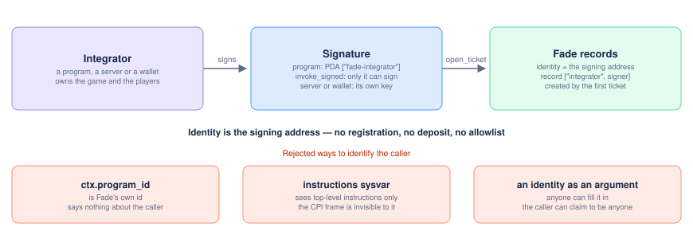

> [Fade](../README.md) · Technical. Domain document 07 of the [Technical Specification](README.md): owns per-instruction account validation, CPI authentication, arithmetic discipline, account lifecycle, token policy, the review of known Solana exploit patterns and the audit plan. Parameter values are the Technical Specification's §2 table, which wins wherever the two differ.

# Fade Spec 07 — Solana Implementation Security

Status: the security specification the V1 program, the shared beacon included (§1, built on 14 and 15 October 2026), is built and reviewed against. This is a checklist an implementer follows while writing the program and an auditor follows while reviewing it. Every item is phrased as "MUST / MUST NOT / SHOULD" plus the concrete attack it closes. Citations are inline; a consolidated reference list is at the end.

Scope reminder: Fade is a permissionless payout protocol. Any integrator — a program over CPI, or a server or wallet signing directly — can open tickets against a shared USDC vault. `request_randomness`, `record_ticket_entropy`, `settle_ticket`, `expire_ticket`, `refund_expired_ticket`, `sweep_ticket_vrf`, `strike_epoch` and every `claim_*` are callable by anyone; so, on the shared beacon, are `register_payout_table`, `sponsor_round`, `refund_round`, `request_round_draw`, `record_round_entropy`, `settle_round_tickets`, `expire_round`, `return_round_ticket`, `reclaim_sponsorship`, `claim_round_payout` and `claim_shares`, while `join_round` is signed by the integrator and the funder as `open_ticket` is. This asymmetry — permissionless callers on both the entry (`open_ticket`) and exit (`settle_ticket`) side, and around the vault, backed by a shared vault of real funds — is the entire risk surface of this program. The instruction set is the one of Technical Specification §5, invariant 8. Nearly every item below traces back to one sentence: **the caller controls 100% of the accounts they hand you; never let "the account has the right shape" substitute for "the account is the one instance you meant."**

---

## 1. Account validation

General rule, stated once so it isn't repeated 40 times below: every account whose *identity* (not just its type) matters for correctness MUST be pinned via one of `address = <known-good pubkey>`, `seeds = [...] , bump` (re-derived, never a client-supplied bump), or `has_one = <field on an already-trusted account>`. A bare `AccountInfo`/`UncheckedAccount` accepted "because the caller said so" is a hole. This is precisely the defect class that produced the Cashio and Wormhole losses (see §8) — both were "the program trusted an account's *claimed* identity instead of proving it."

### The integrator record — created by the integrator's first `open_ticket`

There is no registration instruction. The record an integrator's tickets are attributed to is created by its first `open_ticket`, keyed on the address that signed it.

| Account | Constraint | Attack if missing |
| --- | --- | --- |
| `integrator_authority` | `Signer`. A program integrator signs with its `["fade-integrator"]` PDA through `invoke_signed`; a server or wallet integrator signs with its own key. The signer's address is the integrator's identity (§2) | Any weaker notion of the caller — a claimed program id, an account it merely passes, the instructions sysvar — would let one caller open tickets under another's identity and spend its ceiling. |
| `integrator` PDA (`Integrator`) | `init_if_needed`, `seeds = [b"integrator", integrator_authority.key()]`, `bump` re-derived, never client-supplied. When the record exists, `open_ticket` touches only its counters: `reserved_liability`, the open-ticket count, `next_nonce` and `volume_total` | A re-initialisation under live tickets would reset `next_nonce`, reopening ticket addresses (§4), and the counters the ceiling is checked against, or overwrite the share destination. |
| `share_account` | a USDC token account: owned by the legacy SPL Token program, of `config.usdc_mint`, initialised and not frozen — checked in the handler rather than by type, so that it may be the `funder_usdc` account itself, as it is for a player acting as its own integrator; **not** required to be owned by the authority — an integrator may route its share anywhere. Stored at creation; on every later `open_ticket` it MUST equal the stored value | A caller-suppliable share destination at `open_ticket` would let anyone who can reach the call redirect the integrator's revenue. |
| `set_share_account(new)` | the only way to change the stored share destination: `integrator_authority` signs, and the new account meets the same constraints | Without it an integrator could never move its revenue; with a weaker check, anyone could. |
| — | **No squatting surface.** Nobody can create a record for an address they cannot sign for, so there is nothing to register first and nothing to claim afterwards | A register-by-program-id step would let an attacker register a well-known program first, with adversarial defaults. |
| — | **The record is never closed** | A closable record could be re-created with `next_nonce` reset, letting a new ticket reuse a closed ticket's address (§4). Its rent is a few thousandths of a SOL. |
| — | **Pause.** While the guardian's new-integrators pause flag (`Config::PAUSE_NEW_INTEGRATORS`) is set, an `open_ticket` that would create a record is refused; integrators that already have one are unaffected (Spec 05 §4) | — |

### `request_deposit(amount)` / `request_withdraw(shares)` — liquidity-provider side (Spec 01 §3, Spec 08 §4)

There is **no** direct deposit or withdrawal and **no per-depositor position account**: shares are a standard SPL mint, and every deposit or withdrawal is a request, priced at its epoch's strike and claimed afterwards by a keeper the request itself pays, so the owner makes one move.

| Account | Constraint | Attack if missing |
| --- | --- | --- |
| `owner` | `Signer` | Combined with the next rows — a signer alone is not enough. |
| owner's USDC account (`request_deposit`) | `token::mint = config.usdc_mint`, `token::authority = owner`, owning program = legacy SPL Token | **Mint substitution:** with only the authority checked, a worthless token the attacker mints is "deposited" and, at the strike, real shares are minted against it — a direct theft from every other LP. |
| owner's share account (`request_withdraw`) | `token::mint = share_mint`, `token::authority = owner` | Same substitution class on the way out. |
| claim destination | the owner's canonical associated token account for what the claim will pay — shares for a deposit, USDC for a withdrawal — created in this transaction if absent. At claim time it is pinned by address only: if it cannot receive — closed, frozen, or handed to another owner, which legacy SPL tokens allow — the claim still releases its records and pays its claimer, and parks what it owes on the request for a later claim to deliver — to that account, or, with the owner's signature, to another of the owner's accounts that can receive ([Spec 08](08-program-architecture.md) §2.4) | A keeper must never have to advance someone else's rent to claim, a destination chosen by the claimer would be theft, a record held open by its owner's account would strand the fund's advance, and funds tied to an account its owner lost would never come out. |
| `deposit_queue_usdc` / `share_escrow` | pinned by the seeds of Spec 08 §2, never positional | **The highest-value pin of the vault path.** A caller-supplied "vault" token account of the right mint would receive the transfer while the request records a deposit that never reached the vault: 100 % dilution of every LP at zero cost. |
| `queue` | `seeds = [b"queue"]`, `mut` | A second, attacker-created account of the same shape could be confused with the real one. |
| `vault` | `seeds = [b"vault"]`, `mut` — **present only when this request opens an epoch**, to roll the ticket counters (Spec 08 §4 rule 1) | Opening an epoch without rolling the counters would let its strike run while a ticket opened before its close is still open. |
| `request` (`DepositRequest` / `WithdrawRequest`) | `init_if_needed`, `seeds = [b"deposit"` or `b"withdraw", epoch_id, owner]`, where `epoch_id` is the epoch the request joins by Spec 08 §4 rule 2 — computed by the program, never an argument; a second request in the same epoch tops up the first | A caller-chosen epoch would let a request choose its price. |
| amount | at least 1 USDC deposited, or one whole share withdrawn, or the owner's whole share balance; while the share mint's supply is zero, a deposit of at least `min_first_deposit` | Dust requests that cost their claim more than they carry; the inception attack of Spec 01 §2.3. |
| fees | `CLAIM_FEE` lamports into the request account; `STRIKE_FEE` into `queue` while the strike fund is below `FUND_TARGET` (Spec 08 §6) | An unpaid claim is a second move for the owner; an unfunded strike is a strike nobody runs. |
| `instructions` sysvar | `address = sysvar::instructions::ID`; every **top-level** instruction of the transaction must be in the allowlist (compute budget, system, token, associated-token, Fade vault instructions) — invariant 13 | The same-transaction deposit → settle → withdraw bundle (§5). |
| pause flag | `request_deposit` refuses under the deposits pause flag (`Config::PAUSE_DEPOSITS`); `request_withdraw` is **never** gated (Spec 05 §4) | A pause that blocked withdrawal requests would be a lever to trap LP capital. |
| `system_program`, `token_program`, `associated_token_program` | pinned | A fake token program returns success without moving tokens. |

### `strike_epoch()` — permissionless, paid, clean (Spec 01 §3.5, Spec 08 §4)

| Account | Constraint | Attack if missing |
| --- | --- | --- |
| `caller` | `Signer`; receives `STRIKE_REWARD` from the strike fund | — |
| `queue` | `mut`; a live `current` epoch and `require!(now >= queue.current.close_ts)` | A strike before the close would price requests that can still arrive. |
| `vault` | `mut`; `require!(vault.open_before_close == 0)` — the clean-strike rule (Technical Specification §3.8, invariant 16) | A strike that ran while a fulfilled-but-unsettled ticket was open would price a known outcome into the epoch (Spec 01 §3.5). |
| `share_mint`, `share_claims`, `share_escrow`, `deposit_queue_usdc`, `vault_usdc`, `payable_usdc` | pinned by the seeds of Spec 08 §2; the mint's authority is the vault authority PDA | A substituted mint or token account would let the caller mint shares of the wrong token, or move USDC to the wrong holder. |
| `record` (`EpochRecord`) | `init`, `seeds = [b"epoch", queue.current.epoch_id]`, rent advanced by the strike fund; stores the price, the fill, the chain indices before and after, and the count of requests that will read it (Spec 08 §2.3, §5); **never mutated afterwards except that count** | Claims must read a price that cannot change between two claims of the same epoch (property 10). |
| clock | read through `Clock::get()`, no account the caller could substitute | — |
| compute | O(1): no loop over requests or tickets (invariant 16) — two token transfers, one mint, one burn, then the promotion of Spec 08 §4 rule 6 | A strike whose cost grew with the queue would stop working exactly when the vault succeeded. |

### `claim_deposit(request)` / `claim_withdraw(request)` / `claim_payout(ticket)` — permissionless, paid

| Account | Constraint | Attack if missing |
| --- | --- | --- |
| `request` | re-derived from its seeds, its epoch struck; the rent returns to `request.owner` while its `CLAIM_FEE` goes to the caller | A claim before the strike would be priced at nothing; rent to the caller would make claims a griefing income. |
| `record` / `entry_record`, `at_record` (`EpochRecord`) | `claim_deposit`: `record`, `seeds = [b"epoch", request.epoch_id]`. `claim_withdraw`: that record as the chain's entry (`entry_record`), and a later record of the same chain as its exit (Spec 08 §5) — the caller cannot pick a better epoch, and an exit outside the chain is refused | Price substitution. |
| destination | the owner's canonical associated token account for what is paid; `claim_payout`: `address = ticket.beneficiary` | A permissionless claim with a caller-suppliable destination is theft. |
| `share_claims` / `payable_usdc` / `payout_escrow` | pinned by seeds | — |
| record count | a final claim decrements the records it read; the one that reaches zero closes, its rent to the strike fund | A record that never closed would strand the fund's advance; one that closed early would strand a claim. |
| a frozen destination | `claim_payout` simply fails and can be retried once the beneficiary can receive; `claim_deposit` and `claim_withdraw` still release their records and pay their claimer, and park what they owe on the request ([Spec 08](08-program-architecture.md) §2.4). Nothing of the vault is held hostage, because the strike already moved the owed USDC to `payable_usdc` and the settlement already moved the payout to `payout_escrow` (§6) | — |
| grouping | several claims may share one transaction: claims are not subject to the request allowlist | Keepers would pay one transaction per claim. |

### `open_ticket(price, payout_table, app_share_bps, nonce)` — integrator-signed, over CPI or directly; the beneficiary is an account of the instruction

Fade's whole trust model for a ticket is established here, once: it never calls back into the integrator afterward (§2).

| Account | Constraint | Attack if missing |
| --- | --- | --- |
| `integrator_authority` | `Signer`, with an explicit `is_signer` check; its address keys `integrator` (see *The integrator record* above) | **This is the identity boundary — see §2.** Accepting anything short of the signature — a claimed program id, a PDA re-derived for a program the caller names — would let one caller open tickets under another integrator's identity and draw down its ceiling. |
| `integrator` | `seeds = [b"integrator", integrator_authority.key()]`, `bump`; created on the first call as above; `share_account` read from it; ceiling headroom (20 % of `total_assets`) checked with the new ticket included (Spec 04 §4.1); `volume_total += price` | An over-exposed integrator could keep opening tickets. |
| `ticket` (new) | `init`, `seeds = [b"ticket", integrator.key(), nonce.to_le_bytes()]`, `bump`; **nonce MUST equal **`integrator.next_nonce`, incremented atomically; stores the full payout table, `margin_bps`, `app_share_bps`, `price`, `vault_credit`, `reserved_liability`, the cap at open, `open_slot`, the `generation` and the open-ticket counter it joined (Spec 08 §4), `beneficiary`, `payer`, `status = Open` | Free-form nonces let opens collide and let an attacker pre-create a favourable address. |
| `vault` | `seeds = [b"vault"]`, `mut` — every admission check of Technical Specification §2 runs here, atomically: margin floor, payout table shape and EV in `u128`, price bounds, cap on the free balance, integrator ceiling, gross solvency, `κ`, both breakers; then `total_assets += vault_credit`, `open_vault_credits += vault_credit`, `total_reserved_liability += liability`, one of the two open-ticket counters (Spec 08 §4 rule 3), and the current hour of the share-price ring (Spec 08 §8) | A check deferred to a later `checked_sub` is the Loopscale bug (§8). |
| `funder_usdc` | a USDC token account, `token::mint = config.usdc_mint`, whose `token::authority` is a `Signer` of this instruction: the player's own account when the player signs — a top-level signer flag survives every CPI frame — or the integrator's own account when it pays with funds it holds for its players. Fade cannot tell the two apart and does not try | Without the owner's signature in this exact instruction, an integrator could spend anyone's funds. |
| price split, three pinned destinations | `protocol_share = price × 20 bps` → `protocol_treasury`, `address = config.protocol_treasury` (a USDC account of the protocol, changed only through the 72 h governance path, Spec 05 §3); `app_share = price × app_share_bps` → `address = integrator.share_account`; `vault_credit = price − both shares` → `address = vault_usdc`. Three `transfer_checked` CPIs, all from `funder_usdc` | A positional treasury or share account would redirect revenue; a positional vault would credit the vault for a deposit that never arrived. |
| `app_share_bps` (arg) | `≤ 500`; `margin ≥ 100 + 20 + app_share_bps` else `MarginFloor`; snapshotted on the ticket | An unbounded share, or one read from live config at settle, would let the split move after the player committed. |
| `beneficiary` (account → stored on `ticket`) | any legacy-SPL USDC token account, validated as one at open, stored and immutable; Fade verifies the odds, not that the beneficiary is the integrator's user (Technical Specification §7 item 4) — a conscious, documented trust decision | Left implicit, it would be a standing rug vector nobody had decided on. |
| `vrf_payer` PDA (`["vrf-payer", ticket]`) | `seeds`/`bump`, system-owned; prefunded by `payer` with twice the ORAO fee and the pending-request rent read from ORAO's `network_state` — the margin covers a rise of the fee before the request, and `request_randomness` parks what it does not need on the ticket, so the PDA never ends below its rent-exempt minimum (pinned `orao_program`, `network_state` address derived from it); plus `CRANK_FEE` (250 000 lamports) held on the ticket for the requester and the settler. `open_ticket`** makes no oracle call** (design B, Technical Specification §3.6) | If the VRF program were not pinned, a fake "VRF program" could later hand back fabricated entropy. |
| `payer` | `Signer` paying the SOL (the player or the integrator, whoever pays the transaction); recorded on the ticket as the account that receives every refund and the ticket's rent at close | Refunds to the settler's signer would make settling a way to collect other people's SOL. |
| `token_program`, `system_program` | pinned; the clock is read through `Clock::get()` | as above |

### `request_randomness(ticket)` — permissionless

| Account | Constraint | Attack if missing |
| --- | --- | --- |
| `caller` | `Signer`; receives 50 000 lamports of `CRANK_FEE` | — |
| `ticket` | `status == Open`; `open_slot + 2 ≤ current_slot ≤ open_slot + T_SETTLE`, or, after that window, `request` already owned by ORAO and fulfilled with a non-zero value (the late binding: nothing funded, `RequestWindow` otherwise) | A request in the same slot as the open would let the leader of that slot grind the seed (Technical Specification §3.6). Without the late binding, a fulfilled request someone created and withheld would leave only a forfeiture. |
| `slot_hashes` sysvar | `address = sysvar::slot_hashes::ID`; the ticket's recorded `s*`, `h*` and seed when `record_ticket_entropy` wrote them, whatever SlotHashes holds; otherwise `s*` = the smallest slot present that is greater than `open_slot` while SlotHashes still proves it (`first_after_retained`), `h*` its hash (`EntropyUnavailable` before, `EntropyUnrecorded` once it can no longer be proven); parsed with a bounded reader (the sysvar is ~20 KB) | A caller-supplied "slot hashes" account would be caller-chosen entropy. |
| `orao_program`, `network_state`, ORAO `treasury` | `address =` the deployed ORAO program id; `network_state` derived from it; `treasury` read from `network_state`, never from the caller | A fake oracle program returns fabricated fulfilment. |
| `request` | address derived by ORAO's own seeds from `seed = SHA256("FADE/ORAO-SEED/v1" ‖ program ‖ ticket ‖ open_slot ‖ s* ‖ h*)`; if ORAO already owns it (anyone may pre-create it through ORAO once the seed is public, with `request_v2` or with the deprecated `request`, which on mainnet still creates a legacy `Randomness` at the same address) it is accepted as either kind after the discriminator check and the prepaid fee stays on `vrf_payer`; lamports sent to the address without ORAO leave it system-owned, and the request goes through ORAO, whose account initialisation takes over a pre-funded address — so a stray transfer cannot block a request and force a forfeiture; the pubkey, `s*`, `h*` and the seed are **stored on the ticket**; `status → Requested` | A caller-chosen request account is caller-chosen randomness. |
| `vrf_payer` | signs the ORAO CPI through `invoke_signed`; pays the fee and the rent | — |

### `settle_ticket(ticket)` — permissionless, no deadline, always succeeds

See §5 for the threat enumeration.

| Account | Constraint | Attack if missing |
| --- | --- | --- |
| `caller` | `Signer`, no further trust — pays the tx fee, receives 200 000 lamports of `CRANK_FEE` | — |
| `ticket` | re-derived from its own stored seeds; **explicit **`status == Requested`** check** in addition to the discriminator, so double-settle is structurally impossible; the payout table, margin, share split and reserved liability are read from the ticket, never from live config (Spec 05 §3) | Any bug in the close path would become a double payout. |
| `randomness` | `address = ticket.randomness` — **never a fresh, caller-supplied account**; `owner == orao_program`; a `RandomnessV2` with the *Fulfilled* tag and its length, or a legacy `Randomness` (seed, then a 64-byte value that is zero until fulfilled); stored seed matches, `R ≠ 0` (invariant 15) | A caller who could supply *any* fulfilled account would pick the outcome — Cashio's account substitution applied to VRF results. |
| outcome | `SHA256("FADE/OUTCOME/v1" ‖ program ‖ ticket ‖ seed ‖ R ‖ i)` read as u128 words, rejection-sampled below `2^128 − (2^128 mod 1e9)`, outcome = first cumulative bound above `r` (invariant 6); no `SlotHashes` read | A modulo shortcut carries a 23.28 % bias. |
| `beneficiary` token account | `address = ticket.beneficiary` (stored at open, immutable) | **The most important constraint of this instruction:** with a re-suppliable destination, any third party settling a ticket would redirect the payout to itself. |
| `payout_escrow` | `seeds = [b"payout-escrow"]`, a USDC account owned by the `["vault-authority"]` PDA (Spec 08 §2) | Needed for the frozen-beneficiary path below. |
| the payout | if the beneficiary account is **not** frozen and has the right mint: `transfer_checked(vault_usdc → beneficiary, payout)`, the ticket closed to `payer`. If it **is** frozen (state read from the account before any CPI, since a failed CPI would abort the transaction): `transfer_checked(vault_usdc → payout_escrow, payout)`, `status → PayoutPending`, the ticket stays open with the amount recorded, claimable later by `claim_payout` (§6). In both branches the settlement books the outcome, `total_assets −= payout`, `total_reserved_liability −= liability`, `open_vault_credits −= vault_credit`, the epoch counter the ticket joined is decremented, and `vrf_payer`'s remaining lamports move onto the ticket, which carries them to `payer` at its close (`claim_payout`'s when parked); `payer` is credited directly, never through a CPI, so a payer turned into a program after the open cannot fail the settlement | A settlement that could fail would block every later strike (Technical Specification §3.8) and hold vault liquidity hostage to one frozen destination. |
| `vault`, `integrator` | `mut`; `integrator` pinned by `address = ticket.integrator` — release the integrator's reserved liability, decrement the open-ticket counter the ticket joined (Spec 08 §4 rule 4), update the share-price ring | Releasing the wrong integrator's counter. |
| `token_program` | pinned | — |

### `record_ticket_entropy(ticket)` — permissionless, unpaid, never paused

| Account | Constraint | Attack if missing |
| --- | --- | --- |
| `ticket` | stored seeds and bump; `status == Open` (`WrongTicketStatus`); already recorded: succeeds without writing or emitting | — |
| `slot_hashes` sysvar | pinned; `s*` proven by `first_after_retained(open_slot)` (`EntropyUnavailable` before it exists, `EntropyUnrecorded` once it can no longer be proven) | Without a record, whoever holds a fulfilled request at the seed could wait for SlotHashes to forget `s*` and choose between the refund and settling. |
| effects | `entropy_slot`, `entropy_hash` and `seed` written, nothing else; `TicketEntropyRecorded` | — |

### `expire_ticket(ticket)` — permissionless, only past `T_SETTLE`, only if unfulfilled

| Account | Constraint | Attack if missing |
| --- | --- | --- |
| `ticket` | `status ∈ {Open, Requested}`; `current_slot > open_slot + T_SETTLE`. `Requested`: `randomness` is the bound request, owned by ORAO, pending or fulfilled with zero (*Pending* tag checked as in `settle_ticket`; `AlreadyFulfilled` if fulfilled, `WrongRandomnessAccount` if it does not parse). `Open`: the seed recorded (`EntropyUnrecorded`), `randomness` the ORAO request address derived from it (`WrongRandomnessAccount`); owned by ORAO, it must parse and be pending or fulfilled with zero (`AlreadyFulfilled` if fulfilled: bind it late and settle) | An expiry racing a late fulfilment would let a losing draw be swapped for forfeiture, or a winning one be confiscated. Without the derived-address check on an Open ticket, whoever created its request through ORAO and read a win could withhold the bind and forfeit it (audit of 22 October 2026, F-2). |
| effects | forfeiture: nothing leaves the vault, `total_reserved_liability −= liability`, `open_vault_credits −= vault_credit` (the credit stays as vault assets), the open-ticket counter the ticket joined is decremented (Spec 08 §4 rule 4), `Vault.ticket_forfeits_withheld += 1` unless the ticket was never requested and nothing exists at the derived address, 200 000 lamports of `CRANK_FEE` to `caller`, `vrf_payer` drained onto the ticket, the ticket closed to `payer`; `TicketExpired` (version 2) with the findings and the counter's ordinal | Returning the price would be the free option of Technical Specification §3.2; the only refund is `refund_expired_ticket`'s, of the vault credit, when nobody recorded the seed in time. |

### `refund_expired_ticket(ticket)` — permissionless, paid the settler's share, never paused

| Account | Constraint | Attack if missing |
| --- | --- | --- |
| `ticket` | `status == Open`; `current_slot > open_slot + T_SETTLE` (`NotExpired`); its entropy neither recorded nor proven by SlotHashes (`EntropyStillProven` while it is: record and expire instead) | A refund while the request can still be checked would hand whoever holds it the option to choose the refund over a loss. |
| `beneficiary`, `payout_escrow`, `vault_usdc`, `vault_authority`, `usdc_mint` | as `settle_ticket`: the beneficiary stored at open, its state read before any CPI | A redirectable refund. |
| effects | the vault credit to the beneficiary, or to `payout_escrow` with `status → PayoutPending`, `payout` the credit and `outcome` `REFUND_OUTCOME` (255, an index no payout table holds, so that the parked refund is never read as a settlement parked on outcome 0) when it cannot receive; `total_assets` and `open_vault_credits −= vault_credit`, `total_reserved_liability −= liability`, the counter released, no after-close result and no ring observation (the settled assets do not move); `Vault.ticket_forfeits_withheld += 1`; the settler's share to `caller`, `vrf_payer` drained onto the ticket, the ticket closed to `payer` unless parked (then at the claim); `TicketExpired` with `refunded`, and `parked` when it waits in escrow | A forfeiture here would let whoever withheld a fulfilled winning request until SlotHashes forgot `s*` void it. |

### `sweep_ticket_vrf(nonce)` — permissionless, unpaid, never paused

| Account | Constraint | Attack if missing |
| --- | --- | --- |
| `integrator` | an `Integrator` at its seeds; `nonce < next_nonce` (`WrongNonce`) | Sweeping the `vrf_payer` of a ticket not opened yet would take what its open is about to prefund. |
| `ticket` | `["ticket", integrator, nonce]`; not owned by the program (`WrongTicketStatus`): while the ticket exists its exit drains `vrf_payer` onto it, for its payer | Sweeping a live ticket's prefund. |
| `vrf_payer` | `["vrf-payer", ticket]`, signed by the program; every lamport to `caller`; nothing to sweep succeeds without moving or emitting | — |

### The shared beacon (Spec 09, Spec 08 §13)

The beacon's thirteen instructions follow the general rule above without exception: every account is pinned by `seeds` with a stored bump, by `address` against a stored key, or by `has_one`, and only `settle_round_tickets` takes remaining accounts, in a fixed layout checked group by group against each ticket's stored keys. Every other beacon instruction rejects a non-empty `remaining_accounts` (`RemainingAccounts`). The full check order and every effect are Spec 08 §13.5; the rows below are the ones an auditor checks the code against, with the attack each closes. Built and tested on 14 and 15 October 2026; the state-machine test and the fuzz target of Spec 08 §13.8 run them together.

#### `register_payout_table(outcomes)` — anyone, once per payout table (Spec 08 §13.5.1)

| Account | Constraint | Attack if missing |
| --- | --- | --- |
| `outcomes` (arg) | `payout_table::validate`: count, probability range and sum, `M_CEILING`, the EV check in `u128` | A table stored unvalidated would be trusted by every join that names it. |
| `payout_table` | `["payout-table", hash(outcomes)]`, the hash computed by the program from the validated argument, never taken from the caller; created over pre-funded lamports, or, if Fade already owns it, its stored hash must equal the computed one (`WrongPayoutTable`) and nothing is written | A caller-chosen address or hash would let one table be stored under another's address, and a join would admit a ticket on outcomes it never checked. |
| `payer` | `Signer`; pays the rent, for good (the account is never closed) | — |

#### `join_round(price, app_share_bps, nonce, sponsorship)` — integrator- and funder-signed (Spec 08 §13.5.2)

| Account | Constraint | Attack if missing |
| --- | --- | --- |
| `integrator_authority`, `integrator` | as `open_ticket`: the signer is the identity (§2); `init_if_needed` at `["integrator", integrator_authority]`; `nonce == next_nonce`; a new record needs `share_account`, checked as a usable USDC account (`ShareAccountRequired`, `WrongMint`) | The same as `open_ticket`'s rows: anyone could act as any integrator, or pick a nonce. |
| `funder`, `funder_usdc` | `funder` a `Signer`; `token::mint = usdc_mint`, `token::authority = funder`; stored on the ticket as `refund_to` | A ticket price taken from an account its owner did not sign for; a refund sent anywhere but where the price came from. |
| `payer` | `Signer`; pays the ticket's rent, the prepay, the settlement share, the sponsorship and any rent this join creates; stored on the ticket as the account every lamport returns to | Lamports returned to whoever sends a later instruction would make returns and settlement a way to collect other people's SOL. |
| `config`, `vault`, `vault_usdc`, `usdc_mint` | seeds with stored bumps; `usdc_mint` `address = config.usdc_mint` | A substituted vault token account would receive the ticket price while the books record it in the vault. |
| `payout_table` | Fade-owned `PayoutTable` (Anchor owner and discriminator), its address re-derived from its stored hash (`WrongPayoutTable`); the split and the EV check against the live floor run on it | A table at an address that is not its hash's would let a stored record be swapped for another under the same key. |
| `beneficiary` | a legacy-SPL USDC account; stored, immutable | As `open_ticket`. |
| `ticket` | `init` at `["round-ticket", integrator, nonce]`, never `init_if_needed` | Reinitialising a live ticket would overwrite its payout and its keys. |
| `round`, `next_round` | `["round", n]` and `["round", n + 1]`; the accepting round and the round this join creates, if any, must each be one of the two (`WrongRound`); a created round is made by the program at the address it derives | A caller-chosen round would let a ticket join a closed, paid or other round, after its seed exists. |
| `sponsorship_record` | `["sponsorship", target round, payer]`, required when `sponsorship > 0`, created or topped up by the program (`ConstraintSeeds`, `AccountOwnedByWrongProgram`) | A sponsorship credited to a record its payer does not own would hand its return to someone else. |
| `orao_network_state` | ORAO's network state at its address derived from the pinned ORAO id, owner checked (`NetworkStateUnreadable`); its fee sets a created round's prefund, and the target round's draw must still fit it (`DrawUnderfunded`) | A fabricated fee would set a prefund the real request cannot pay, or admit tickets into a round that can only forfeit. |
| admission | `open_ticket`'s code, `instructions/admission.rs`: pause flags (`PAUSE_TICKETS`, `PAUSE_ROUNDS`), the drawdown ring, `risk::ticket_for` and `risk::admit` with the round's `min_price`; then the capacity rule of Spec 08 §13.4 (`RoundCapacity`) and the epoch counters (`RoundEpochClosed`), all before any transfer | A copy of admission would drift from the direct path's; a check after a transfer would leave a refused join with funds moved. |

#### `sponsor_round(lamports)` / `reclaim_sponsorship()` — anyone (Spec 08 §13.5.3, §13.5.10)

| Account | Constraint | Attack if missing |
| --- | --- | --- |
| `round` | `["round", round.id]` with its stored bump; sponsorship only while `Accepting`, or `Paid` and not requested (`RoundNotAccepting`); for an `Accepting` round, refused while `PAUSE_TICKETS` or `PAUSE_ROUNDS` is set; the draw must still fit the prefund (`DrawUnderfunded`) | Sponsoring a round whose draw can no longer be requested, or paying an unpaid round during a pause, would turn its tickets' full refund into a forfeiture. |
| `sponsorship` | `["sponsorship", round, sponsor]`: created or topped up by the program at that address on sponsorship; on reclaim, the stored bump, `has_one = sponsor`, `round == round.id` (`WrongRound`) | A record read at another address, or of another round, would pay one sponsor another's return. |
| `sponsor` | on reclaim, `has_one` against the record: the return and the record's lamports go to the stored sponsor, whoever sends the reclaim | Returns paid to the caller would make reclaiming a way to take other people's sponsorship. |
| `rent_payer` | optional; required, and equal to `round.rent_payer`, when the reclaim closes the round (`RentReceiverRequired`) | The round's rent and dust paid to anyone the caller names. |
| `vault`, `config`, `orao_network_state` | seeds with stored bumps; ORAO's network state at its derived address, owner checked | As `join_round`. |

#### `request_round_draw()` — anyone, paid the request share (Spec 08 §13.5.6)

| Account | Constraint | Attack if missing |
| --- | --- | --- |
| `round` | stored bump; `Paid` with a recorded side; `close_slot + 2 ≤ slot ≤ close_slot + t_settle_slots`, or after it only a request ORAO already owns and fulfilled non-zero (`RoundRequestWindow`) | A request in or before the close slot would let its leader grind the seed; a fresh request after the window would let a withheld draw be retried. |
| `slot_hashes` | `address = SlotHashes`; the round's recorded seed and `s*` take precedence over it whenever they exist (`record_round_entropy`, or an earlier request), whatever it holds; otherwise `s*` the first slot after `close_slot` it holds, while it still proves it (`EntropyUnavailable` before `s*` exists, `EntropyUnrecorded` once it no longer proves it) | A caller-supplied slot hash is a caller-chosen seed; a seed recomputed from SlotHashes after a recorded one would let the request address move, and a fulfilled request created through ORAO be left unbound. |
| `request` | ORAO's request PDA for the seed of Spec 08 §13.4, derived by the program (`WrongRandomnessAccount`); if ORAO already owns it, it must parse as a request and nothing is funded | A caller-chosen request account is a caller-chosen randomness. |
| `round_vrf` | `["round-vrf", round]` with the round's `vrf_bump`, system-owned; signs the ORAO CPI; stray lamports swept to the round first | A signer the round does not control would let anyone spend its prefund. |
| `orao_program`, `orao_network_state`, `orao_treasury` | `address = ORAO id`; the network state at its derived address; the treasury the one it names (`TreasuryMismatch`); `fee + rent + request_share ≤ draw_max` (`DrawUnderfunded`), the round's snapshot, never what it holds | A fake oracle returns fabricated randomness; a fee above the snapshot would charge tickets more than they prepaid (§13.4 fact 1). |

#### `record_round_entropy()` — anyone, unpaid, never paused (Spec 08 §13.5.6a)

| Account | Constraint | Attack if missing |
| --- | --- | --- |
| `round` | writable, `["round", round.id]` with its stored bump; a round already recorded (`entropy_slot ≠ 0`) is left untouched and the call succeeds, whatever its status; otherwise `Paid` (`WrongRoundStatus`) | Rewriting a recorded seed would move the round's ORAO request address, so a fulfilled request created through ORAO could be hidden from the late binding and from the expiry's check; recording an unpaid round would fix a seed before its close exists. |
| `slot_hashes` | `address = SlotHashes`; `s*` the first slot after `close_slot` it holds, read only while it proves it, the seed of Spec 08 §13.4 computed by the program (`EntropyUnavailable` before `close_slot + 2`, `EntropyUnrecorded` once SlotHashes no longer proves it) | A caller-supplied slot or hash is a caller-chosen seed, and with it a caller-chosen request address. |
| remaining accounts | none (`RemainingAccounts`); no signer, no lamport moves, nothing written but `seed` and `entropy_slot` | An instruction anyone may send unpaid must have nothing to redirect. |

The recorded seed is what the late `request_round_draw` and `expire_round` read for good: the request is bound at, and the expiry looks for a fulfilled request at, the recorded seed's address, whatever SlotHashes holds by then. A keeper records every round at `close_slot + 2`, with its request or alone when the request is refused.

#### `settle_round_tickets(count, wins)` — anyone, never paused, no deadline (Spec 08 §13.5.7)

| Account | Constraint | Attack if missing |
| --- | --- | --- |
| fixed accounts | `config`, `vault`, `round`, `round_vrf`, `payout_escrow`, `vault_usdc`, `vault_authority` by seeds with stored bumps; `randomness` `address = round.randomness`; `usdc_mint` `address = config.usdc_mint` | As `settle_ticket`: a substituted escrow, vault account or randomness redirects funds or outcomes. |
| `randomness` | at the first settlement only: owned by ORAO, a request of either layout, fulfilled, for `round.seed`, non-zero (`NotFulfilled`, `WrongRandomnessAccount`); its value kept in `round.drawn_randomness`, which every later batch uses | Settlement on a pending or foreign request; a round left unsettleable if ORAO later changes the account (§4). |
| remaining accounts | exactly `4 × count + popcount(wins)`, `1 ≤ count ≤ 32`, no bit of `wins` at or above `count` (`MalformedBatch`) | A layout the program does not fully parse would leave accounts it never checked. |
| each group | `ticket` writable, Fade-owned `RoundTicket` at `["round-ticket", integrator, nonce]` with its stored bump, of this round, `Joined`, named once in the batch; `integrator`, `payer`, `payout_table` equal its stored keys, the integrator and the table Fade-owned of their types; `beneficiary` present if and only if the ticket's bit is set and equal to `ticket.beneficiary`; ticket, integrator, payer and beneficiary writable; the computed payout at most `payout_max` and non-zero exactly when the bit is set (`MalformedBatch` for any mismatch). A closed ticket, or one an earlier batch parked, is skipped | **The highest-value checks of the beacon.** Any account accepted positionally would let a settler pay one ticket's payout to another's beneficiary, release another integrator's reservation or return a payer's lamports to itself. The fuzz target of Spec 08 §13.8 substitutes, removes, inserts and flips every account of the layout against an oracle written from §13.5.7. |
| `rent_payer` | optional; required, and equal to `round.rent_payer`, when the batch closes the round (`RentReceiverRequired`) | As `reclaim_sponsorship`. |

#### `refund_round()` (a participant) / `expire_round()` / `return_round_ticket()` (anyone) — never paused (Spec 08 §13.5.5, §13.5.8, §13.5.9)

| Account | Constraint | Attack if missing |
| --- | --- | --- |
| `round` (refund) | stored bump; `Accepting` and never recorded in the counters (`RoundPaid`, `WrongRoundStatus`); `slot ≥ max(first_slot, last_join_slot) + refund_slots` (`RefundWindow`) | A refund once paid would be the free option of Technical Specification §3.2, taken after the seed exists; counted from the first join, an outsider could empty every slow round at 600 s for one fee. |
| `participant` (refund) | owned by the program, a `RoundTicket` (discriminator) of the round whose `payer` or `funder` is the caller or whose `integrator` is `["integrator", caller]` (`NotRoundParticipant`); a `Sponsorship` never counts; not required when the round's draw no longer fits its prefund | Anyone could end a round they have no part in, for one fee; a one-lamport sponsorship, made and shown in the same transaction and reclaimed in full after, would be that. A round that can never be drawn refuses every join, so only its participants could end it, and their silence would refuse every beacon join: anyone may refund it. |
| `orao_network_state` (refund) | `["orao-vrf-network-configuration"]` under the pinned ORAO id (seeds), owner ORAO (`NetworkStateUnreadable`) | A fee read from any other account would let a caller call a healthy round doomed and refund it as an outsider. |
| `round`, `round_vrf`, `randomness`, `slot_hashes` (expiry) | stored bumps; `Paid` or `Requested`; `slot > close_slot + t_settle_slots` (`NotExpired`); if requested, `randomness` is the stored request, owned by ORAO, parsed, pending or fulfilled with zero (`AlreadyFulfilled` otherwise); if unrequested, the request address the program derives from the round's recorded seed whatever SlotHashes holds, or, never recorded, from SlotHashes while it still proves `s*`, refused if ORAO fulfilled it (`AlreadyFulfilled`); a round never requested, never recorded and no longer proven is not forfeited but refunded in full, as `refund_round` refunds, counted in `forfeits_withheld` (`RoundExpired.refunded`) | An expiry racing a fulfilment would let a losing round be forfeited at will, or a winning one confiscated; a forfeiture on a request someone created and read is a withheld draw that profits whoever withheld it; a forfeiture decided once the program can no longer look for that request would let whoever holds it fulfilled void every round its players won by waiting for SlotHashes to forget `s*`. |
| `ticket` (return) | `["round-ticket", integrator, nonce]` with its stored bump, `Joined` (`WrongTicketStatus`); `round` at `["round", ticket.round]` with its stored bump, `Refunded` or `Forfeited`; `integrator` `address = ticket.integrator` | A return on a live round would be a cancellation, which the beacon does not have. |
| `refund_to`, `payer` (return) | `address = ticket.refund_to` (`BeneficiaryMismatch`), `address = ticket.payer`; an unusable `refund_to` parks the price in `payout_escrow` | The ticket price or the lamports of a refunded ticket sent to the caller. |
| `rent_payer` | optional; required, and equal to `round.rent_payer`, when the return closes the round | As above. |

#### `sweep_round_vrf(round_id)` — anyone, unpaid, never paused (Spec 08 §13.5.8a)

| Account | Constraint | Attack if missing |
| --- | --- | --- |
| `vault` | `["vault"]` with its stored bump, read only; `1 ≤ round_id < next_round_id` (`WrongRound`) | Sweeping the `round_vrf` of a round not yet created would take what its request is to sweep into it. |
| `round` | `["round", round_id]` (seeds from the argument); read as a `Round` only while Fade owns it, its stored id `round_id` (`WrongRound`); `Requested` refused (`WrongRoundStatus`); any other owner is a closed round, never read | Another round's address would send one round's lamports to another, or to the caller of a round still open; reading an account Fade does not own as a round would let anyone forge its status. A sweep of a `Requested` round would move the `refund` its first settlement or expiry deducts from the draw cost, raising every ticket's charge for the rent payer's benefit. |
| `round_vrf` | `["round-vrf", round]`, system-owned, signed by the program; every lamport it holds moves, into `round` while Fade owns it, to `caller` once the round has closed | A caller-chosen destination for an open round would let anyone take what the round's close owes its rent payer. |
| remaining accounts | none (`RemainingAccounts`); nothing written but lamports; nothing to sweep succeeds without moving or emitting anything | An instruction anyone may send must have nothing to redirect, and must not fail the round-ending work it is packed with. |

What a sweep can never change: no outcome, charge, settlement, return, reclaim or close reads `round_vrf` outside `Requested` (an `Accepting` or `Paid` round's request sweeps it into the round anyway), so the sweep moves nothing anyone is owed by the books; and a `round_vrf` left empty still receives ORAO's later refund, which only credits it.

#### `claim_round_payout()` / `claim_shares()` — anyone, never paused (Spec 08 §13.5.11, §13.5.12)

| Account | Constraint | Attack if missing |
| --- | --- | --- |
| `ticket` | stored seeds and bump; `PayoutParked` or `ReturnParked` (`WrongTicketStatus`) | A claim on a ticket never parked would pay twice. |
| `destination` (payout) | `ticket.beneficiary` for a parked payout, `ticket.refund_to` for a parked return (`BeneficiaryMismatch`); `payer` `address = ticket.payer` | As `claim_payout`: a re-suppliable destination. |
| `integrator` (shares) | optional; at `["integrator", integrator.authority]` with its stored bump | Claiming one integrator's app shares through another's record. |
| `destination` (shares) | `config.protocol_treasury` without an integrator (`TreasuryMismatch`), `integrator.share_account` with one (`ShareAccountMismatch`); usable, and never `vault_usdc` itself (`DestinationUnusable`); the amount non-zero (`NothingToClaim`) | Shares paid anywhere but to their owner; a transfer from `vault_usdc` to itself that zeroes the ledger without moving a token. |

#### Devnet only: `migrate_config()` (Spec 08 §13.5.13)

Compiled only with the `devnet` feature, like `no-timelock`, so a mainnet build cannot carry it. `authority` must be the upgrade authority recorded in the program's `ProgramData`, itself the one `fade_program` names (`NotUpgradeAuthority`); `config` is `["config"]` owned by Fade and is rewritten only from its version 1 layout, 695 bytes, to 791, with the six beacon parameters it takes as arguments (`beacon_min_price`, `beacon_threshold`, `round_k`, `tick_slots`, `refund_slots`, `crank_round_settle_lamports`) appended to both `RiskParams` and validated (`RiskParams::is_valid`, `InvalidParams`), `PAUSE_ROUNDS` added to the pause flags and every other byte kept; `vault` is `["vault"]` with its stored bump, writable: the migration sets `next_round_id = 1` when it reads 0. A migration callable by anyone else would let any signer rewrite the parameters.

### Admin: `set_pause_flags` / `set_params` / `apply_params` / `cancel_params` / `set_share_metadata` / upgrade

- `config.council` and `config.guardian` MUST each be a multisig vault PDA (Squads v4 or equivalent), never a single hot key, for anything that changes parameters or funds flow — see [Squads' own guidance on multisig program-upgrade management](https://squads.xyz/blog/solana-multisig-program-upgrades-management) and their [advanced security best practices](https://docs.squads.so/main/additional-resources/advanced-security-best-practices) on time-locks.
- A risk-tiered split: the 2-of-3 guardian may only set pause flags through `set_pause_flags` (safety needs speed); the 4-of-7 council alone lifts them, and alone calls `set_params`, `cancel_params` and `set_share_metadata` (the share mint's name, symbol and logo in Metaplex Token Metadata, signed by the vault authority PDA, which is the metadata's update authority). A loosening change waits its class delay as `Config`'s single pending change, and `apply_params` is permissionless once `effective_at` has passed and checks the pending parameters again (Spec 05 §3, Spec 08 §7): the delays are enforced by the program, not by the multisig's interface. κ has a program floor of 0.8 and every change to it waits 24 hours, so that no parameter change can hold back LP exits beyond 1.25 times the reserved liability without notice. A change applied at once writes the parameters and the treasury together, as `apply_params` does. The BPF **upgrade authority** is a separate on-chain field from the in-program `config.council` — both must independently point at the council's multisig.
- Every admin instruction re-derives/checks the multisig's *current* signer set from on-chain state at call time — never cache a "who's an admin" list in a way that survives a multisig membership change without being re-read.

---

## 2. CPI safety in both directions

### How Fade identifies the calling integrator

**The naive approaches, and why each fails:**

1. *"Check *`ctx.program_id`* inside the handler."* This is always Fade's own program id — Solana does not expose "the program that called me" as a field the callee can simply read off `Context`. There is no built-in `msg.sender`.
2. *"Use the Instructions sysvar to look up which program invoked me."* The sysvar (`Sysvar1nstructions1111111111111111111111111`) exposes **top-level transaction instructions only** — inner CPI frames are not enumerable through it ([Solana docs: Instruction Introspection](https://solana.com/docs/core/instructions/instruction-introspection); [RareSkills: Solana Instruction Introspection](https://rareskills.io/post/solana-instruction-introspection)). Since the integrator's CPI into Fade is by definition an *inner* instruction, there is no sysvar-based way to see "which program's CPI frame is currently invoking me" one level up. A malicious wrapper could top-level-call something innocuous while nesting the real, differently-attributed call several CPI frames deep — invisible to this approach. This is exactly the class of bug the Wormhole exploit weaponized: trusting sysvar-adjacent introspection without checking the *account's own identity* first (§8).
3. *"Have the integrator pass its program id as a plain instruction argument."* Free — the caller can claim to be anyone.

**The pattern that works, and why:** make the integrator *sign*, and make its identity the address that signed. A key signs as itself. A program signs through a **PDA it derives under its own program id**: the runtime's `invoke_signed` lets a program produce a signer flag only for PDAs derived from the program currently executing, so no other program, ever, can sign as that address ([Anchor PDA docs](https://www.anchor-lang.com/docs/basics/pda)). Fade therefore needs no cross-program derivation check: `open_ticket` requires `integrator_authority` to be a signer and keys the integrator's record on that address, so acting as an integrator takes that integrator's own signature and nothing less. Whoever wants to know which program stands behind a record re-derives `["fade-integrator"]` under the program id, off-chain, and compares addresses. Concretely:

- `open_ticket`'s `integrator_authority` MUST carry an explicit `is_signer` check (Anchor's `seeds`/`bump` constraints do not by themselves assert the signer bit on every account type — verify this for whichever account type is used, at implementation time, against the pinned Anchor version).
- The record's address is a function of the authority and nothing else, and no field of the record can change which authority it answers to — the entire identity scheme depends on this.

The three rejected approaches and the one that works, side by side:

**Caveat to record explicitly, not discover in an incident:** this scheme authenticates *whoever can produce the signature* — for a program integrator, whatever code currently lives at its program id; for a key, whoever holds it. If an integrator's upgrade authority or signing key is compromised, Fade's trust in that integrator transfers to the intruder, and Fade cannot detect this from inside its own instructions (Technical Specification §7 item 5). Integrators are asked to make their program immutable or put its upgrade authority behind a reviewed multisig and time-lock, and to keep server keys in an HSM or equivalent; an intruder is bounded by the caps and the 20 % ceiling, and can spend only funds it controls.

**Where instruction-sysvar introspection *****is***** the right tool:** not for caller identity, but for scanning **sibling top-level instructions** in the current transaction for forbidden compositions — e.g., the allowlist that `request_deposit` and `request_withdraw` apply to every top-level instruction of their own transaction, which is what forbids a `settle_ticket` from riding along (§5, invariant 13). That is a different question ("what else is in this transaction") than "who is really invoking me right now," and the sysvar answers the first question correctly while being useless for the second.

### Consequences of Fade never calling back into the integrator (V1 decision)

- **Positive:** removes an entire reentrancy class outright — Fade never CPIs into arbitrary integrator code mid-settlement, so there is no path for integrator code to reenter Fade's own instruction, manipulate vault state, or observe/react to partial state during settlement. This shrinks the audit surface dramatically: Fade needs zero ongoing trust in an integrator's *code correctness*, only in what it supplied once, at `open_ticket` (payout table, price, beneficiary, nonce) — validate that input exhaustively at that single checkpoint (§3), because it is the only checkpoint.
- **Negative / must design around:** integrators get no on-chain hook to react atomically to settlement (custom bonus logic, XP, event emission into their own state) — any such integration is necessarily eventual-consistency, driven by the integrator indexing Fade's settlement logs/events off-chain or polling `ticket` account state after the fact. Document this constraint for integrator-facing docs so nobody designs an atomic-composability feature that this architecture cannot support.
- Because there is no later correction path once `open_ticket` completes (no callback, no "are you sure" round-trip), the payout table/price/beneficiary validation at `open_ticket` is the *only* checkpoint — treat any validation gap there as unrecoverable until an explicit admin/cancel path, not "will get caught downstream."

---

## 3. Arithmetic

Blanket discipline (apply to every line touching money, shares, or liability, no exceptions):

- `overflow-checks = true`** MUST be explicit and verified in the program's **`Cargo.toml`** release profile.** Anchor's workspace template sets this by default, but plain Rust release builds default to `false`; a silently-disabled overflow check turns every arithmetic bug into a silent wraparound exploit instead of a caught panic. Treat this as a build-config checklist item to verify at every CI run, not just at project setup.
- Every add/sub/mul/div on a balance, share count, or liability figure uses `checked_*` (never bare operators, never `saturating_*` for money — saturating semantics are only correct for things like display counters).
- Any multiply-then-divide sequence widens to `u128` for the intermediate product *before* dividing (`(a as u128) * (b as u128) / (c as u128)`, never `(a / c) * b`) to avoid both overflow and unnecessary precision loss.
- `f32`/`f64` MUST NOT appear anywhere in on-chain code — a grep for `f32|f64` across the program crate should return zero hits. All USDC math is integer, base-unit (6-decimal), fixed-point.

**Share math (deposit/withdraw):**

- Shares use the virtual-share formula of Spec 01 §2.1 — `shares_out = floor(assets × (total_shares + 10^3) / (total_assets + 1))` — so the empty-vault case needs no special branch and cannot divide by zero, and the first deposit must be at least 100 USDC (Spec 01 §2.3). Never mint 1:1 on an empty vault: that is the first-depositor inflation attack.
- Round **down** on both directions — fewer shares minted on deposit, fewer assets paid on withdraw — consistently in favor of the vault. This is the standard vault-math defense against the "repeated tiny deposit/withdraw to farm rounding" drain and mirrors OpenZeppelin's ERC-4626 guidance ([OpenZeppelin: defending ERC4626 inflation attacks](https://www.openzeppelin.com/news/a-novel-defense-against-erc4626-inflation-attacks)).
- `total_assets` is an **internal ledger field**, updated only by `strike_epoch` (the epoch's deposits and withdrawals), `open_ticket` (`+ vault_credit`) and `settle_ticket` (`− payout`), never derived by reading the vault token account's live SPL balance. (Full rationale in §6 — this is the fix for the donation/inflation attack class.) The ledger identities `vault_usdc.amount ≥ total_assets`, `deposit_queue_usdc.amount ≥` the queued deposits and `payable_usdc.amount ≥` what struck withdrawals still owe are reconciliation checks, never the source.

**Liability/reservation accounting:**

- `reserved_liability = checked_sub(payout_max, vault_credit)` with `payout_max = checked_mul(price, max(m_i)) / 10_000` in `u128` and `vault_credit = price − protocol_share − app_share` (Technical Specification §3.5) — bounded at `open_ticket` by `M_CEILING` and `max_price`, so the product cannot approach `u64::MAX`.
- Gross solvency `total_reserved_liability + open_vault_credits ≤ total_assets` and `total_reserved_liability ≤ 0.8 × total_assets` MUST be checked and enforced **atomically inside **`open_ticket` (`require!` that hard-aborts on insufficient headroom) — never rely on a later `checked_sub` failing at the strike as the only backstop; that is a Loopscale-shaped bug (§8), not a defense.
- `free_balance = checked_sub(checked_sub(total_assets, total_reserved_liability), open_vault_credits)` — a bare subtraction here that wraps on underflow would silently bypass every cap; this line deserves its own unit test with the reservations deliberately pushed above `total_assets` to confirm it errors rather than wraps.
- The per-ticket cap is `min(0.5 × vault_margin × free_balance / 10_000, 150 × total_assets / 10_000)` and the integrator ceiling `20 % × total_assets`, both in `u128`, both compared against liability *including* the new ticket (Spec 04 §2.4); the epoch counters of Spec 01 §3.5 are `u32` with `checked_add`/`checked_sub`.

**Payout table check:**

- Payout table validated at `open_ticket`, in `u128`: 1 to 32 outcomes, `Σ p_i == 1e9` exactly, no `p_i == 0`, every multiplier ≤ 10 000×, and `Σ p_i·m_i ≤ (10 000 − margin)·1e9` (Technical Specification §2) — reject malformed payout tables at the only checkpoint that exists (§2).
- Outcome selection reads 128-bit words from `SHA256("FADE/OUTCOME/v1" ‖ program ‖ ticket ‖ seed ‖ R ‖ i)`, rejection-samples them below `2^128 − (2^128 mod 1e9)`, then walks the cumulative probabilities (Technical Specification §3.6, invariant 6). No `% N` shortcut on a raw oracle value.
- Modulo bias is **not** accepted. Selection is over the 1e9 probability scale, not over the outcome count: a 32-bit word reduced modulo 1e9 carries a 23.28 % bias, which is a defect, not a rounding nicety (invariant 6, Spec 03 §4). Rejection sampling makes the draw exactly uniform.

**Fee/rake calculations (if any):** same `u128`-widened, `checked_*`, consistently-rounded-toward-the-vault treatment as share math — no separate rules.

---

## 4. Rent, account lifecycle, and closing

| Account | Created | Closed | Rent paid by | Rent reclaimed by |
| --- | --- | --- | --- | --- |
| global `config` | once, at `initialize` (upgrade authority only) | never in V1 | deployer/admin | n/a |
| `vault`, `queue`, `vault_usdc`, `deposit_queue_usdc`, `payable_usdc`, `share_mint`, `share_escrow`, `share_claims`, `payout_escrow` | once, at `initialize`, which also seeds the strike fund to `FUND_TARGET` | never in V1 (no `close_vault` instruction exists — state explicitly, don't leave it implicit) | deployer/admin | n/a |
| `integrator` (`Integrator`) | the integrator's first `open_ticket` | never: a closable record would let `next_nonce` restart and a new ticket reuse a closed ticket's address (below) | that call's `payer` | n/a |
| `DepositRequest` / `WithdrawRequest` | `request_deposit` / `request_withdraw` | its final claim, by anyone once its epoch is struck — the rent to the owner, the `CLAIM_FEE` to the claimer | the owner | the owner, and only the owner |
| `EpochRecord` | `strike_epoch` | by the claim that brings its count of pending readers to zero (Spec 08 §5), or by the strike itself when no claim will ever read it | the strike fund, as an advance — the striker, when the fund is dry | whoever advanced it, named in the record |
| `ticket` | `open_ticket` | `settle_ticket`, `expire_ticket` or `refund_expired_ticket`; in the frozen-beneficiary case it stays open as `PayoutPending` and is closed by `claim_payout` | `payer`, recorded on the ticket at open | `payer` — **read from the ticket, never sent to the tx signer** |
| `vrf_payer` (system PDA) | `open_ticket`, prefunded with twice the ORAO fee and the request rent | drained onto the ticket at `settle_ticket`, `expire_ticket` or `refund_expired_ticket`, and to `payer` with the ticket's close; if the ticket expires before any request, the whole prefund goes back; ORAO's rent refund at fulfilment lands here first. What reaches it after the ticket's close (the refund of a request fulfilled after `expire_ticket` forfeited the ticket, or any transfer) is moved by `sweep_ticket_vrf(nonce)`, permissionless, to its caller, since nothing on-chain names the payer any more | `payer` | `payer`, or the sweeper once the ticket is closed |
| ORAO `request` account | `request_randomness` (or pre-created by anyone at the derived address) | **never**: ORAO has no close instruction, 1 346 200 lamports stay locked (Technical Specification §2) | `vrf_payer` | n/a — the locked rent is part of the per-ticket overhead |
| `PayoutTable` (beacon) | `register_payout_table`, once per payout table, at the address of its hash | never: immutable, and every ticket that names it reads it at settlement | the registering payer, 492 072 lamports for a 32-outcome table at SIMD-0437's last step | n/a |
| `Round` (beacon) | the `join_round` that finds no round accepting tickets | by the instruction that leaves it `Drawn`, `Refunded` or `Forfeited` with no ticket and no sponsorship left: a settlement batch, a return or a reclaim, which must then name `round.rent_payer` (`RentReceiverRequired`) | the payer of the join that creates it, 375 144 lamports at the last step | `round.rent_payer`, read from the round, with the round's rounding dust |
| `round_vrf` (system PDA, beacon) | holds lamports from `request_round_draw` to the first settlement or `expire_round` | drained to the round by the first settlement or the expiry; what reaches it after either (sent by anyone, or ORAO's rent refund for a request fulfilled after its round was forfeited) by `sweep_round_vrf`, refused while the round is `Requested` (Spec 08 §13.5.8a) | `Round`, exactly what ORAO takes | the round, then its tickets' payers and sponsors; after a drain, the round's rent payer through its close, or the sweep's caller once the round has closed |
| `RoundTicket` (beacon) | `join_round`, `init` at `["round-ticket", integrator, nonce]` | its settlement or its return; when the payout or the return is parked, by `claim_round_payout` | `payer`, recorded on the ticket | `payer`, read from the ticket, with the prepay's return, and the settlement share too after a refund |
| `Sponsorship` (beacon) | the first `sponsor_round`, or `join_round` carrying a sponsorship, of a sponsor on a round | `reclaim_sponsorship`, by anyone once the round is drawn, refunded or forfeited | the sponsor | the stored `sponsor`, with its return |
| ORAO `request` account of a round | `request_round_draw` (or pre-created by anyone at the derived address) | never, as on the direct path: its 184 440 lamports at the last step are part of the draw cost the round's tickets share | `round_vrf` | n/a |

### Specific attacks and the rule that closes each

- **Closing a ticket before settlement.** There MUST NOT be any generic "close this ticket" path reachable before a `Settled`, `Expired` or `PayoutPending → claimed` state. The timeout paths for a VRF request that never fulfills are two **separate, narrowly-scoped instructions**, both permissionless only after `T_SETTLE` (150 slots) with no fulfilled request, both releasing the reservation: `expire_ticket` forfeits the escrowed credit to the vault — never to whoever calls it; and `refund_expired_ticket`, only for an Open ticket never requested whose seed was never recorded and whose `s*` SlotHashes no longer proves (so no draw can be derived for it), returns the vault credit to the ticket's beneficiary, or parks it in `payout_escrow` as `PayoutPending` with `REFUND_OUTCOME` when the beneficiary cannot receive it, and counts it in `Vault.ticket_forfeits_withheld`. Neither pays the credit to whoever calls it, and the refund returns the vault credit alone (the protocol and app shares paid at open stay paid). A generic "close" reachable by the integrator at any time would let it walk back a reservation — or worse, redirect the escrowed ticket price — before the player ever sees a resolved outcome. And `settle_ticket` has **no deadline**: a fulfilled ticket can be settled at any later time, and `expire_ticket` refuses it (Spec 02 §2.1).
- **Reviving a closed account.** Anchor's `close = target` constraint writes the `CLOSED_ACCOUNT_DISCRIMINATOR` sentinel, zeroes the remaining data, and transfers lamports to `target`, all inside the closing instruction — but the account isn't purged from the ledger until the runtime GC step at end-of-transaction, so a same-transaction or well-timed re-funding can keep it alive and attempt a "revival" ([Solana docs: Closing Accounts](https://github.com/solana-foundation/solana-com/blob/main/apps/web/content/courses/program-security/closing-accounts.mdx); [FuzzingLabs: Revival Attacks on Solana Programs](https://fuzzinglabs.com/revival-attacks-solana-programs/)). Rules: (a) always use Anchor's `close =` macro constraint, never a hand-rolled lamport-drain that forgets the discriminator sentinel; (b) **never** use `init_if_needed` on the `ticket` PDA — its address is nonce-scoped and one-shot by design, so any attempt to reinitialize it should be a hard error, not a silent overwrite; (c) Anchor's own `Account<'info, T>` deserialization already rejects the closed sentinel on read — don't bypass that by deserializing manually anywhere on the ticket's lifecycle.
- **Reusing a nonce/PDA after close.** Once a `ticket` PDA is closed (zero lamports), the address is legitimately available for reuse by a future `init` — that's fine *if and only if* nonces are monotonic and program-assigned (§1: `integrator.next_nonce`, never integrator-chosen). If nonces were free-form, an integrator could deliberately reuse a value, and any stale off-chain or on-chain reference that assumed "this address always means ticket #7" would silently associate itself with a different ticket after reinit — a data-confusion bug, not a memory-safety one, but a real one for indexers and any future feature that stores a `ticket` pubkey long-term.
- **The randomness account being closed before **`settle_ticket`** reads it.** It cannot be: the request account is owned by the ORAO program, which has no close instruction, so its rent stays locked and the account persists (Technical Specification §2). `settle_ticket` consumes it exactly once, in the same instruction that closes the ticket, so no window exists in which settlement depends on an account someone else could remove. The `expire_ticket` path, or `refund_expired_ticket` once the seed is lost, is the backstop for "the randomness never arrives", whatever the cause. The beacon cannot rely on that argument: a round is settled over several batches, possibly days apart, and once its first settlement makes it `Drawn` nothing else can end it (`expire_round` refuses a fulfilled round). Were every batch to read the request account, an ORAO upgrade that moved the fulfilled layout, changed the owner or added a close would leave the round's remaining tickets unsettleable for good, their reservations and the epoch counter, and so a strike, with them. The first `settle_round_tickets` therefore reads the request once and keeps `R` on the round (`Round.drawn_randomness`, Spec 08 §13.2.2); every later batch reads it there and checks the request account by address only. The residual dependency is the window between fulfilment and the first settlement, the same as the direct path's, and `expire_round` remains the backstop while the round is still `Requested` and its request pending or fulfilled with zero. Like `expire_ticket`, it refuses a request account it cannot parse as ORAO's: forfeiting a round on a request whose value can still be read off-chain would let anyone forfeit only the rounds the vault would lose, so a round caught by such an ORAO change waits for an upgrade of the program rather than being forfeited.
- **The beacon's accounts close only at a round's end.** A `RoundTicket` closes at its settlement or return, never before its round is drawn, refunded or forfeited: there is no cancellation (Spec 08 §13.5.4), so no path lets a joined ticket leave with its price, prepay or shares. A `Round` closes only in the instruction that ends its last ticket or sponsorship, and its rent goes to the stored `rent_payer`. Every account the program creates by hand rather than through Anchor's `init` (`Round`, `Sponsorship`, `PayoutTable`) is created over a pre-funded system account at its derived address, as `init` does, and refused at any other owner.
- Every `init`'d account uses `#[account(space = 8 + Struct::INIT_SPACE)]` via Anchor's `InitSpace` derive, not a hand-computed constant — a stale hand-computed size after a field is added is an invisible-at-compile-time, only-fails-at-runtime bug.
- Every permissionless liveness call is paid from a **flat** fee prepaid by the party that created the work, never from the vault and never proportionally to the payout: `CRANK_FEE` (250 000 lamports at `open_ticket`: 50 000 to the randomness requester, 200 000 to the settler or expirer) and, on the liquidity-provider side, `CLAIM_FEE` (200 000 lamports per request, to whoever claims it) and `STRIKE_REWARD` (200 000 lamports per strike, from a strike fund that requests refill through `STRIKE_FEE`, Spec 08 §6). A proportional bounty would turn "who settles first" into a race worth manipulating; a fee from the vault would make LPs pay for liveness.

---

## 5. The permissionless `settle_ticket` instruction

The caller supplies the whole account list, so the defense is to pin everything: `randomness`, `beneficiary`, `vault_usdc`, `payout_escrow` and `integrator` are read from the ticket's and the vault's own state (§1), never accepted positionally. The remaining lever is timing: an outcome is public the moment ORAO fulfils it, and a searcher could bundle a deposit, the settlement and a withdrawal to capture a known win with no prior exposure. Epoch-batched forward pricing with the clean strike (Technical Specification §3.8) is the primary defense; the instruction-sysvar allowlist on `request_deposit` and `request_withdraw` (invariant 13) is the secondary one; neither suffices alone, because a leader can still sequence several transactions from one party inside a block. Compute starvation and front-running only fail the caller's own transaction. The full enumeration is [§5 of the appendix](07-solana-implementation-security-appendix.md).

---

## 6. Token handling

Four rules. `total_assets` is a ledger field, never the vault's live SPL balance, so a donation is inert (the ERC-4626 inflation class). V1 accepts one mint, canonical Circle USDC under the legacy SPL Token program, and rejects Token-2022 at the owner check: transfer fees, transfer hooks and confidential amounts each break exact accounting. A frozen beneficiary never blocks settlement: `settle_ticket` inspects the account before any CPI and routes the payout to `payout_escrow` as `PayoutPending`, released by the permissionless `claim_payout` (Technical Specification §3.8). A freeze of `vault_usdc` itself halts every payout and withdrawal until lifted: accepted counterparty risk, disclosed in the Technical Specification §7. Rationale and sources: [§6 of the appendix](07-solana-implementation-security-appendix.md).

---

## 7. Denial of service and compute

The payout table is a compile-time-bounded array (`MAX_OUTCOMES = 32`), so every loop that reads it is bounded at the point it is written; a non-empty `remaining_accounts` is rejected, except by `settle_round_tickets`, whose groups are bounded by `MAX_ROUND_BATCH = 32` and checked one by one against each ticket's stored keys (§1); `strike_epoch` is O(1) whatever the queue (invariant 16). `settle_ticket` and `open_ticket` are the heaviest instructions of the direct path, a settlement batch of up to 32 tickets the heaviest of the beacon (about 350 000 units, Spec 08 §13.5.7), and all are profiled with LiteSVM's compute-unit reporting against a documented budget rather than the default. Details: [§7 of the appendix](07-solana-implementation-security-appendix.md).

---

## 8. Known Solana exploit patterns — is Fade exposed, and what specifically prevents it

The review — Cashio, Wormhole, Loopscale, marginfi and the other incidents the rules above are mapped to, each with its root cause, whether Fade is exposed to the same class, and what specifically prevents it — is on [the appendix](07-solana-implementation-security-appendix.md). The references to §8 throughout this page point there.

---

## 9. Audit and testing plan

The plan — the stateful property tests and fuzz targets with the invariants they assert after every step, the deterministic LiteSVM suite, and where external audit budget is worth spending — is on [the appendix](07-solana-implementation-security-appendix.md), under §9. The shared beacon's own tests, its state-machine test over a reference model, the fuzz target on the settlement layout and the invariants they check after every step, are Spec 08 §13.8; one audit covers both paths.

---

## References

The sources cited in this document are listed in [the appendix](07-solana-implementation-security-appendix.md).
