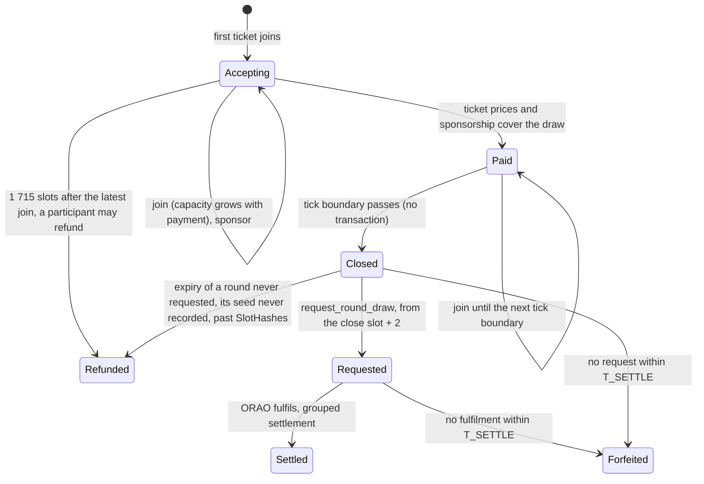

> [Fade](../README.md) · Technical. Domain document 09 of the [Technical Specification](README.md): owns the shared beacon, one ORAO draw settling every ticket of a round. Parameter values are the Technical Specification's §2 table (Shared beacon), which wins wherever the two differ.

# Fade Spec 09 — Shared Beacon

Status: design decided on 4 October 2026 and revised the same day after an adversarial review and its counter-review, for team review. It turns the pre-mortem of [Spec 02 §8](02-randomness-and-settlement.md#8-shared-beacon-pre-mortem) into a design. **The beacon is in the launch scope**: one audit covers it and the direct path together. [Spec 08 §13](08-program-architecture.md#13-shared-beacon-accounts-and-instructions) specifies its accounts and instructions, and records in its §13.10 the thirteen points this document left ambiguous, decided on 7 October 2026. Two of them change this design: **no cancellation** (a ticket that has joined stays until its round's end, §6), and **capacity measured per ticket against its own cap** (§7). The draw prefund is corrected (§5). **Implemented** (7 to 15 October 2026): the arithmetic, `fade_math::beacon`; every account and instruction of Spec 08 §13 in the program; the state-machine test and the fuzz target of Spec 08 §13.8; the client (`clients/js/src/beacon`), which builds every beacon transaction as a version 1 transaction without any address lookup table, or plain v0 without one where v1 is not accepted; the keeper's loop and an app demo, both behind configuration; all of it run against the real ORAO on devnet; the live devnet deployment carries it since 18 October 2026, one program with the direct path, its rounds paused (`PAUSE_ROUNDS`). The adversarial review followed on 17 October 2026; the independent audit is ahead. How an integrator uses it is [Beacon Integration](../product/beacon-integration.md).

Every figure below is computed with rent as SIMD-0437 leaves it once fully active (696 lamports per byte of the account and its 128-byte overhead, a tenth of the 6 960 before SIMD-0437; 5 080 today, after its second step), SOL at 120 USD and 350 ms slots.

## 0. Summary

- **One draw per round.** Small tickets join a round; one ORAO request serves it, and each ticket settles on its own outcome derived from the draw and its identifier. Outcomes stay independent.
- **Rounds exist only when there are tickets.** The first ticket opens a round. No ticket, no round, no draw, no cost.
- **Admitted on entry, closed without a transaction.** A ticket is checked against every cap and its liability reserved the moment it joins. A round whose draw is paid closes by itself at the next tick boundary, about 13 s; nobody sends a close.
- **Capacity follows payment.** A round may only reserve liability in proportion to how much of its draw is paid, each ticket's liability counted against its own cap. Nobody can fill a round without paying for it, and a round is only ever full once paid. Capacity never decreases: nothing leaves a round before its end.
- **Nothing is ever paid back that did not come in.** On the beacon path the protocol and app shares stay in the vault until the ticket settles, so a refund returns exactly what the ticket put in.
- **The player pays a share of the draw in proportion to the ticket price**, never more than the ticket's prepay, `ceil(D_r × price / T_r)` (§5), the bound the program enforces. 150 bps of overhead at the minimum ticket price is the design point the threshold is set for, at the draw cost it was derived from (§3); it moves with rent and ORAO's fee until the threshold is recomputed. The vault never pays for a draw. Anyone may sponsor a draw so that a round is paid sooner; an integrator can have a lone ticket drawn at the next tick by sponsoring it in the same join.
- **No withdrawal, one way out, never forced.** A ticket that has joined cannot be cancelled. Once a round has taken no ticket for about 600 s, any of its participants (a ticket's payer, funder or integrator) may refund it if its draw is still unpaid; nobody is paid to, and nobody has to.
- **Liquidity providers wait for a round about as long as for a direct ticket.** A round joins the epoch accounting when it is paid, before its seed can exist, on the side of the epoch close the payment falls on; a round paid before the close holds the strike until it settles or forfeits, at most `tick_slots + t_settle_slots` plus the settlement, and an unpaid round never holds it.
- **Two paths, the integrator's choice.** The direct path is V1: one ticket, its own draw, from 7.5 USDC. The beacon serves small tickets, from a minimum targeted at 0.10 USD.

## 1. Why

A direct ticket carries 934 440 lamports of fixed overhead: the ORAO fee, the rent locked in the request account and the crank fee, 0.11 USD. Under the 150 bps rule that sets its minimum ticket price at 7.5 USDC (Technical Specification §2). Most of that overhead is per request, not per ticket: one draw costs 734 440 lamports (500 000 fee, 184 440 locked rent, 50 000 to the requester), 0.088 USD. Shared by a round, it falls below a cent per ticket. That is what makes round-ups, cashbacks and other payments of a few cents possible.

## 2. A round at a glance



The transactions of a round of ten tickets: ten joins, each carried by its own payment; one request, which pays ORAO; ORAO's own fulfilment; one grouped settlement. Twelve transactions on Fade's side, against thirty for ten direct tickets.

## 3. The round

**Created by its first ticket.** `Vault` names the round accepting tickets. A join passes that round and the next one's address; if no round accepts tickets, or the named one has closed, the join creates the next. A client that built its transaction against a round which closed in the meantime still lands in the right round, without a retry.

**Admission on entry.** `join_round` does everything `open_ticket` does on the direct path, in the same transaction: payout table check (Spec 03), per-ticket cap, integrator ceiling, breakers, reservation of the liability and credit of the ticket price to the vault (Spec 04). It differs in three ways:

- **Shares are held, not paid out.** The protocol share and the app share stay in `vault_usdc`, booked on the round outside `total_assets`. They become claimable when the ticket settles: the protocol's in a ledger the treasury sweeps, the integrator's in its record, which it claims with `claim_shares`. Nothing is pushed to a share account at settlement, so a share account the integrator closes or freezes cannot make settlement fail.
- **The funder's account is recorded.** `refund_to`, the token account the ticket price came from, is pinned beside `beneficiary`. A refund returns the ticket price there: in a merchant-funded win-back the ticket price is the merchant's, the payout the customer's.
- **The round's capacity is checked** (§7), and the ticket's draw prepay moves into the round's account (§5). A join refused for capacity is refused before any transfer: nothing moves, and the client retries (§7).

**Paid, then closed at the next tick.** A round is **paid** once its ticket prices and sponsorship cover its draw: `R ≥ T_r × (1 − S / D_r)` (§5). From then on it cannot be refunded, but by the expiry of a round whose seed was never recorded (Expiry, below), and sponsorship cannot be withdrawn. The round **closes** at the first tick boundary after the slot in which it was paid, every 37 slots, 12.95 s; tickets joining before that boundary still enter and lower every share. The close is a slot computed from state, not a transaction. Waiting for the tick lets a busy round gather more tickets.

**Snapshots.** At its creation a round records the parameters it runs on: the threshold `T_r`, the draw prefund `D_r` (two ORAO fees, the rent of a pending request and the request share, §5) at the live ORAO fee and rent, the round-cap multiple `k`, the beacon minimum ticket price, the settlement share, the tick and the refund window. Governance changes apply to rounds created afterwards (Spec 05 §3), so no change can make a round charge more than its tickets prepaid.

**Threshold.** The smallest total of ticket prices at which a ticket at the minimum price pays exactly 150 bps in overhead, its share of the draw plus its settlement share:

```latex
T = \frac{C \cdot m}{0.015 \cdot m \cdot 10^9 / P - s}
```

with `C` the draw's real cost in lamports, the ORAO fee, the rent the fulfilled request keeps and the request share (734 440 at the last SIMD-0437 step, 1 896 200 at today's rent), not the prefund `D_r`, which would give a threshold 2.26 times too high (19.53 USD instead of 8.64), `m` the minimum ticket price, `P` the SOL price in USD and `s` the settlement share in lamports. It is a governed USDC amount, recomputed when SOL moves more than 30 %; the program needs no price. As on the direct path, the transaction fee of the open itself is outside the overhead: in a checkout the join rides a transaction that is sent anyway.

| Minimum ticket price | Settlement share | Threshold |
| --- | --- | --- |
| 0.50 USD | 20 000 lamports | 8.64 USD |
| 0.50 USD | 5 000 lamports | 6.39 USD |
| 0.10 USD | 5 000 lamports | 9.79 USD |
| 0.10 USD | 20 000 lamports | none: the settlement share alone exceeds 150 bps |
| 0.10 USD | 5 000, plus a 5 000-lamport open counted as overhead | 29.38 USD |

**What the 150 bps holds on.** In a paid round a ticket's charge is at most `ceil(C × price / T_r)`, whatever the sponsorship (Spec 08 §13.4: a paid round has `R ≥ T_r × (1 − S/D_r)` and `C ≤ D_r`). The 150 bps is therefore exact only at the `C` the threshold was computed from: at the last-step rent and today's ORAO fee. The program enforces only the prepay, `ceil(D_r × price / T_r)`, about 231 bps of the price at the last step and an 8.64 USD threshold, 765 bps at today's rent. Two cases charge more than 150 bps without any error: a threshold computed at the last-step rent but used at today's rent, where a draw of 1 896 200 lamports is 263 bps of the price at 8.64 USD before the settlement share (311 bps with it at 0.50 USD and 20 000 lamports); and an ORAO fee that rises after a round's creation, which the prefund absorbs up to one fee: a doubled fee charges 171 bps before the settlement share at the last-step rent (`C` = 1 234 440), and about 333 bps at today's rent (`C` = 2 396 200, which today's prefund of 5 505 160 still admits exactly). The threshold is governed for that reason: recompute it when rent or ORAO's fee moves, as when SOL moves more than 30 %. At today's rent the formula gives 22.31 USD at 0.50 USD and a 20 000-lamport share, 16.49 USD at 0.50 USD and 5 000, and 25.28 USD at 0.10 USD and 5 000; a deployment before SIMD-0437's last step sets those, as the direct path sets `min_price` from the rent of the day (Technical Specification §2).

**Seed and draw.** From the close slot + 2, anyone calls `request_round_draw` and earns the 50 000-lamport request share included in the draw. Its seed is `SHA256("FADE/BEACON-SEED/v1" ‖ program ‖ round ‖ close_slot ‖ s* ‖ h*)`, with `s*` the first slot after the close present in SlotHashes and `h*` its hash: it does not exist while tickets can join or leave, and two rounds never share a seed or a request account. The request does not touch the epoch accounting: the round entered it at its payment (§9). The request records the seed and `s*` on the round; so does `record_round_entropy`, which anyone may call while SlotHashes still proves `s*` (from the close slot + 2, for about 512 slots) and which changes nothing else. A keeper records it at the close slot + 2, with the request or, if the request is refused, on its own: once recorded, finding the round's request never depends on SlotHashes again (*added on 17 October 2026*, fifth audit pass). ORAO fulfils in about 6 to 8 slots on devnet (17 draws of 18; one took 89 slots).

**Settlement.** Each ticket resolves on `SHA256("FADE/BEACON-OUTCOME/v1" ‖ program ‖ round ‖ ticket ‖ R ‖ i)`, with the rejection sampling of Spec 02 §6. Settlement is grouped, several tickets per transaction, for a settlement share far below the direct path's 200 000 lamports: 20 000 was the working figure and 5 000 the target; measured, a settler spends about 1 200 to 2 000 lamports a ticket at 100 000 micro-lamports per unit in batches of 8 to 32, so 5 000 is enough ([Spec 08 §13.5.7](08-program-architecture.md#1357-settle_round_ticketscount-u8-wins-u32)). Every ticket is settled, won or lost: its payout is paid or parked in `payout_escrow` as on the direct path, its shares become claimable, its account is closed, and its remaining SOL returns to its payer. Volume counters move at settlement, never at the join.

**Expiry.** A closed round not requested, or not fulfilled, within `T_SETTLE` of its close forfeits as a whole, like a direct ticket (Spec 02 §2.2): the seed exists, so a refund would give an option to whoever withheld the draw. The seed is public from the slot after the close, so anyone may create the round's request through ORAO and read its outcome; a round whose request exists fulfilled is therefore never forfeited, requested or not: it is bound after the window and settled, from the recorded seed whatever SlotHashes holds. A round never requested whose seed was never recorded can no longer be looked for once SlotHashes forgets `s*`, about 512 slots after the close: someone may hold its fulfilled request, and a forfeiture then would be theirs to choose, so its expiry refunds it in full instead, as an unpaid round is refunded, and counts as a withheld draw (*changed on 17 October 2026*, fifth audit pass: such a round was forfeited). The refund does not depend on the draw, but it still leaves whoever held the request a choice between binding it while `s*` is proven and that refund; recording every round's seed at the close slot + 2 is what keeps the case out of reach. The alarm tells a round nobody requested, a keeper's failure, from every other expiry, a request pending or fulfilled with zero, or an expiry too late for the program to look for the request; those are the signature of a withheld draw, and only they pause new tickets. The direct path follows the same rules since the audit fixes of 22 October 2026, so "like a direct ticket" holds literally: a direct ticket's request at its seed fulfilled is bound late and settled, one whose seed was never recorded and is gone is refunded its credit, and the direct expiries count in `Vault.ticket_forfeits_withheld`. A request fulfilled after the deadline gives whoever orders that slot the choice of the end, on rounds as on direct tickets; every such expiry counts as withheld.

## 4. Two paths

| | Direct path (V1) | Beacon path |
| --- | --- | --- |
| Draw | its own | one per round |
| Minimum ticket price | 7.5 USDC | targeted at 0.10 USD (§8) |
| Result | about 2 s after the open | the round closes at the tick after it is paid (within about 13 s under load, longer at low volume), is drawn from about 3 to 4 s after the close and settled 5 to 13 s after it with the reference keeper on a public devnet endpoint |
| Shares | paid out at open | held until the ticket settles |
| Who chooses | the integrator, per ticket | the integrator, per ticket |

The program does not switch paths on its own. A large ticket gains little from the beacon: it pays the draw by itself, locks its round at once and waits for the tick.

## 5. Who pays what

**The draw, pro rata to the ticket price.** The round's draw costs `D`, paid to ORAO at the request. Its tickets are charged `ceil(max(0, D − S) × price / R)` each, with `S` the sponsorship and `R` the round's total ticket prices; the sponsor is charged `min(S, D)`. Rounding up guarantees the draw is covered.

**Prepaid at the threshold, with a margin.** At the join, the ticket's payer moves into the round's account the most its ticket price could be charged, `ceil(D_r × price / T_r)`. The prefund `D_r` is what the request must hold when it is sent: two ORAO fees, one of margin as the direct path prefunds (Technical Specification §2), the rent a pending request account advances (610 392 lamports at the last SIMD-0437 step; ORAO refunds it down to the fulfilled account's 184 440 at fulfilment), and the requester's share: 1 660 392 lamports, 5 505 160 at today's rent. A fee rise between the round's creation and its request is then absorbed; beyond one fee the round cannot pay, and forfeits at `T_SETTLE` as a direct ticket would, unless someone pays ORAO for its request directly before then (anyone may create it at the round's seed; the round then binds it and its tickets are charged only the requester's share, Spec 08 §13.5.6). The charge is on the draw's real cost, 734 440 lamports, since the rent refund comes back before anyone is charged; whatever was not charged returns to each payer at settlement.

**The settlement share** stays with the ticket and pays whoever settles it.

**Sponsorship.** Anyone may add lamports to a round's draw until its draw is requested, as long as that draw still fits the round's prefund: the integrator, Fade, a merchant. With half the draw sponsored, a round is paid at half the threshold; with the whole draw sponsored, whatever its ticket prices. Sponsorship cannot be withdrawn: unused sponsorship returns to the sponsor through `reclaim_sponsorship` once the round is drawn, pro rata, all of it after a refund. This is how an integrator bounds its players' wait, and how a merchant-funded win-back pays its draws.

**A lone player, or a round that does not fill.** No vault money ever completes a draw. A round closes as soon as it is paid, by ticket prices reaching the threshold or by sponsorship. An integrator that wants one ticket drawn at once sends, in the same `join_round`, the sponsorship that pays the round (Spec 08 §13.5.2): one call, one ticket, closed at the next tick boundary, within about 13 s, and settled 5 to 13 s after the close with the reference keeper. For a 0.10 USDC ticket alone in a round that is 1 641 175 lamports at the last SIMD-0437 step, 0.197 USD; the draw's 734 440, 0.088 USD, are charged to the sponsorship first, so the ticket itself is charged nothing and the rest of the sponsorship comes back to the join's payer, the sponsor, through `reclaim_sponsorship` once the round is drawn. Without sponsorship the ticket waits for the round to be paid by others; if it is not, any participant may refund it once it has taken no ticket for about 600 s, and every ticket price, prepay and sponsorship comes back in full (§6).

**Automatic sponsors.** A keeper that sponsors on its own follows two rules: it never spends on a round more than its tickets paid it in shares, so an attacker can only make it spend money the attacker paid in; and it only completes a draw, in one transaction, so the round is paid at once and no later refund can return the top-up after it has bought capacity. At 1 000 tickets of 1 USD a day, a round gathers 6.95 USD in 600 s and lacks 0.017 USD of its draw: its protocol shares, 0.014 USD, cover four fifths of the gap, and an app share of 50 bps, 0.035 USD, covers it twice.

**A round of ten tickets of 1 USD**, minimum ticket price 0.50 USD, settlement share 20 000 lamports, at the governed threshold of 8.64 USDC: each ticket fronts 212 175 lamports, a draw prepay of 192 175 and the settlement share; it is charged 93 444, 73 444 of the draw and the share, 1.12 % of its ticket price, and gets 118 731 back. The shares, 20 bps to the protocol and the app's, are taken from the ticket price in USDC and held until settlement.

## 6. No cancellation; refunding

- **No cancellation** (decided on 7 October 2026). A ticket that has joined a round stays until the round is drawn, refunded or forfeited. It keeps the design simple, makes capacity monotonic, since only joins and sponsorship move a round before its draw, and closes every bait-and-cancel: joining to buy capacity for someone else's ticket and leaving before the draw, or farming shares on a cancelled ticket.
- **Refund, the way out.** Once a round has taken no ticket for 1 715 slots, about 600 s, any participant may refund it if its draw is still unpaid: the payer, funder or integrator of one of its tickets, showing that ticket. A sponsor is not a participant (*changed on 16 October 2026*, final audit): any amount makes a sponsorship, and a refund returns all of it, so one lamport would let an outsider refund for one fee; a sponsor gets everything back from a participant's refund, and a sponsorship does not move the window. Anyone may refund a round whose draw no longer fits its prefund, ORAO's fee having risen by more than the one fee of margin it holds, once the same window is open (*changed on 17 October 2026*, second final audit): such a round refuses every join and sponsorship, so nobody can become a participant, and if its participants never refund it, every beacon join is refused; it can only end refunded, so its exit takes nothing from anyone. *Changed on 15 October 2026* (the audit): the refund was first open to anyone from 600 s after the round's first ticket. It costs one transaction fee, so an outsider could empty every slow round at 600 s and keep the beacon from drawing at the volumes §5 and §12 count on, and open a round with its own ticket to choose when the 600 s start; counted from the latest join, a round still gathering tickets is never refundable, and only those with something in it can end it. The refund is O(1): it releases the round's aggregate reservation and credits and returns the sponsorship; each ticket's ticket price and SOL are then pulled by its player or integrator, or pushed by anyone. A refunded round accepts no more tickets.
- **Never forced, never rewarded.** Nobody is paid to refund, and nobody outside the round may. A round left alone keeps accepting tickets and sponsorship and closes once paid, at 15 minutes or later. An unpaid round costs liquidity providers nothing meanwhile: its reservation is bounded by its payment (§7) and the strike does not wait for it (§9).
- **Once paid, forfeiture is the only failure**, but for one case. A closed round not requested or not fulfilled within `T_SETTLE` forfeits as a whole (§3); a round never requested whose seed was never recorded, expired once SlotHashes no longer proves `s*`, is refunded instead, since whether its draw exists can no longer be checked (§3, *changed on 17 October 2026*).
- **When a return cannot land**, because `refund_to` was closed or frozen, it is parked in `payout_escrow` and delivered by `claim_round_payout`, as a payout is.

## 7. Capacity

**Round cap.** One draw decides the whole round, so a corrupted draw, which needs ORAO's key holders and the leader of the seed slot, costs at most what the round holds. Each ticket is admitted against its own per-ticket cap, `min(0.5 · vault_margin · free_balance, 150 bps · total_assets)` (Spec 04 §2.4), with its own vault margin and the free balance at its join, exactly as on the direct path; the round may hold `k` caps in all, each ticket counting its liability as a fraction of its own cap. A round's liability is then at most `k` times the most generous cap among its tickets, the risk of one direct ticket at that cap. `k` starts at 1. Raising it scales what one withheld draw is worth, so it waits for stronger randomness, the signature verification of V1.1 or the blinding of Spec 02 §7, not only for the 24 h loosening delay.

**Capacity follows payment.** A paid round may use `k` caps; an unpaid one at most `(1 − h) · k` caps times the share of its draw that is paid, `h` = 10 % (`UNPAID_HEADROOM_BPS`):

```latex
\sum_i \frac{L_i}{cap_i} \le \begin{cases} k & \text{paid} \\ (1 - h) \cdot k \cdot \left(\frac{R}{T_r} + \frac{S}{D_r}\right) & \text{unpaid} \end{cases}
```

**The headroom** (*added on 15 October 2026*). Everything that buys an unpaid round its room, ticket prices and sponsorship, comes back in full at a refund. Without headroom, a round left just short of payment and filled to its paid share would refuse every later join, the one that would pay it included, since the payment's room is capped at `k`: one ticket and a sponsorship one lamport short, all refunded at 600 s, could refuse the beacon's every join for good. With it, the join that makes a round paid always finds at least `h · k` caps of room, and once it lands nothing in the round can be refunded.

with `L_i` each ticket's liability and `cap_i` its own per-ticket cap at its join (Spec 08 §13.4 gives the integer form, each fraction rounded up). No ticket's margin penalises another: a ticket with a small margin has a small cap and uses more of the round, and leaves the others' use unchanged. Since no ticket leaves a round before its end, the paid share and the room it buys only grow. Each ticket's own ticket price therefore buys room in proportion to it. An unsponsored ticket always fits when its liability is at most `(1 − h) · k × cap / T_r` times its ticket price; above that ratio it needs a sponsor, or to be the join that pays the round. The table gives `k × cap / T_r`; the unpaid bound is 0.9 of it:

| Vault | Vault margin | Round cap | Largest liability per unit of ticket price, unsponsored (T = 8.64 / 9.79) |
| --- | --- | --- | --- |
| 5 000 | 1.0 % | 25 | 2.9× / 2.6× |
| 5 000 | 2.8 % | 70 | 8.1× / 7.1× |
| 100 000 | 1.0 % | 500 | 57.9× / 51.1× |
| 100 000 | 2.8 % | 1 400 | 162× / 143× |
| 1 000 000 | 1.0 % | 5 000 | 579× / 511× |
| 1 000 000 | 2.8 % | 14 000 | 1 620× / 1 430× |

**High multipliers on small tickets.** The beacon's per-ticket limits are the direct path's: multipliers up to `M_CEILING` (10 000×) and the per-ticket cap. A fully paid round carries one cap at `k = 1`, so a single ticket may use all of it. The largest multiplier on a 0.10 USDC ticket, at the demo payout table's 3.5 % margin (2.8 % to the vault after a 50 bps app share and the 20 bps protocol share), on an otherwise idle vault:

| Vault | Per-ticket cap | Largest multiplier, 0.10 USDC | Paid share a ×1 000 ticket needs | Paid share a ×10 000 ticket needs |
| --- | --- | --- | --- | --- |
| 13 400 | 187.6 | ×1 876 | 53.3 %: 864 975 lamports (0.104 USD) of sponsorship in its join | refused: 999.9 of liability exceeds the cap |
| 70 000 | 980 | ×9 800 | 10.2 %: 150 043 lamports (0.018 USD) | refused: 999.9 exceeds the cap |
| 1 000 000 | 14 000 | ×10 000, the ceiling | 0.71 %: fits unsponsored, the ticket alone pays 1.16 % | 7.14 %: 99 371 lamports (0.012 USD) |

The share is that of an otherwise empty round, at `T_r` = 8.64 USDC, without the headroom: an unpaid round needs `1/(1 − h)` of it, 1.11 times (59.2 % rather than 53.3 % for the first row, 963 219 lamports of sponsorship rather than 864 975), unless the sponsorship pays the round outright, which a ticket within the cap always fits; in a round already holding tickets it is paid already, and the ticket fits if the round's remaining room covers it and it takes no more than its own paid share of it, or `h · k` caps if more when its join is the one that pays the round (below). Where the capacity rule binds, the integrator's sponsorship in the join is what makes the multiplier admissible.

**A join's share of a round** (*added on 17 October 2026*, second final audit; *extended the same day*, fourth pass, to every join, paid round or not; *narrowed on 24 October 2026*, re-audit: the `h · k` floor was every join's). Every join takes at most `k · min(1, price/T_r + sponsorship/D_r)` caps, its own price and sponsorship, and the join that makes the round paid at least `h · k` caps. Without it, once honest prices paid a round, one ticket at the minimum price, sized to the room left on a long-shot table, filled it for the edge on that ticket and sent every later join of the tick to a new unpaid round, a second draw for honest players, repeatable on every paid round for a few cents. With it, the room a paid round has left is sold at the rate an unpaid round's is: taking `k` caps costs about `T_r` of ticket prices or `D_r` of sponsorship, about one draw, however many joins share the filling. The `h · k` floor is the paying join's alone, the room the headroom promises it: kept by every join, it let `1/h` = 10 long shots at the minimum price, each at `h · k` caps, fill a paid round for about an eighth of a draw (1 USDC of 0.10 USDC tickets for room worth 8.24 USDC at the round's rate), the one-ticket attack ten tickets at a time. A 0.10 USDC ticket up to about 980× on a 70 000 USDC vault at 2.8 % still fits unsponsored as the join that pays a round; any other join above its own paid share brings the paid share the second table gives (×1 000 there: 10.2 %, 150 043 lamports), in a paid round as in an unpaid one. Before the payment the same holds: first written for joins leaving a round paid only, it let one long shot joined one slot before the payment take the room honest prices or third-party sponsorship had bought (0.71 caps on 0.50 USDC after seven 1 USDC tickets), leaving the paying join and the rest of the tick little, for nothing if the round was never paid; an honest ticket above its own share now brings sponsorship in an unpaid round with spare room too, unless its join pays the round within `h · k` caps.

**Late joiners.** One round accepts tickets at a time. While it is unpaid, a join that does not fit is refused before any transfer, and the retry must bring payment (its own sponsorship, or a price that completes the payment) or use less capacity (a lower multiplier, or a smaller ticket at the same multiplier); a higher price that leaves the round unpaid never helps, since at a fixed multiplier it raises the ticket's usage at least as fast as the payment it brings. Once the round is paid, a join it has no room for is not refused: it opens the next round and lands there at once, the full round keeping its own close slot, request and settlement (*changed on 15 October 2026*: first written, it waited for the full round's close, so one ticket filling a paid round right after its payment refused every other join for the rest of the tick, for the edge on that ticket). A client builds every join against the round it read and its successor, so the same transaction lands in either.

This is what stops a capacity freeze. A ticket of a few cents at 10 000× cannot fill a round, so nobody can hold the vault's capacity without paying for draws. **One round accepts tickets at a time**, and only a paid round can be full, so at most one unpaid round exists: the liability anyone can hold in unpaid rounds is at most `(1 − h)` of one round cap; every honest join that brings its own payment still fits, the one that pays the round within `h · k` caps; and a full paid round sends the next join to a new round. Filling a paid round costs about one draw's payment, since no join in it takes more than its own payment buys, the `h · k` floor being only the paying join's: a filler pays for the draws it sends the next joins to (*corrected on 17 October 2026*: first written as "one paid draw per round filled", which held only when the filler had paid the draw; one ticket could fill a round honest prices had paid; *corrected again on 24 October 2026*: with the floor every join's, ten minimum-price joins at `h · k` caps each filled a paid round for about an eighth of a draw).

**Throughput comes from rounds closing, not from their size.** A paid round makes way for the next at its tick. Win-back tickets of 0.10 USD on a 20 USD purchase, each round's draw sponsored, `k = 1`:

| Vault | Vault margin | Tickets per round | Tickets a day, one round per tick | Sponsorship per ticket |
| --- | --- | --- | --- | --- |
| 100 000 | 1.0 % | 25 | 166 795 | 0.0035 USD |
| 100 000 | 2.8 % | 70 | 467 027 | 0.0013 USD |
| 1 000 000 | 1.0 % | 251 | 1 674 625 | 0.0004 USD |
| 1 000 000 | 2.8 % | 703 | 4 690 285 | 0.0001 USD |

A merchant-funded win-back sponsors its own rounds, so this is its capacity. Without sponsorship such tickets exceed the ratio of the table above and are refused.

**One round account.** Every join writes the accepting round, and every open on either path writes `Vault`. `Vault` binds first: at the measured 64 274 compute units per open, the per-account limit of 12 M compute units per block allows 186 opens per block, about 46 million a day shared between the paths and their settlements (Spec 08 §9). The round stays one account; sharding it would gain nothing while `Vault` binds.

## 8. Minimum ticket price

The target is **0.10 USD**: a round-up of ten cents must be able to win back a purchase. Under the 150 bps rule a 0.10 USD ticket may carry 12 500 lamports of overhead, so the settlement share must stay under about 5 000 lamports, which grouped settlement has to reach. The beacon minimum ticket price is a governed parameter, set from the measured settlement share: 0.50 USD if grouped settlement lands near 20 000 lamports, 0.10 USD if it lands near 5 000. Below the minimum, integrators accumulate round-ups into tickets. **Measured on 14 October 2026** ([Spec 08 §13.5.7](08-program-architecture.md#1357-settle_round_ticketscount-u8-wins-u32)): a ticket's share of a batch costs its settler 2 007 lamports in a batch of 8, 1 366 in a batch of 21 and 1 241 in a batch of 32 at 100 000 micro-lamports per unit, about 11 000 to 14 500 at 1 000 000. A 5 000-lamport settlement share pays a batching settler up to about 315 000 to 420 000 micro-lamports per unit; on its own it is 150 bps of a 0.04 USD ticket. Grouped settlement therefore lands near 5 000, and the measurement supports the 0.10 USD target with a 9.79 USD threshold (§3). The parameters stay at their conservative `SPEC` values (0.50 USD, 20 000 lamports, 8.64 USD) until the team lowers them, a 24-hour loosening.

A beacon ticket's account is rent its payer fronts and gets back at settlement. A lean account, with the payout table stored once and referenced by its hash, cuts that float: 291 624 lamports against the direct ticket's 686 952 ([Spec 08 §13.2](08-program-architecture.md#13-shared-beacon-accounts-and-instructions)).

## 9. Liquidity providers and the strike

The strike prices an epoch on the vault as it stood at its close, leaving out the results of tickets opened after it ([Spec 01](01-vault-and-lp-accounting.md) §3.5). A beacon ticket is counted **when its round is paid**, or when it joins a round already paid: before the round's close no seed exists, so no outcome can be known when the side is fixed. Its credit is already outside the settled assets the strike prices on, like any open credit.

- **At the payment**, the round's tickets enter the epoch counters in one step, on the side of the epoch close the payment falls on, with the side recorded on the round; each join until the round's close adds its ticket to the same counter, except that a round counted before the epoch's close takes no join from that close on (`RoundEpochClosed`): the price then contains only tickets opened before the close, on the beacon path as on the direct one ([Spec 01](01-vault-and-lp-accounting.md) §3.5). Both are O(1). Not at the close or the request: from the slot after the close the seed is public and anyone can have ORAO answer it first, so a side chosen then could be chosen knowing the results (Spec 08 §13.7, §13.10 point 5).
- **The strike waits for a round paid before the epoch's close**, whether or not that round has closed yet, and never refunds one: the rest of its tick (at most `tick_slots`), its request window (at most `t_settle_slots`), its fulfilment and its settlement, or its forfeiture, about a minute or two as on the direct path. It never waits for a round that is unpaid, refunded or paid at or after the close.
- **A liquidity provider's claim** therefore arrives about ten minutes after the request, beacon or not.

## 10. Security

Spec 02 §8 sets four requirements; this design meets each of them.

| Requirement (Spec 02 §8) | How it is met |
| --- | --- |
| Commitment cutoff: nobody knows the draw while tickets can still join | The seed is the hash of a slot after the close; ORAO's output depends on it. Same reasoning as design B, one level up. |
| No grinding of ticket identifiers against a known draw | Identifiers are fixed at the join from the integrator's nonce, and every ticket is admitted before the close: no ticket joins, leaves, changes or is admitted afterwards. |
| Abort and retry follow the forfeiture rule | A closed round unrequested or unfulfilled after `T_SETTLE` forfeits as a whole. No ticket can be cancelled; refunds happen before the round is paid, while no seed exists, and, after it, only for a round whose seed was never recorded and which SlotHashes no longer proves (§3). |
| An explicit cap on the round | The round cap and capacity rule of §7. |

**Attacks the design closes**, found by the review of 4 October 2026:

| Attack | Closed by |
| --- | --- |
| Open a ticket as one's own integrator, collect the app share, cancel and get the whole ticket price back: the vault loses the shares every cycle | No cancellation (§6); shares held until settlement, and a refund returns exactly what came in (§3) |
| Fill round after round with tiny tickets at huge multipliers, never pay a draw, and hold up to 70 % of the vault, rationing withdrawals and refusing every honest ticket | Capacity follows payment, one round accepting tickets at a time (§7) |
| Keep a round open across each epoch close to delay every liquidity provider's claim | An unpaid round never holds the strike; a paid one closes at the next tick boundary after its payment and joins cannot move it, so it holds the strike at most `tick_slots + t_settle_slots` plus its settlement or expiry (§9) |
| Raise ORAO's fee, or lower a governed parameter, while rounds are open, so that they cannot pay their draw | Snapshots and a one-fee margin (§3, §5) |
| Two rounds closing on one tick sharing one draw | Seed bound to the round (§3) |
| Inflate the volume counters with refunded tickets | Volume counted at settlement (§3) |
| Join with a large ticket price to buy capacity, let high-multiplier tickets fill it, then withdraw before the draw | No cancellation (§6): the ticket price that bought the room stays and pays its share of the draw |
| Join with a minimal margin to shrink every other ticket's room | Each ticket is measured against its own cap (§7) |
| Leave a round just short of payment and fill it to its paid share, so that every join is refused, then refund it all at 600 s and start over | The headroom: an unpaid round holds at most `(1 − h) · k` caps, and the join that pays it always fits (§7) |
| Refund every slow round at 600 s, for one fee each, so that no round is ever paid at low volume | The window counts from the latest join, and only a participant refunds (§6) |
| Fill each paid round at once with one ticket, so that every other join is refused for the rest of the tick | A full paid round sends the next join to a new round (§7) |

**Two opposite tickets in one round** cannot hedge each other: every ticket draws its own independent outcome, and every payout table pays back less than it takes in, so any combination loses the margin on each ticket.

**Withheld draws.** An isolated expiry, one requested round unfulfilled while the requests around it were fulfilled, is the signature of a withheld draw (Spec 02 §7). So is the expiry of a round never requested whose request someone created through ORAO, or which the program could no longer look for, now a refund (`RoundExpired` without `checked && !request_found`): whoever created the request could read the outcome and chose not to bind it. The alarm counts it per round, and the guardian pauses new tickets on the first. The program counts these expiries durably (`Vault.forfeits_withheld`, each `RoundExpired` carrying its ordinal): a keeper that cannot read a round's end compares that count with the expiries it has accounted for, and never infers a withheld draw from transaction history, which anyone can bury under cheap transactions naming the round (*added on 16 October 2026*, final audit).

**Never paused.** Refund, grouped settlement, `claim_shares` and `claim_payout` join the paths no pause may block (Technical Specification §5).

## 11. Parameters

The values in force are the Technical Specification's §2 table (Shared beacon); this table gives the reason for each.

| Parameter | Value | Why |
| --- | --- | --- |
| Tick | 37 slots, 12.95 s | A busy round gathers more tickets before it closes |
| Refund window | from 1 715 slots, about 600 s, after the round's latest ticket; callable by a participant, never forced, never rewarded | A way out for players and payment integrators that no outsider can use to empty slow rounds |
| Unpaid headroom `h` | 10 % of `k` caps, a program constant | The join that pays a round always fits (§7) |
| Beacon minimum ticket price | 0.50 USD in `RiskParams::SPEC`, target 0.10 USD, which the measured settlement share supports (a 24 h loosening for the team) | §8 |
| Threshold | the formula of §3: 8.64 USD at 0.50 USD and a 20 000-lamport share, 9.79 USD at 0.10 USD and 5 000 | 150 bps at the minimum ticket price, at the draw cost `C` the threshold is computed from; recomputed when rent or ORAO's fee moves |
| Draw prefund | `D_r` with one ORAO fee of margin | As the direct path |
| Settlement share | about 20 000 lamports, target 5 000 | Grouped settlement; measured at 1 200 to 2 000 lamports a ticket at 100 000 micro-lamports per unit, so 5 000 is enough (§8) |
| Round cap | `k` times one ticket's cap, `k` = 1 at launch, raised only with stronger randomness | §7 |
| Draw timeout | `T_SETTLE` from the close, forfeiture; a refund for a round never requested whose seed was never recorded, expired once SlotHashes no longer proves `s*` (§3) | Spec 02 §2 |

Every parameter here is snapshotted by a round at its creation; lowering the threshold or the minimum ticket price, raising `k`, shortening the tick or the refund window are 24 h loosening changes (Spec 05 §3).

## 12. Orders of magnitude

Tickets of 1 USD, minimum ticket price 0.50 USD, settlement share 20 000 lamports:

| Tickets a day | Round paid and closed after | Overhead per ticket |
| --- | --- | --- |
| 1 000 | 6.95 USD gathered in 600 s against an 8.64 USD threshold: closes later, on a sponsor (§5), or is refunded | at most 1.5 % |
| 10 000 | about 78 s | 1.22 % |
| 100 000 | about 13 s | 0.83 % |
| 1 000 000 | about 13 s | 0.30 % |

For comparison, a direct ticket costs 934 440 lamports, 11.2 % of a 1 USD ticket.

## 13. Alternatives considered

- **Admission at the close, with ticket prices waiting outside the vault** (the draft of 3 October). It keeps waiting ticket prices out of the strike, but a large round is admitted over several transactions after its seed exists, so the admission order becomes an option for whoever knows the draw. Admission on entry removes the question.
- **Shares paid out at the join, as on the direct path.** Rejected: with refunds, the vault would pay back shares it never received.
- **A round full when its liability reaches the cap, whatever it paid.** Rejected: one ticket of a few cents could fill a round, and the next would open behind it, round after round.
- **At most one unpaid round, without capacity following payment.** It bounds the freeze, but one tiny ticket could then block the beacon for everyone until someone paid its draw.
- **A forced refund at 600 s, or a reward for refunding.** Rejected: it empties rounds about to be paid, and a reward makes bots force it anyway.
- **Cancellation until the draw is paid** (the design of 4 October). Removed on 7 October 2026: a cancellation either lowers a round's capacity under the tickets it paid for, or must leave part of its payment behind, and each fix adds state and attack surface for a way out the refund already provides.
- **The smallest vault margin among a round's tickets as the round's margin** (the first recommendation of Spec 08 §13.10 point 3). Rejected: one low-margin join would shrink every other ticket's room; measuring each ticket against its own cap is as safe and O(1).
- **A draw budget attached to each ticket, irrevocable.** Rejected: in a refunded round it would take money from honest players and merchants.
- **The strike waiting for open rounds.** Rejected: up to 21 minutes for every liquidity provider at low volume, with nothing to protect before the seed exists.
- **A fixed tick that draws whatever it holds.** An almost empty tick pays a whole draw: either the player exceeds 150 bps or someone subsidises it.
- **The vault completing an unfilled round.** Rejected: the vault would pay most when its income is lowest.
- **A flat fee per ticket, or an equal share.** Both break the 150 bps rule for small tickets in sparse rounds.
- **A fee in USDC taken from the ticket price for the draw.** ORAO is paid in SOL; it would need a swap and a price.
- **Several rounds accepting tickets at once.** Each pays its own draw; splitting the flow slows every round.
- **Sharding the round account.** `Vault` binds first (§7).
- **A native beacon without an oracle**, a class-group VDF, bonded commit-reveal keepers: kept as research.

## 14. Open questions

1. When to lower `beacon_min_price` to 0.10 USD and the settlement share to 5 000 lamports, which the measurement supports (§8): a team decision, a 24 h loosening.
2. When to raise `k` above 1, and the randomness hardening it waits for.

Answered: the settlement share of grouped settlement, measured on 14 October 2026 (§8); the lean beacon ticket and payout tables stored once by hash, specified in Spec 08 §13.2 and built; the account layout and instructions, specified in Spec 08 §13, its thirteen open points decided on 7 October 2026 (§13.10), and built.
