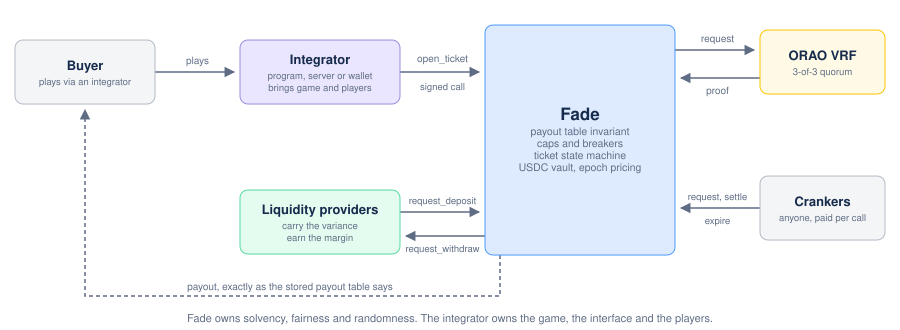
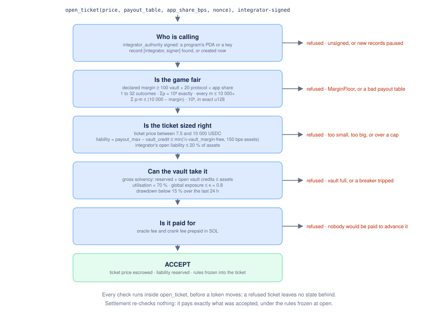

> [Fade](../README.md) · Technical.

# Fade — Technical Specification

**Status:** consolidated specification. This document owns the mechanism: every parameter value, every ruling, every invariant, the V1 scope, the known limitations and the open technical questions.

**How to read this.** This document deliberately **derives nothing**: every proof, simulation and measurement lives in one of the domain documents of §6. Where a domain document and this document disagree, this document wins on the value and the domain document on the derivation. An auditor reads §2, §3 and §5, then 08, 07, 01, 02, 03, 04, 05. Every number in this specification is regenerated by `scripts/oracle/fade_ref.py`, the integer reference of the program's arithmetic.

**The parties and the flows between them.** Every box is specified below; the drawing only arranges it.

---

## 1. V1 scope

This is the only list of what is in and out of V1.

**In.** The payout table invariant and its property tests; the vault with epoch-priced deposits and withdrawals, a paid and clean strike and paid claims, so that a liquidity provider makes one move (§3.8); `open_ticket`, `request_randomness`, `settle_ticket` and `expire_ticket` with liability reservation; per-ticket ORAO randomness bound after entropy (§3.6); integrators identified by their signature alone, with a record created by their first ticket and no deposit; per-ticket caps, the integrator ceiling, the global exposure limit, the utilisation and drawdown breakers; governance as in §2 (council, timelock, guardian); one reference integrator program proving the CPI path; a demo front end and integration documentation.

**Out, and therefore roadmap.** CPI callbacks into integrator programs, and with them every game whose value comes from player decisions between reveals, through a session ticket; a shared randomness beacon, one ORAO draw settling a round of small tickets, whose arithmetic is in `fade_math::beacon` but which the program does not carry; shared-outcome games and the `CorrelationGroup` accounting they need (04 §7.1), which only become buildable with such a beacon; multi-asset support; the referral layer and its line in the split; governance decentralisation beyond 05 §7 Phase 0; capacity that grows with the volume an integrator has brought (progressive credit, 04 §4.3 — its counter ships in V1, its rule does not); lending the vault's idle capital; a randomness source that does not depend on ORAO.

**Out, and why.** Switchboard cross-attestation on large tickets: Switchboard is not integrated in V1, and enforcing the 20 bps threshold as a cap would refuse every demo game on a 25 k vault. An integrator bond: no on-chain predicate could ever justify slashing it, since every violation is refused at open, so a bond would only ration capacity — which the 20 % integrator ceiling and the vault-wide limits already do without asking an integrator for capital (04 §4). Token-2022: rejected outright, because a transfer hook would hand a third party a guaranteed CPI into every payout; V1 hardcodes a single legacy SPL USDC mint.

---

## 2. Parameters — single source of truth

Where a domain document and this table disagree, this table wins. The governance class of every parameter — what may change it, and after what delay — is in 05 §3.

### Payout table and outcome selection

| Parameter | Value | Authority |
| --- | --- | --- |
| `p_i` representation | `u64`, 1e9 fixed point | 03 §1 |
| `m_i` representation | `u64`, basis points (a 1-in-1e9 top payout at a 150 bps margin needs 9.85e12 bps-units, which overflows `u32`) | 03 §1 |
| EV check | `Σ (p_i as u128)·(m_i as u128) ≤ (10_000 − margin_bps) as u128 · 1e9` — a pure cross-multiplication with zero rounding error; no floating-point value may touch it anywhere, off-chain validators included | 03 §3 |
| `Σ p_i` | must equal exactly 1e9; reject otherwise; a zero-probability outcome is rejected | 03 §2 |
| `MAX_OUTCOMES` | 32 | 03 §7 |
| `M_CEILING` | 10 000× | §3.3 below |
| Randomness word for selection | ≥ 128 bits, rejection sampling | 03 §4 / 02 §6 |
| Payout table and app share | passed as arguments of `open_ticket` and snapshotted into the ticket; there is no persistent payout table account and no game account — "per game" is the integrator's own bookkeeping | 07 §1 |

### Exposure and risk

| Parameter | Value | Authority |
| --- | --- | --- |
| Liability of a ticket | `payout_max − vault_credit`, where `vault_credit = price − protocol_share − app_share` is what the vault actually receives at open (the shares leave the vault in the same transaction) | §3.5 |
| Free balance | `total_assets − total_reserved_liability − Σ vault_credit of open tickets` | §3.5, invariant 1 |
| Per-ticket liability cap | `min(0.5 · vault_margin/10_000 · free_balance, 150 bps · total_assets)`, where `vault_margin`** is the payout table's margin net of the app and protocol shares** — what the vault actually earns, never the margin the integrator declares | 04 §2.4, §6 / §3.7 |
| Integrator ceiling | `20 % · total_assets` on the integrator's open liability, the new ticket included; nothing is deposited to obtain it | 04 §4 |
| Utilisation admission breaker | 70 %: `(total_reserved_liability + Σ open vault credits) / total_assets` after adding the ticket | 04 §7.3 |
| Drawdown breaker | ≥ 15 % fall of the **share price** within a rolling 24 h — the price rather than `total_assets`, so that deposits and withdrawals never trip it: new tickets refused and caps halved until a clean window passes; it never touches withdrawals (05 §4) | 04 §7.3 / 08 §8 |
| Global exposure `κ` | 0.8 — hard invariant (§5 item 2); the 70 % breaker is the admission gate that keeps it unreached | 03 §6 |
| Integrator identity | the address that signs `integrator_authority`: a program signs with its `["fade-integrator"]` PDA over CPI, a server or a wallet with its own key. The record `["integrator", authority]` is created by the integrator's first `open_ticket`; there is no registration step and no bond | 07 §1, §2 |
| Funder | a USDC account whose owner signs the ticket: the player's own, or funds an operator holds for its players. Fade cannot tell the two apart and does not need to; an operator names itself beneficiary and credits its players | 07 §1 |
| Progressive credit | each integrator record counts the ticket volume it has opened (`volume_total`) from its first ticket; a ceiling that grows with it is specified and not enabled in V1 | 04 §4.3 |
| Split | Vault margin floor **100 bps** of the ticket price (minimum `min_vault_margin_bps`); protocol share **20 bps** of the ticket price, taken at open to the treasury; app share **0–500 bps**, chosen per ticket. Admission requires `margin ≥ min_vault_margin + protocol_share + app_share` (`MarginFloor`) | §3.7 |
| Min / max ticket price | **7.5** / 10 000 USDC. The minimum is derived, on Solana's rent once SIMD-0437 is fully active (696 lamports per byte; its last three steps are planned with Agave 4.4 in November 2026): the fixed per-ticket overhead the player pays in SOL — 500 000 lamports oracle fee + 184 440 lamports of rent locked in the request account + 250 000 lamports crank fee = 934 440 lamports, about 0.0009 SOL, 0.112 USD at 120 USD/SOL — divided by the **150 bps reference margin** of the risk model (the vault margin floor, the protocol share and a 30 bps app share) gives 7.48 USDC. Against the bare 120 bps floor the same overhead breaks even at 9.3 USDC: a game declared at the floor with no app share pays the player more overhead than the vault takes between 7.5 and 9.3 USDC, accepted and listed in §7. Until the last step is active the overhead is higher (2 096 200 lamports at today's 5 080 lamports per byte): a deployment before then sets `min_price` from the rent of the day, 16.8 USDC at 120 USD/SOL, and lowers it as each step activates (§7 item 7). Governable; recompute when SOL moves more than 30 % (6.2 USDC at 100 USD/SOL, 18.7 USDC at 300 USD/SOL) and when rent changes | §3.7 |

The cap is computed on the **free** balance: a vault-freeze attack becomes geometric instead of linear (398 tickets to reach 95 % utilisation instead of 29 under a flat 10 % cap, 04 §3.1), and every offerable multiplier falls as utilisation rises (§3.4). A flat `max_payout_bps = 1000` would be 6.67× full Kelly at a 150 bps margin (04 §6).

**Every check **`open_ticket`** runs**, grouped by the question it answers. The values are the ones in the tables above; the figure only arranges them. A ticket that fails any of them is refused before a token moves, and settlement re-checks none of them.

### Randomness and settlement

| Parameter | Value | Authority |
| --- | --- | --- |
| Primary oracle | ORAO VRF | 02 §0 |
| Randomness binding | design B — request after entropy (§3.6) | §3.6 |
| Request seed | derived on-chain: `SHA256("FADE/ORAO-SEED/v1" ‖ program ‖ ticket ‖ open_slot ‖ s* ‖ h*)`; never caller-supplied | §3.6 |
| Outcome derivation | `SHA256("FADE/OUTCOME/v1" ‖ program ‖ ticket ‖ seed ‖ R ‖ i)`, u128 words, rejection sampling below `2^128 − (2^128 mod 1e9)` | §3.6 / 03 §4 |
| ORAO fee and treasury | read from ORAO `network_state` at request time, never an admin setting (currently 500 000 lamports on mainnet, 300 000 on devnet) | §3.6 |
| ORAO rent | 4 455 160 lamports advanced per request, 3 108 960 returned at fulfilment, **1 346 200 locked for good** (no close instruction) | §3.6 |
| `vrf_payer` | system-owned PDA `["vrf-payer", ticket]`, funded at open with twice the fee and the rent of a pending request, the second fee a margin against a rise of ORAO's fee before the request; the request keeps only the fee and rent of the moment on it and parks the rest on the ticket; the rent ORAO returns comes back to it; whatever it holds at settle or expiry goes back to the ticket's payer | 02 §4 / 07 §4 |
| Secondary cross-attestation | not in V1 (see §1); revisit with the Ed25519-precompile hardening in §7 | — |
| `T_SETTLE` | 150 slots (\~52.5 s): the time Fade waits for randomness, never a deadline for settlement | 02 §3 |
| `CRANK_FEE` | 250 000 lamports, prepaid in SOL at `open_ticket`, flat; 50 000 to whoever calls `request_randomness`, 200 000 to whoever calls `settle_ticket` or `expire_ticket` | 02 §4 / §3.6 |
| Expiry path | `expire_ticket`, permissionless after `open_slot + T_SETTLE`; fails if the randomness has arrived in the meantime; forfeits the ticket price to the vault | 02 §2 |
| Oracle-outage alarm | 60 slots, off-chain: pauses new tickets well before any in-flight ticket can be forfeited | 02 §3 |

**ORAO, read on-chain and from the published source** (program `VRFzZoJdhFWL8rkvu87LpKM3RbcVezpMEc6X5GVDr7y`, github.com/orao-network/solana-vrf, Apache-2.0). Fulfilment needs **3 of 3 authorities on mainnet** (3 of 4 on devnet), each contributing an Ed25519 signature over the seed, stored publicly, with no commit phase. The program is upgradeable, and one system-owned key is at once its upgrade authority, its treasury and one fulfilment authority. Hence §3.6: a single authority can stall any request, and because Ed25519 is deterministic **the key holders can compute the outcome of any seed before it is requested**. The crate `orao-solana-vrf` 0.7.0 needs anchor-lang 0.32; Fade ships a hand-written CPI module checked against a vendored copy of ORAO's IDL. ORAO is chosen because it is a **push** oracle whose quorum writes the fulfilment unconditionally; a pull oracle such as Switchboard On-Demand leaves the reveal to a transaction anyone *may* send and nobody *must*, which a cranker fee narrows but cannot close.

Every duration is specified in **slots, not seconds** — mainnet slot time is \~350 ms since SIMD-0525 and trending toward 200 ms — with one exception, the epoch, which is a wall-clock window (600 s, 10 minutes) because it prices deposits and withdrawals for people, not for the chain.

### Vault

| Parameter | Value | Authority |
| --- | --- | --- |
| NAV mechanism | epoch-batched forward pricing: an epoch is a batch of requests, numbered by the strike, that closes at the next multiple of `epoch_length_seconds` after its first request; every request of an epoch clears at one price struck after its close; at most two epochs are live | 01 §3 / 08 §4 |
| Strike condition | the epoch's close has passed **and** no ticket opened before it is still open (§3.8); the strike prices only settled history | §3.8 / 01 §3.5 |
| `epoch_length_seconds` | 600 (10 minutes, closing at :00, :10, :20 … UTC); a change applies to the next close computed, never to an epoch that already has one | §3.8 / 08 §4 |
| `STRIKE_REWARD` | 200 000 lamports per strike, flat, from the strike fund held by `Queue` — the settle share of `CRANK_FEE`, for the same reason (02 §4); the fund also advances the rent of the epoch's record and recovers it when the record closes | 08 §6 |
| `STRIKE_FEE` / `FUND_TARGET` | 200 000 lamports per request, paid into the fund only while it holds less than `FUND_TARGET`, 50 000 000 lamports (0.05 SOL), to which `initialize` seeds it | 08 §6 |
| `CLAIM_FEE` | 200 000 lamports per request, held in the request and paid to whoever executes its final claim: keepers claim for liquidity providers, whose only move is the request | 08 §6 |
| Minimum request | 1 USDC deposited, or one whole share withdrawn, or the owner's whole share balance | 08 §6 |
| Accounting source | internal fields of `Vault` and `Queue`, two accounts that never share a write (08 §1); no token balance is ever read to price anything | 01 §1 / 08 §2 |
| Share token | standard SPL mint, transferable: forward pricing protects the primary market; a secondary sale is at the parties' own price and never touches the vault | 01 §1 |
| Virtual-share offset | 3 (1 000 virtual shares against 1 virtual asset) | 01 §2 |
| Minimum first deposit | 100 USDC — an inception defence, not indexed to the vault | 01 §2 |
| Withdrawal rationing | pro rata against the free liquidity at the strike, computed on the tickets opened after the close; the unfilled remainder rolls into the next epoch, and a withdrawal served across several epochs is claimed once (08 §5); bounded by 01 §4.3 | 01 §4.3 |
| Rounding | **down** on both deposit and withdraw | 01 §2 |
| Arithmetic | `u128` intermediates mandatory: measured `u64` headroom on bps-scaled multiplications is only 5.8×–18× | 01 §2 |

### Governance

| Parameter | Value | Authority |
| --- | --- | --- |
| Upgrade authority | Squads v4, 4-of-7, hardware signers, 72 h timelock | 05 §1, §2 |
| Pause guardian | 2-of-3, may only tighten, instantly, and only boolean pause flags — never a numeric parameter | 05 §4 |
| Un-pause | requires the 4-of-7 council | 05 §4 |
| Parameter changes | tightening is immediate; loosening is delayed by class — 24 h for caps, floors, `min_price`, `epoch_length`, `T_SETTLE` and the breaker thresholds; 7 days for a cut of the vault margin; 72 h and the upgrade council for the oracle program id and the treasury | 05 §3 |
| Upgrade authority burned? | No in V1, deliberately | 05 §1 |
| Snapshotted into the ticket at open | `margin_bps`, full payout table, the app share, the reserved liability and the computed cap | 05 §3 / 03 §5 |
| Ticket nonce | argument must equal `integrator.next_nonce`; the integrator never chooses it | 07 §1 |

### Build and test toolchain

| Item | Value |
| --- | --- |
| Program framework | Anchor 1.2.0 (anchor-lang, anchor-spl without default features) |
| Validator toolchain | Agave 4.2.2, cargo-build-sbf 4.1.0, platform-tools v1.57 |
| SBPF architecture | **v3** — active on mainnet (feature `enable_sbpf_v3_deployment_and_execution` = `5cC3foj77CWun58pC51ebHFUWavHWKarWyR5UUik7dnC`, slot 428 976 000) and devnet, verified on the runtime crate `agave-feature-set` 4.2.2 and the on-chain feature accounts, never on the CLI's `solana feature status` table, which still lists v3 under a retired id. v0 stays buildable as the fallback |
| Test harnesses | litesvm (npm 1.4.1, crate 0.16.0) and mollusk-svm 0.15.1, pinned to a **mainnet feature set and mainnet rent** by fixtures from `scripts/sync-features.py`, never the all-features default. The compute-unit probe of 03 §7 ran on mollusk 0.13.1 and is re-run on 0.15.1 before release |
| Property and fuzz testing | proptest 1.11, proptest-state-machine 0.8, cargo-fuzz. Trident 0.12 still targets solana-sdk 2.3 and is not usable with this toolchain |
| Client generation | Codama 1.11 (`@codama/nodes-from-anchor`, `@codama/renderers-js`) over `@solana/kit` 8 |

---

## 3. Cross-cutting rulings

These decisions resolve conflicts between domain documents or fix what no domain document could decide alone. They are recorded with their reasoning because each overrides a recommendation made in good faith elsewhere.

### 3.1 No time-priced reservation rent

Reserved liability carries no time-priced premium. The cost driver of a vault-freeze attack is **the number of chain-touches the cap forces**, not the dollar size of any one reservation; a flat per-transaction fee taxes that directly, a percentage rent is weakest exactly where leverage is highest. Sustaining a 30-day freeze costs 243 k–7.29 M USD under `CRANK_FEE` plus the free-balance cap, against 86 137 USD under a rent (04 §3). The utilisation breaker covers the case a fee does not price — many *honest* actors spiking utilisation at once — and registering more identities buys nothing against limits that every identity shares (04 §5).

### 3.2 Forfeiture on timeout, never paid back

A ticket whose randomness never arrives is forfeited to the vault, not paid back. If an unfulfilled ticket were paid back, withholding the randomness would be a perfect free option. Under forfeiture, a player-plus-oracle strategy that suppresses losing draws and reveals only winners produces a payoff distribution statistically identical to honest play — collusion nets zero (02 §2.2).

This does not bound a bribe to suppress a genuine *win*; that is bounded structurally by the per-ticket cap, not by incentives. Honest players are protected by the 60-slot off-chain alarm firing well before the 150-slot forfeiture point, not by the on-chain rule.

### 3.3 `M_CEILING` = 10 000×, against the risk model's 100×

The risk analysis recommends 100×; the arithmetic analysis recommends 10 000×. Ruling: **10 000×**, on three grounds drawn from the risk analysis itself.

1. The per-ticket liability cap already performs the solvency work; `M_CEILING` is a second lever on the same exposure.
2. That analysis concedes `M_CEILING`'s real function is raising the dollar cost of griefing — a function now discharged by `CRANK_FEE` (§3.1).
3. Its own grid is non-monotonic: tightening `M_CEILING` from 1000 to 100 **worsens** drawdown in 5 of 8 cells of the correlated-adversarial scenario, because a higher hit frequency at lower multipliers more than offsets the smaller per-hit size.

A fixed 100× would also hardcode today's vault size into the protocol permanently. The grid only tested vaults up to 1 M USDC; §8 item 3 keeps the re-run open.

### 3.4 The per-ticket cap is computed on the free balance

The vault analysis chose the gross vault as the cap's base (a free-balance base lets an attacker who raises utilisation shrink every honest ticket's cap); the risk analysis chose the free balance (it makes the attacker's own reservations shrink geometrically). Ruling: **free balance**; the utilisation breaker bounds the effect on honest users. At the 75 bps cap, reaching the 70 % breaker takes 160 tickets on a free-balance base against 93 on a gross base. The cost is that caps fall as the vault fills — half of the idle-vault cap at 50 % utilisation, 30 % at the breaker — so the largest offerable multiplier moves with utilisation.

**The cap bounds the liability, never the multiplier, so the ticket price is the other half of the trade.** On a fixed payout table a cap of `C` admits a ticket price of about `C / (max(m) − 1)`: the same cap that refuses 25 USDC at 1 000× accepts 1 USDC at the same 1 000×. This is how the rest of the industry already states the constraint — a headline maximum win, and a maximum bet that shrinks as the win grows — and it is the form an integrator's interface should use. `fade_math::risk::max_admissible_price` computes it, by binary search over `admit` itself rather than a closed form, so it cannot round differently from the admission it predicts; admission is monotone in the ticket price, so the answer is exact. Two consequences worth stating to an integrator: the vault size sets the liability in dollars, and the **minimum ticket price** sets how much multiplier that liability buys — which is why a shared randomness draw per round of tickets, by lowering the per-ticket overhead and with it the minimum ticket price, is the change that would most widen what Fade can serve.

### 3.5 Liability is what the vault can still lose

The randomness analysis reserves `price × max(m_i)`; the risk and arithmetic analyses reserve `price × (max(m_i) − 1)`. Both forget that the protocol share and the app share leave the vault at open. Ruling: **the reserved liability of a ticket is **`payout_max − vault_credit`**, with **`vault_credit = price − protocol_share − app_share` — the worst-case outflow beyond what the vault actually received — and `vault_credit`, not `price`, is what joins `total_assets` at open. On the demo slot (25 USDC at 3.5×, 50 bps app share) that is 62.675 USDC, not 62.50; the difference is the 0.175 USDC of shares. Whichever convention the code uses, it must be used everywhere; mixing them double-counts or under-counts reserved liability.

Solvency is checked **gross** (invariant 1): reserved liability plus open vault credits must not exceed `total_assets`, because a ticket's payout draws on both.

### 3.6 Randomness binding: request after entropy

The domain analysis assumed an oracle that only needs to be honest at fulfilment time. The verified facts above break that assumption: ORAO's key holders can precompute the outcome of any seed, so a player colluding with them could open only winning tickets, and forfeiture (§3.2) does not cover *selection* of tickets, only *withholding* of draws. Ruling: **the ORAO seed is derived on-chain from entropy that does not exist when the ticket is opened.**

- `open_ticket` (slot `t`): admission, escrow, reservation, snapshot. No oracle call. The ticket pre-funds a system-owned PDA `["vrf-payer", ticket]` with twice the ORAO fee and the rent of a pending request, both read from `network_state`; the margin keeps a rise of the fee before the request from turning into a forfeiture, and comes back at close.
- `request_randomness` (permissionless, `t + 2 ≤ current ≤ t + T_SETTLE`): `s*` is the smallest slot present in `SlotHashes` that is greater than `t` (skipped slots are simply not present), `h*` its hash; `seed = SHA256("FADE/ORAO-SEED/v1" ‖ program ‖ ticket ‖ t ‖ s* ‖ h*)`; the ticket's PDA pays ORAO `request_v2(seed)`. If a request account already exists at the derived address — anyone can pre-create it once the seed is public, with `request_v2` or with ORAO's deprecated `request`, which still creates a legacy account there — it is accepted after owner and discriminator checks, and the prepaid fee is returned at close. `s*`, `h*`, the seed and the request address are stored in the ticket.
- `settle_ticket` (permissionless, once fulfilled, at any later time): the request account must match the stored address, be owned by ORAO, be a fulfilled `RandomnessV2` or legacy `Randomness`, and carry the stored seed and a non-zero 64-byte value `R`. The outcome is `SHA256("FADE/OUTCOME/v1" ‖ program ‖ ticket ‖ seed ‖ R ‖ i)` read as u128 words with rejection sampling (invariant 6). Settlement never reads `SlotHashes`, so it has no 512-slot cliff, and it has no deadline: a deadline would strand a ticket fulfilled late, since `expire_ticket` refuses a fulfilled request.
- `expire_ticket`: after `t + T_SETTLE` with no fulfilled request, forfeiture as in §3.2.

Why not mix `h*` in at settlement instead? If ORAO fulfils at or before `s*`, the leader producing `s*` already knows `R` and can grind or skip the block to pick the outcome. Requesting only after `s*` is final means every candidate `h*` gives a different seed whose outcome nobody knows without ORAO's keys, so an attack now needs the key holders **and** the leader of `s*` **and** the player. The residual, a malicious upgrade of the ORAO program itself, is in §7. Cost: one extra permissionless transaction and at least one slot per ticket. A system-owned PDA can pay ORAO: on devnet such a PDA signed `request_v2` through `invoke_signed`, was recorded as the request's `client` and received the returned rent.

### 3.7 The split, the cap's margin, and the minimum ticket price

These three parameters are set together, because each one is a term of the other two.

**Which margin feeds the cap.** The payout table's declared margin is chosen by the integrator; the vault earns only what remains after the shares paid out at open. The Kelly term protects the vault's capital, so it is computed on `vault_margin = margin − app_share − protocol_share`. An integrator who inflates the declared margin cannot widen its own cap.

**The split.** Every ticket pays: the vault margin floor, 100 bps of the ticket price, the least the vault may earn in expectation (every figure of this specification assumes exactly this); the protocol share, 20 bps of the ticket price to the protocol treasury at open — a fifth of the vault margin floor's revenue, below GMX's 30 %; and the app share, 0 to 500 bps, chosen per ticket. A ticket is admitted only if `margin ≥ 100 + 20 + app_share` (reject `MarginFloor`), and its cap uses `vault_margin`. V2 option, recorded: a performance fee on realised liquidity-provider profit instead of a flat 20 bps, so the protocol is paid only when liquidity providers are.

**The minimum ticket price.** The protocol must never accept a ticket whose fixed costs exceed the vault's expected take, or the "fair price" claim is false: the player would pay more in overhead than the vault takes. The derivation, the reference margin it uses and the 7.5–9.3 USDC band it accepts are in the §2 row. It is a governable parameter with a documented derivation, to be recomputed when SOL moves by more than 30 % and when Solana's rent changes.

**Consequence for the demo.** The founding vault is 5 000 USDC. At that size the per-ticket cap is 25 to 75 USDC depending on the vault margin, so a ticket at the 7.5 USDC minimum can carry at most 4.3× to 11× (10.3× on the demo slot, whose integrator takes 50 bps), and a 25 USDC ticket 2.0× to 4.0× (3.79× on the demo slot). The demo payout tables run on 25 USDC tickets: three games at 25 USDC with 3.2× to 3.5× tops, a 10× ticket refused by the cap at 5 000 USDC and accepted once a live deposit takes the vault to 25 000 USDC, and a 5× loot box refused because its margin does not cover the split.

### 3.8 What moves with state, and what does not

Every dollar figure in this specification is a ratio applied to live state; the ratios are the parameters. This ruling fixes which quantities may vary with the vault, with volume or with the oracle, and at which layer. Derivations: 04 §2.5 (capacity against assets), 01 §3.5 (the strike), 01 §5.5 (yield and dilution); governance classes: 05 §3.

1. **Vault size changes nothing but the dollar values.** The per-ticket cap, the integrator ceiling and both breakers are ratios of `total_assets` and the free balance. Their dollar values follow the vault with no parameter change, and none of them is a step function of size. One consequence integrators plan around: the ceiling is 20 % of assets and, on the demo slot, the per-ticket cap 1.4 % of an idle vault, so an integrator holds 14 max-sized tickets at once at every vault size — growth buys a bigger single ticket at the same concurrency (04 §2.5). Progressive credit, once enabled, reads an integrator's own cumulative volume through fixed constants (04 §4.3): like every other cap, a function of state, not a parameter that moves with it. `min_first_deposit` is not indexed to the vault: it defends inception only.
2. **Epoch length follows the oracle, never the vault.** The 600 s epoch is a margin over oracle-plus-settlement latency (a 17× margin over the 35 s p99 assumed in 01 §3.3), which is a property of ORAO and of the crank market, not of TVL or volume. Rule: `epoch_length ≥ 10 × p99(open → settled)`, re-derived only when a measurement changes it — the samples so far (5 slots on mainnet, about 10 on devnet, §8 item 2) are far below the bar; 600 s stands until the devnet latency study reports. Shortening the epoch is a loosening change; lengthening it a tightening one. `T_SETTLE` follows the same discipline at \~30× the measured p99 and is never re-derived for a change in slot time, which slots absorb.
3. **The strike is paid, it prices only settled history, and a liquidity provider makes one move.** An epoch is a batch of requests — in the sense of Centrifuge's epochs and ERC-7540's asynchronous vaults, not Solana's — numbered by the strike: the first request opens one, which closes at the next multiple of `epoch_length_seconds`, and a request made after the close joins the next; at most two are live, and a period with no request creates nothing (08 §4). The strike of an epoch runs only once its close has passed **and every ticket opened before that close has settled or expired**. `Vault` keeps two counters, open tickets opened before the live close and after it, with a generation number so that each ticket decrements the right one; opens, settlements and expiries update them in O(1), and each change of epoch rolls the second into the first. Tickets opened after the close never delay the strike, so a stream of new tickets cannot starve it; it waits at most for the tickets open at the close — `T_SETTLE` for unfulfilled ones, the settler's 200 000-lamport incentive for fulfilled ones, about a minute in practice. This closes the leak of a known-but-unapplied outcome into an epoch's price exactly, keeps the strike O(1), and never values an open ticket: no ticket opened before the close is open, and those opened after it are left out of the price — their credits while open, their results once closed — which the strike computes on the vault's settled assets as they stood at the close (01 §3.5, 08 §4). Rationing at the strike is computed against the tickets opened after the close, and a withdrawal served across several epochs is claimed once (08 §5). The strike is paid a flat `STRIKE_REWARD` from a strike fund that requests refill only while it is below target, and every request prepays a `CLAIM_FEE` to whoever claims it, so keepers strike and claim and **a liquidity provider's only move is the request** (08 §6). One consequence binds: `settle_ticket`** must always succeed.** A ticket that could not be settled would block every later strike, so if the payout transfer cannot land — a frozen beneficiary account — the payout is parked in `payout_escrow`, the vault's single escrow account, and the ticket stays open as `PayoutPending` until a permissionless `claim_payout` delivers it; the reservation is released at settle regardless (07 §6).
4. **Yield is disclosed, never managed.** `APY = vault_margin × turnover × 12`, turnover being the ticket volume in a month over the time-weighted assets of the month. When capital arrives faster than volume, turnover falls and the yield falls for every liquidity provider identically; no parameter compensates. Raising the vault margin floor to defend the yield would refuse every game declared near the floor (`MarginFloor`), and an administered share curve is exactly the admin-controlled economic lever 05 §6 classifies as a rug vector. The vault-size invariance of the yield only holds from about 3× monthly turnover; at 1× the cap clips large tickets harder on a small vault. The disclosure rule of 01 §5.4 stands: never a single yield number, always the distribution with the trailing turnover.
5. **Measured, governed, never formulaic.** `min_price` follows the SOL price (§2), `T_SETTLE` and the epoch follow measured latency; V1 has no on-chain price or latency oracle, so each is a governed parameter with a documented derivation, an off-chain watcher that alarms at its trigger (±30 % on SOL, a fresh p99), and the asymmetric delay of 05 §3: raising `min_price` or lengthening a window is tightening and immediate, the reverse is delayed.

---

## 4. The capital frontier, at the minimum ticket price

The tightened liability cap and the per-ticket oracle cost close on each other, and this is what V1 can honestly promise. On a ticket at the 7.5 USDC minimum, the largest multiplier the vault can back is set by the cap on its free balance; the vault sizes are the smallest that admit the ticket, with the shares of §3.5 counted (computed with `fade_ref.py`):

| Multiplier on 7.5 USDC | Liability | Vault at 280 bps of vault margin (the demo slot) | Vault at the 100 bps floor |
| --- | --- | --- | --- |
| 10× | 67.55 | 4 826 | 13 503 |
| 100× | 742.55 | 53 040 | 148 503 |
| 1 000× | 7 492.55 | **535 k** | 1.5 M |
| 10 000× (`M_CEILING`) | 74 992.55 | 5.36 M | 15.0 M |

Three consequences strengthen the thesis: half a million USDC is already more than most teams put on their own balance sheet for a single game, and 1 000× on a 25 USDC ticket needs 1.78 M — the argument for a shared vault, quantified; sharing one draw across a round of tickets is what unlocks tickets below 7.5 USDC; and the table is an honest capital target to show liquidity providers instead of a headline yield. Any public copy promising 1 000× must state the vault it assumes.

---

## 5. Invariants

The list an auditor is handed alongside the code. Each is enforced on-chain unless marked otherwise.

**Solvency**

1. **Gross solvency:** `total_reserved_liability + Σ vault_credit of open tickets ≤ total_assets` at all times, checked atomically **inside** `open_ticket` — never deferred to a later `checked_sub`. Net liability alone is not enough: with 200 of vault assets, a ticket price of 100 at 2.5× reserves 150 ≤ 200 yet pays 250. The free balance used by the cap is `total_assets − total_reserved_liability − Σ vault_credit`. This is the shape of defect that cost Loopscale \~5.8 M USD.
2. `Σ (reserved liability of open tickets) ≤ κ · total_assets` with `κ = 0.8`, enforced at `open_ticket` and at every operation that lowers the vault — the epoch strike, against the tickets opened after its close — never at settlement, which may not be refused (invariant 9). The per-ticket cap does not compose: 200 000 open copies of a cap-calibrated top payout have a 52 % chance that ten hit together (03 §6).
3. `total_assets` is never derived from a token account's live balance. Ledger identities: `vault_usdc ≥ total_assets`; `deposit_queue_usdc ≥` the deposits queued; `payable_usdc ≥` what struck withdrawals still owe.

**Fairness**

1. `Σ p_i == 1e9` exactly, at open; no outcome has `p_i = 0`.
2. The EV check passes in `u128` integer arithmetic, with no floating point anywhere in the path.
3. Outcome selection is exactly uniform via rejection sampling; a 32-bit word reduced modulo 1e9 carries **23.28 %** bias, which is a defect and not a rounding nicety.
4. The payout table, `margin_bps`, the app share, the reserved liability and the cap stored in the ticket at open are the ones used at settle. Settlement never reads live config and never re-checks a cap.

**Custody**

1. No admin instruction may rewrite a liquidity provider's balance, override a ticket outcome, or move vault funds outside the user paths — `request_deposit`, `request_withdraw`, `strike_epoch`, `claim_deposit`, `claim_withdraw`, `settle_ticket`, `expire_ticket` and `claim_payout`. Each would be strictly worse than the upgrade key itself.
2. A pause may never block `settle_ticket`, `expire_ticket`, `strike_epoch`, a `claim_*` on a struck request, or a `request_withdraw`, nor strand escrowed ticket prices.
3. Queuing an upgrade sets the tickets pause flag (`Config::PAUSE_TICKETS`) as a separate step **before** the 72 h clock starts, so reserved liability can only shrink during the delay. Without this ordering the timelock is decorative. *Procedural:* Fade cannot observe a Squads proposal on-chain; the rule is enforced by the council's runbook and an off-chain watcher that alarms on an open proposal while new tickets are unpaused.

**Identity**

1. The integrator is the signer of `integrator_authority`, and its identity is that signer's address: a program's `["fade-integrator"]` PDA, which only that program can sign for through `invoke_signed`, or a server's or wallet's own key. Its record lives at `["integrator", authority]`, so acting as an integrator takes that integrator's signature. Neither `ctx.program_id` nor the instructions sysvar can establish the caller: the sysvar sees only top-level instructions, not the inner CPI frame.
2. Every account carrying money or identity is pinned by `address` / `seeds` / `has_one` against already-trusted state, never accepted positionally.

**Composition**

1. `request_deposit` and `request_withdraw` reject any transaction whose **top-level** instructions are not all in an allowlist (compute budget, system, token, associated-token, Fade vault instructions), by instructions-sysvar introspection at an absolute index. The sysvar cannot see inner CPIs, so this is necessary but **not** sufficient; epoch pricing carries the real load.

**Randomness**

1. The ORAO seed is derived on-chain (§3.6); no instruction accepts a caller-supplied seed or a caller-chosen request account, and the ticket nonce equals `integrator.next_nonce`.
2. `settle_ticket` accepts a request account only if its address, owner, discriminator, state tag, stored seed and length all match; a *Pending* account leaves the ticket byte-identical.

**Epoch**

1. **Clean strike:** `strike_epoch` executes for an epoch only when its close has passed and no ticket opened before that close is still open; the counters and the generation of 08 §4 are conserved by every open, settle, expiry, request and strike; the strike's compute cost is independent of the number of queued requests and of the number of tickets; the epoch's own queued deposits and unburned withdrawal shares, and the credits of tickets opened after the close, are excluded from its price.
2. **Two sides:** no ticket instruction writes `Queue` or a liquidity-provider token account, and no liquidity-provider instruction writes `Vault` except `strike_epoch` and a request that opens an epoch (08 §1).

---

## 6. Domain documents

| # | Document | Owns |
| --- | --- | --- |
| 01 | [Fade Spec 01 — Vault and LP Accounting](01-vault-and-lp-accounting.md) | Vault state, share math, epoch pricing, the strike, withdrawal policy, yield and dilution, drawdown Monte Carlo |
| 02 | [Fade Spec 02 — Randomness and Settlement](02-randomness-and-settlement.md) | Oracle choice, ticket state machine, timeout derivation, cranker economics, binding checks, outcome selection |
| 03 | [Fade Spec 03 — Payout Table Invariant and Arithmetic](03-payout-table-invariant.md) | Representation, rounding proof, modulo bias, margin snapshotting, the variance gap, measured compute units |
| 04 | [Fade Spec 04 — Risk and Exposure](04-risk-and-exposure.md) | Exposure accounting, cap derivation and Kelly, capacity against assets, the integrator ceiling and progressive credit, rate limiting, solvency grid, circuit breakers |
| 05 | [Fade Spec 05 — Governance and Upgrade Safety](05-governance.md) | Authorities, timelock and LP-exit interaction, parameter classification, pause semantics, emergency playbook, rug-vector self-audit, decentralisation path |
| 07 | [Fade Spec 07 — Solana Implementation Security](07-solana-implementation-security.md) | Per-instruction account validation, CPI authentication, arithmetic discipline, account lifecycle, token policy, exploit-pattern review, audit plan |
| 08 | [Fade Spec 08 — Program Architecture](08-program-architecture.md) | The account map and what each instruction writes, the epoch lifecycle as a state machine, the liquidity-provider fee flows and the strike fund, the parameter queue, the drawdown breaker's state, throughput bounds |

Property tests live in their domain documents: 01 §7, 02 §9, 03 §8, 04 §9, 07 §9 and 08 §12. Monte Carlo results sit beside each document, in its appendix file.

---

## 7. Known limitations of V1

The only list of what V1 does not claim.

1. **Randomness is oracle-assumed, not proven.** With a third-party VRF the honest claim is *publicly verifiable odds*, not *provable fairness*. Any one ORAO authority can stall a request (bounded by forfeiture, §3.2) and the key holders can precompute outcomes (bounded by §3.6). A key holder who also holds vault shares could withhold only the winning draws and keep its share of the payouts avoided; the per-ticket cap bounds each event and an isolated expiry, which a genuine outage never produces, sets off the alarm (02 §7). The step after V1 blinds the oracle for large tickets by mixing its value with the hash of a slot that follows its answer (02 §7). A **malicious upgrade of the ORAO program**, whose upgrade authority is a single key, could write arbitrary randomness after the fact and defeats both; V1 documents it. V1.1 hardening: verify the authorities' Ed25519 signatures over the seed inside the settle transaction, once ORAO's combination rule is confirmed.
2. **An oracle outage forfeits every ticket in flight.** If ORAO stops fulfilling for more than 150 slots, every ticket opened in the preceding minute is forfeited to the vault, players included; the 60-slot alarm pauses new tickets so that the exposure stays at about one minute of volume. The alternative, paying the ticket price back, is the free option of §3.2.
3. **The upgrade key exists.** Mitigated by a 4-of-7 council, a 72 h timelock, the pause-first ordering rule and the §5 never-list — not eliminated. Burning it in V1 would strand liquidity providers' funds behind the first bug.
4. **An integrator can substitute the beneficiary.** Fade verifies odds and pays the beneficiary named at open, not that the integrator's user is credited. An operator that holds its players' funds is its own beneficiary by design, and whether a player behind it is paid is between the two of them. The protocol cannot close this; the on-chain payout table bounds it, and the reference integration links every player's purchase to its public ticket so the player can check the odds and the result that applied.
5. **A compromised integrator inherits Fade's trust.** Identity is bound to a signing address, so whoever takes over a program integrator's upgrade authority, or a server integrator's key, keeps that integrator's access. Bounded by the caps and the 20 % ceiling, not by account validation: the intruder can spend only funds it controls, and the share account is fixed in the record.
6. **Liquidity-provider returns are volatile, and fall when capital outruns volume.** A month ends in the red 29–43 % of the time at 1× monthly turnover and 1–11 % at 30×; a larger vault thins the drawdown tail but barely moves that rate; and the yield, `vault_margin × turnover × 12`, falls for everyone when deposits arrive before integrators do (§3.8). The slow convergence comes from the \~98.5× longshot archetype, whose ticket prices the cap does not self-limit (01 §5).
7. **Per-ticket fees are heavy against the margin.** Oracle fee, permanently locked rent (ORAO has no close instruction) and crank fee cost 934 440 lamports per ticket once Solana's SIMD-0437 is fully active, about 0.0009 SOL, 0.11 USD at 120 USD/SOL. SIMD-0437 lowers rent in five steps: the second, active on mainnet since 11 September 2026, took it from 6 960 to 5 080 lamports per byte, and steps three to five, planned with Agave 4.4 in November 2026 and each behind its own feature gate, bring it to 696 ([Solana — Reduced Rent](https://solana.com/upgrades/reduced-rent)). The program reads rent at run time, so the locked request rent falls with each step with no redeploy, from 1 346 200 lamports today to 184 440. ORAO's 500 000-lamport fee then becomes the largest part, which only a draw shared by several tickets can amortise. The specification states the minimum ticket price at the last step, 7.5 USDC (§2); a deployment before it uses the rent of the day (16.8 USDC at 120 USD/SOL with today's rent) and lowers `min_price` as each step activates. A game declared at the bare 120 bps floor still pays the player more overhead than the vault takes between 7.5 and 9.3 USDC.
8. **The mainnet demo runs before any audit, with real funds.** The founding deposit and the closing 20 000 USDC deposit are the team's own money in unaudited code; an outside liquidity provider who deposits before the Phase 1 audit (05 §7) is told so first.

---

## 8. Open questions

1. **ORAO's combination rule.** Presumably an XOR of the authorities' contributions; needed before the V1.1 hardening that verifies their Ed25519 signatures inside the settle transaction (§7 item 1).
2. **Real fulfilment latency for ORAO.** Samples so far: 5 slots on mainnet (observed transaction), about 10 slots on devnet (Fade's own request). `T_SETTLE = 150 slots` and the 600 s epoch stay derived from vendor claims and assumptions until the devnet latency script (repository, phase 8) reports p50 and p99 over 50 requests; §3.8 says how each is re-derived from them.
3. **Whether **`M_CEILING = 10 000×`** survives** a re-run of the correlated-adversarial grid under the cap formula of §2 and on vaults above 1 M USDC (§3.3).

---

## 9. One subject, one owner

This document states how Fade works: every parameter, every rule, every invariant an auditor works from. The domain documents of §6 hold the derivations; this document holds the values.
